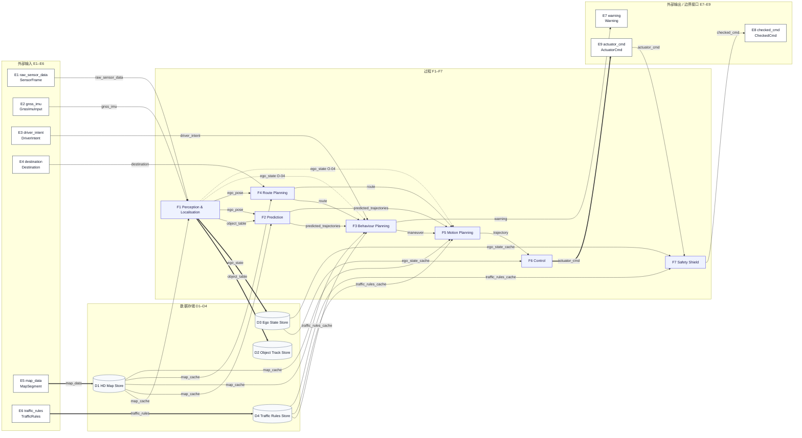
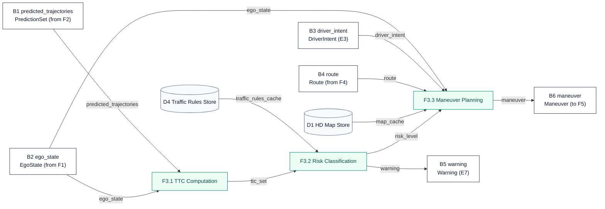

# NL-RQ-ADAS-v1 → SOFL 形式化规格（生成模型：MiniMax-M3.1-Flash，第 1 版）

**文档文件**：`MiniMax-M3.1-Flash-1.md`
**生成模型**：MiniMax-M3.1-Flash（生成序列第 1 次）
**输入规格**：`NL-RQ-ADAS-v1_spec.md`（Baseline v1.0，唯一输入）
**交付物**：两个 module（`ADAS_System` Level 0、`AEB_Branch` Level 1）+ 两张 CDFD + open-issues + 可追溯性矩阵
**建模纪律**：只建模规格写明的内容；规格未写明之处不作发明，只在 open-issues 中登记。

## 目录

| # | 交付物 | 位置 |
|---|---|---|
| 1 | Module `ADAS_System`（Level 0） | 本文 §1（源文件 `sofl/ADAS_System.sofl`） |
| 2 | Module `AEB_Branch`（Level 1） | 本文 §2（源文件 `sofl/AEB_Branch.sofl`） |
| 3 | CDFD 元素与连线清单（含 Mermaid 图） | 本文 §3（源文件 `report/01-cdfd.md`） |
| 4 | Open issues | 本文 §4（源文件 `report/02-open-issues.md`） |
| 5 | 可追溯性说明 | 本文 §5（源文件 `report/03-traceability.md`） |
| 6 | 机械校验脚本 | `check_model.py`（语法/类型/存储访问一致性检查，当前 0 error） |

---

## 1. Module ADAS_System（Level 0，整车级）

```sofl
module ADAS_System

/* ===========================================================================
   NL-RQ-ADAS-v1  ->  SOFL model, LEVEL 0 (vehicle-level ADAS onboard system)
   Source clauses : S1 scope (R-SCOPE-1..4), S3 E1-E9 (R-E-1..2),
                    S4 D1-D4 (R-D-1..2), S5 F1-F7 + S5.1 dependency list
                    (R-L0-1), S7 N-1..N-7, S8 A-1..A-7, S9 R-G-1..R-G-6
   =========================================================================== */

/* ---------------------------------------------------------------------------
   MODULE HEAD  (ports = data flows crossing the vehicle boundary, R-SCOPE-2)
   E1 raw_sensor_data | E2 gnss_imu | E3 driver_intent | E4 destination
   E5 map_data | E6 traffic_rules  -> in
   E7 warning | E8 checked_cmd     -> out   (R-E-1: E7 and E8 are the only
                                              outputs of the system)
   E9 actuator_cmd is produced inside the vehicle by F6 and consumed by F7
   (S5, S5.1); it is therefore an in-boundary interface terminal of this
   CDFD, not a port of the module head.  See open-issue O-15.
   --------------------------------------------------------------------------- */

|  |  |  |
| --- | --- | --- |
| ( E1: SensorFrame \| E2: GnssImuInput \| E3: DriverIntent \| E4: Destination \| E5: MapSegment \| E6: TrafficRules ) Warning | CheckedCmd |

/* ---------------------------------------------------------------------------
   NOTATION NOTES (extensions to the required surface syntax -> open-issue O-01)
     bool            boolean literal type, used for the validity flags of E1/E2
                    and the active flag of E7 (S3, S9 R-G-6)
     list of T       homogeneous sequence of T, used only where the spec
                    states a per-object obligation (D2 object table, F2
                    trajectories, F3.1 TTC set)
     const NAME = v  named constant; every value is traceable to a normative
                    threshold N-1..N-7 (S7) or a modelling assumption A-1..A-7
                    (S8).  No other numeric literal appears in any contract.
     post if g then p   conditional postcondition.  "true" is the always-true
                    guard.  Several post lines in one process are conjoined.
     pre  p           precondition; it states real constraints (thresholds,
                    validity flags, range conditions).  No null/emptiness checks
                    occur: every datum is non-null by type declaration, so
                    such checks would be tautologies (R-G-6, see O-20).
     Units: speed m/s, acceleration m/s^2, distance m, angle rad/s, time s.
            km/h occurs only where the spec states it (N-1, N-2, N-3, N-4) and
            is converted explicitly.  See open-issue O-02.
   --------------------------------------------------------------------------- */

/* =========================== TYPE DECLARATIONS ============================ */

SensorFrame = composed of
  timestamp: real,
  camera_valid: bool,
  radar_valid: bool,
  lidar_valid: bool
end

GnssImuInput = composed of
  position_valid: bool,
  imu_valid: bool,
  x: real,
  y: real,
  heading: real,
  angular_rate: real,
  accel_long: real,
  accel_lat: real
end

DriverIntent = composed of
  requested_cruise_speed: real,
  override_accelerate: bool,
  override_brake: bool,
  override_steer: bool,
  driver_attention: String
end

Destination = composed of
  longitude: real,
  latitude: real,
  preferences: String
end

MapSegment = composed of
  road_id: String,
  lane_id: nat,
  posted_speed_limit: real,
  curvature: real,
  lane_topology: String
end

TrafficRules = composed of
  posted_speed_limit: real,
  signal_state: String
end

Warning = composed of
  warning_type: String,
  active: bool
end

ActuatorCmd = composed of
  accel_long: real,
  brake: real,
  steer: real
end

CheckedCmd = composed of
  accel_long: real,
  brake: real,
  steer: real
end

ObjectTrack = composed of
  id: nat,
  x: real,
  y: real,
  vx: real,
  vy: real,
  object_class: String
end

ObjectTable = composed of
  object_count: nat,
  objects: list of ObjectTrack,
  lead_object_id: nat,
  lead_x: real,
  lead_y: real,
  lead_vx: real,
  lead_vy: real
end

EgoState = composed of
  x: real,
  y: real,
  speed: real,
  yaw_rate: real,
  acceleration: real,
  update_timestamp: real
end

TrajectoryPoint = composed of
  dt: real,
  x: real,
  y: real,
  vx: real,
  vy: real
end

ObjectTrajectory = composed of
  object_id: nat,
  horizon: real,
  points: list of TrajectoryPoint
end

PredictionSet = composed of
  object_count: nat,
  horizon: real,
  trajectories: list of ObjectTrajectory,
  min_ttc: real
end

Trajectory = composed of
  horizon: real,
  max_speed: real,
  max_acceleration: real,
  max_deceleration: real,
  min_lead_distance: real,
  lateral_acceleration: real
end

Maneuver = composed of
  maneuver_type: String,
  target_speed: real,
  target_lane: nat,
  required_deceleration: real
end

Route = composed of
  path_length: real,
  eta: real,
  lane_geometry: String,
  target_lane: nat
end

/* ============================== CONSTANTS ================================
   Every constant below is taken from the threshold table of S7 (normative)
   or the assumption table of S8 (modelling assumption).  No value has been
   invented.  Two constants are named but deliberately left unvalued, because
   S7 does not fix a number for them (O-10, O-11).
   ------------------------------------------------------------------------- */

const V_AEB_MAX = 36.1        /* N-1 : AEB operational up to 130 km/h = 36.1 m/s */
const T_RISK_HIGH = 3.0       /* A-5 : onset of the caution band = 3.0 s       */
const T_FCW = 1.5             /* A-5 : critical band edge, follows N-2         */
const T_FCW_CREDIT = 2.0      /* N-2 : warning present no later than TTC = 2.0 s*/
const A_EMERGENCY = 6.0       /* A-1 : emergency deceleration 6.0 m/s^2          */
const A_MAX_ACCEL = 2.0       /* A-2 : RSS a_max,accel = 2.0 m/s^2              */
const A_MAX_BRAKE = 4.0       /* A-2 : RSS a_max,brake = 4.0 m/s^2              */
const A_MIN_BRAKE = 4.0       /* A-2 : RSS a_min,brake = 4.0 m/s^2              */
const RHO_RESPONSE = 0.1      /* A-2 : RSS response time rho = 0.1 s            */
const A_COMFORT = 3.0         /* A-3 : comfortable longitudinal limit 3.0 m/s^2 */
const YAW_RATE_MAX = 3.5      /* A-4 : yaw-rate envelope 3.5 rad/s              */
const STEER_MAX = 1.0         /* A-6 : steering command envelope +/- 1.0        */
const PREDICT_HORIZON = 3.0   /* A-7 : prediction horizon 3.0 s                 */
const RSS_D_MIN = <unvalued>  /* N-5 : RSS Eq.(1) of [S4] is not reproduced in
                                  the input document -> O-10                */
const LAT_ACC_CAP = <unvalued>/* N-7 : lateral-acceleration capability value is
                                  not given in S7 -> O-11                     */

/* ================================ PROCESSES =============================== */

/* ---- F1 Perception & Localisation  (S5 F1; S4 D2, D3; S5.1) -------------- */
process F1_Perception_Localisation(E1: SensorFrame, E2: GnssImuInput) out: ObjectTable, EgoState
ext rd D1
ext wr D2
ext wr D3
pre E1.timestamp >= 0 and E1.camera_valid = true and E1.radar_valid = true and E1.lidar_valid = true and E2.position_valid = true and E2.imu_valid = true and D1.posted_speed_limit >= 0
post if true then ObjectTable.object_count >= 0 and D2.object_count = ObjectTable.object_count and D3.speed = EgoState.speed and D3.yaw_rate = EgoState.yaw_rate and D3.update_timestamp = EgoState.update_timestamp
post if true then EgoState.speed >= 0 and EgoState.yaw_rate <= YAW_RATE_MAX and EgoState.yaw_rate >= -YAW_RATE_MAX
end_process

/* ---- F2 Prediction  (S5 F2, bullet R-F2-1; S5.1) ------------------------- */
process F2_Prediction(ObjectTable: ObjectTable, EgoState: EgoState) out: PredictionSet
ext rd D1
pre ObjectTable.object_count >= 0 and EgoState.speed >= 0 and D1.posted_speed_limit >= 0
post if true then PredictionSet.horizon >= PREDICT_HORIZON and PredictionSet.object_count <= ObjectTable.object_count
post if PredictionSet.object_count = 0 then PredictionSet.min_ttc = 0
post if PredictionSet.object_count > 0 then PredictionSet.min_ttc >= 0 and PredictionSet.min_ttc <= PREDICT_HORIZON
end_process

/* ---- F3 Behaviour Planning  (S5 F3; refined in module AEB_Branch) -------- */
process F3_Behaviour_Planning(EgoState: EgoState, PredictionSet: PredictionSet, DriverIntent: DriverIntent, Route: Route) out: Maneuver, Warning
ext rd D1
ext rd D4
pre EgoState.speed >= 0 and PredictionSet.object_count >= 0 and DriverIntent.requested_cruise_speed >= 0 and D1.posted_speed_limit >= 0 and D4.posted_speed_limit >= 0
post if PredictionSet.object_count = 0 then Warning.active = false and Warning.warning_type = none and Maneuver.required_deceleration = 0
post if PredictionSet.object_count > 0 and PredictionSet.min_ttc > T_RISK_HIGH then Warning.active = false and Warning.warning_type = none and Maneuver.required_deceleration = 0
post if PredictionSet.object_count > 0 and PredictionSet.min_ttc <= T_RISK_HIGH and PredictionSet.min_ttc > T_FCW then Warning.active = true and Warning.warning_type = caution and Maneuver.maneuver_type = lane-keeping-with-deceleration and Maneuver.required_deceleration > 0
post if PredictionSet.object_count > 0 and PredictionSet.min_ttc <= T_FCW then Warning.active = true and Warning.warning_type = imminent collision and Maneuver.maneuver_type = emergency deceleration and Maneuver.required_deceleration >= A_EMERGENCY and Maneuver.target_speed = 0 and Maneuver.target_lane = D1.lane_id
post if PredictionSet.object_count > 0 and PredictionSet.min_ttc <= T_FCW_CREDIT then Warning.active = true
post if Warning.warning_type = none then Maneuver.target_lane = Route.target_lane
post if Warning.warning_type = none and DriverIntent.requested_cruise_speed > 0 then Maneuver.target_speed = DriverIntent.requested_cruise_speed
post if true then Maneuver.target_speed <= D4.posted_speed_limit
end_process

/* ---- F4 Route Planning  (S5 F4; S5.1) ----------------------------------- */
process F4_Route_Planning(Destination: Destination, EgoState: EgoState) out: Route
ext rd D1
pre Destination.longitude >= -180 and Destination.longitude <= 180 and Destination.latitude >= -90 and Destination.latitude <= 90 and EgoState.speed >= 0 and D1.posted_speed_limit >= 0
post if true then Route.path_length >= 0 and Route.eta >= 0
end_process

/* ---- F5 Motion Planning  (S5 F5; N-5, N-6; S5.1) ------------------------- */
process F5_Motion_Planning(Maneuver: Maneuver, Route: Route, EgoState: EgoState, PredictionSet: PredictionSet) out: Trajectory
ext rd D1
ext rd D4
pre Maneuver.required_deceleration >= 0 and EgoState.speed >= 0 and D1.posted_speed_limit >= 0 and D4.posted_speed_limit >= 0
post if true then Trajectory.horizon >= 0 and Trajectory.max_speed >= 0 and Trajectory.max_speed <= D4.posted_speed_limit
post if Maneuver.required_deceleration > 0 then Trajectory.max_deceleration >= Maneuver.required_deceleration
post if Maneuver.maneuver_type = emergency deceleration then Trajectory.max_deceleration >= A_MIN_BRAKE and Trajectory.max_acceleration <= A_MAX_ACCEL
post if true then Trajectory.min_lead_distance >= RSS_D_MIN
post if true then Trajectory.lateral_acceleration <= LAT_ACC_CAP and Trajectory.lateral_acceleration >= -LAT_ACC_CAP
end_process

/* ---- F6 Control  (S5 F6; A-3, A-6) --------------------------------------- */
process F6_Control(Trajectory: Trajectory) out: ActuatorCmd
ext rd D3
pre Trajectory.horizon >= 0 and D3.speed >= 0
post if true then ActuatorCmd.accel_long <= A_COMFORT and ActuatorCmd.accel_long >= -A_COMFORT and ActuatorCmd.brake >= 0
post if true then ActuatorCmd.steer <= STEER_MAX and ActuatorCmd.steer >= -STEER_MAX
end_process

/* ---- F7 Safety Shield  (S5 F7; R-E-2; A-3, A-6, N-6) ------------------- */
process F7_Safety_Shield(ActuatorCmd: ActuatorCmd) out: CheckedCmd
ext rd D3
ext rd D4
pre D3.speed >= 0 and D4.posted_speed_limit >= 0
post if true then CheckedCmd.accel_long <= A_COMFORT and CheckedCmd.accel_long >= -A_COMFORT and CheckedCmd.brake >= 0
post if true then CheckedCmd.steer <= STEER_MAX and CheckedCmd.steer >= -STEER_MAX
post if ActuatorCmd.steer <= STEER_MAX and ActuatorCmd.steer >= -STEER_MAX then CheckedCmd.steer = ActuatorCmd.steer
post if ActuatorCmd.brake > A_MIN_BRAKE then CheckedCmd.brake >= A_MIN_BRAKE
post if D3.speed >= D4.posted_speed_limit then CheckedCmd.accel_long <= 0
end_process

end_module
```

---

## 2. Module AEB_Branch（Level 1，F3 的 AEB 分支细化）

```sofl
module AEB_Branch

/* ===========================================================================
   NL-RQ-ADAS-v1  ->  SOFL model, LEVEL 1 (refinement of the AEB branch of F3)
   Source clauses : S6 R-L1-1 (F3 -> F3.1 TTC Computation -> F3.2 Risk
                    Classification -> F3.3 Maneuver Planning),
                    S5 F3 (behaviour planning responsibilities),
                    S7 N-1, N-2, S8 A-1, A-5, A-7, S9 R-G-1..R-G-6
   Refines        : F3_Behaviour_Planning of module ADAS_System (Level 0).
                    All other Level-0 functions stay atomic (R-SCOPE-4).
   =========================================================================== */

/* ---------------------------------------------------------------------------
   MODULE HEAD  (ports of the branch boundary)
   in  : predicted trajectories (from F2), ego state (from F1),
         driver_intent (E3), route (from F4)
   out : warning (E7), manoeuvre (to F5)
   The types SensorFrame..Route are the ones declared in module ADAS_System
   and are reused unchanged (cross-module type reference -> open-issue O-01).
   --------------------------------------------------------------------------- */

|  |  |  |
| --- | --- | --- |
| ( PredictionSet: PredictionSet \| EgoState: EgoState \| DriverIntent: DriverIntent \| Route: Route ) Warning | Maneuver |

/* ---------------------------------------------------------------------------
   NOTATION NOTES: identical to module ADAS_System (bool, list of, const,
   "true" guard, unit convention m/s, no null checks -> O-01, O-02, O-20).
   --------------------------------------------------------------------------- */

/* ---- types declared by this module (the two new ones) -------------------- */

TTCSet = composed of
  object_count: nat,
  ttc_count: nat,
  min_ttc: real,
  ttc_values: list of real
end

RiskLevel = composed of
  risk_level: String
end

/* ============================== CONSTANTS ================================
   Re-declared here for readability; identical values and identical
   provenance as in module ADAS_System.
   ------------------------------------------------------------------------- */

const V_AEB_MAX = 36.1        /* N-1 : 130 km/h = 36.1 m/s                       */
const T_RISK_HIGH = 3.0       /* A-5 : caution band onset 3.0 s                  */
const T_FCW = 1.5             /* A-5 : critical band edge, follows N-2          */
const T_FCW_CREDIT = 2.0      /* N-2 : warning present no later than TTC = 2.0 s */
const A_EMERGENCY = 6.0       /* A-1 : emergency deceleration 6.0 m/s^2           */
const PREDICT_HORIZON = 3.0   /* A-7 : prediction horizon 3.0 s                  */

/* ================================ PROCESSES =============================== */

/* ---- F3.1 TTC Computation  (S6 F3.1) ------------------------------------ */
process F3_1_TTC_Computation(PredictionSet: PredictionSet, EgoState: EgoState) out: TTCSet
pre PredictionSet.object_count >= 0 and EgoState.speed >= 0
post if true then TTCSet.object_count <= PredictionSet.object_count and TTCSet.ttc_count = TTCSet.object_count
post if TTCSet.object_count = 0 then TTCSet.min_ttc = 0
post if TTCSet.object_count > 0 then TTCSet.min_ttc >= 0 and TTCSet.min_ttc <= PREDICT_HORIZON
end_process

/* ---- F3.2 Risk Classification  (S6 F3.2; N-2; A-5) ----------------------- */
process F3_2_Risk_Classification(TTCSet: TTCSet) out: RiskLevel, Warning
ext rd D4
pre TTCSet.object_count >= 0 and D4.posted_speed_limit >= 0
post if TTCSet.object_count = 0 then RiskLevel.risk_level = no risk and Warning.active = false and Warning.warning_type = none
post if TTCSet.object_count > 0 and TTCSet.min_ttc > T_RISK_HIGH then RiskLevel.risk_level = no risk and Warning.active = false and Warning.warning_type = none
post if TTCSet.object_count > 0 and TTCSet.min_ttc <= T_RISK_HIGH and TTCSet.min_ttc > T_FCW then RiskLevel.risk_level = caution and Warning.active = true and Warning.warning_type = caution
post if TTCSet.object_count > 0 and TTCSet.min_ttc <= T_FCW then RiskLevel.risk_level = critical and Warning.active = true and Warning.warning_type = imminent collision
post if TTCSet.object_count > 0 and TTCSet.min_ttc <= T_FCW_CREDIT then Warning.active = true
end_process

/* ---- F3.3 Maneuver Planning  (S6 F3.3; N-1; A-1) ------------------------ */
process F3_3_Maneuver_Planning(RiskLevel: RiskLevel, EgoState: EgoState, DriverIntent: DriverIntent, Route: Route) out: Maneuver
ext rd D1
pre EgoState.speed >= 0 and DriverIntent.requested_cruise_speed >= 0 and D1.posted_speed_limit >= 0
post if RiskLevel.risk_level = no risk then Maneuver.maneuver_type = cruise and Maneuver.required_deceleration = 0 and Maneuver.target_lane = Route.target_lane
post if RiskLevel.risk_level = no risk and DriverIntent.requested_cruise_speed > 0 then Maneuver.target_speed = DriverIntent.requested_cruise_speed
post if RiskLevel.risk_level = caution then Maneuver.maneuver_type = lane-keeping-with-deceleration and Maneuver.required_deceleration > 0 and Maneuver.target_lane = Route.target_lane
post if RiskLevel.risk_level = caution and DriverIntent.override_accelerate = true then Maneuver.target_speed = DriverIntent.requested_cruise_speed
post if RiskLevel.risk_level = critical then Maneuver.maneuver_type = emergency deceleration and Maneuver.required_deceleration >= A_EMERGENCY and Maneuver.target_speed = 0 and Maneuver.target_lane = D1.lane_id
post if EgoState.speed <= V_AEB_MAX and RiskLevel.risk_level = critical then Maneuver.maneuver_type = emergency deceleration and Maneuver.required_deceleration >= A_EMERGENCY
end_process

end_module
```

---

## 3. CDFD 元素与连线清单

# CDFD — 元素与连线清单

> 记法：process = 圆角矩形，data store = 开口矩形，external entity = 方框；
> 每条连线都是**有名字的、有向的、单生产者/单消费者**的数据流（R-G-4）。
> 连线上的类型取自两个 module 的类型声明。
> 下方 Mermaid 图与本清单的连线表逐条一一对应（粗线 `==>` 表示写连线，方向为 process→store）。

---

### 1. ADAS_System CDFD（Level 0，整车级）

### 1.0 图示


静态导出：`report/figures/ADAS_System_CDFD_L0.svg`（Mermaid 源：`report/figures/ADAS_System_CDFD_L0.mmd`）



> 虚线为 **O-04** 中登记的“§5.1 未列、但 §5 功能输入隐含要求”的两条新增边（F1→F3、F1→F5 的 `ego_state`），
> 需规范作者裁决。

### 1.1 外部终端（external entities）— 9 个，恰好 E1–E9，不增不减

| ID | 名称 | 方向（按 R-SCOPE-2 相对整车边界） | 承载数据流 | 类型 | 连接到 |
|---|---|---|---|---|---|
| E1 | `raw_sensor_data` | in | 时间同步传感器帧 + 每传感器有效性标志 + 时间戳 | `SensorFrame` | F1 |
| E2 | `gnss_imu` | in | GNSS 定位 + IMU 采样 + 有效性标志 | `GnssImuInput` | F1 |
| E3 | `driver_intent` | in | 请求巡航车速、加速/制动/转向覆盖、驾驶员注意力状态 | `DriverIntent` | F3（Level 1：F3.3） |
| E4 | `destination` | in | 目的地经纬度 + 路径偏好 | `Destination` | F4 |
| E5 | `map_data` | in | 当前路段高精地图段 | `MapSegment` | D1（**写**，S4 “refreshed by E5”） |
| E6 | `traffic_rules` | in | 限速 + 当前车道信号灯状态 | `TrafficRules` | D4（**写**，S4 “refreshed by E6”） |
| E7 | `warning` | out | 警告类型（none/caution/imminent collision）+ 激活标志 | `Warning` | ← F3（Level 1：← F3.2） |
| E8 | `checked_cmd` | out | 最终执行命令：纵向加速度 / 制动 / 转向 | `CheckedCmd` | ← F7 |
| E9 | `actuator_cmd` | 边界内接口（S5：F6 产生、F7 消费） | 仲裁前原始执行命令 | `ActuatorCmd` | F6 → E9 → F7 |

> E9 计入 R-L0-1 要求的 9 个外部接口元素，但按 R-SCOPE-2（边界＝整车）它不穿越整车边界，
> 故它是 CDFD 内的接口终端，而不是 module head 的端口。详见 O-15。

### 1.2 过程（processes）— 7 个，恰好 F1–F7，不增不减

| ID | 名称 | 输入数据流 | 输出数据流 | 读存储 | 写存储 |
|---|---|---|---|---|---|
| F1 | Perception & Localisation | E1 `SensorFrame`, E2 `GnssImuInput`, D1 | `ObjectTable`, `EgoState` | D1 | D2, D3 |
| F2 | Prediction | F1: `ObjectTable`, `EgoState`; D1 | `PredictionSet` | D1 | — |
| F3 | Behaviour Planning | F1: `EgoState`; F2: `PredictionSet`; E3; F4: `Route`; D1, D4 | `Maneuver`, E7 `Warning` | D1, D4 | — |
| F4 | Route Planning | E4, F1: `EgoState`; D1 | `Route` | D1 | — |
| F5 | Motion Planning | F3: `Maneuver`; F4: `Route`; F1: `EgoState`; F2: `PredictionSet`; D1, D4 | `Trajectory` | D1, D4 | — |
| F6 | Control | F5: `Trajectory`; D3 | E9 `ActuatorCmd` | D3 | — |
| F7 | Safety Shield | E9 `ActuatorCmd`; D3, D4 | E8 `CheckedCmd` | D3, D4 | — |

### 1.3 数据存储（data stores）— 4 个，恰好 D1–D4，不增不减

| ID | 名称 | 内容类型 | 写入者 | 读者 | 生命周期（S4） |
|---|---|---|---|---|---|
| D1 | HD Map Store | `MapSegment` | E5（外部刷新） | F1, F2, F3, F4, F5 | 跨行程持久，由 E5 刷新 |
| D2 | Object Track Store | `ObjectTable` | F1 | 无（S5.1 未指派读者，见 O-13） | 每感知周期重建，短期融合保留 |
| D3 | Ego State Store | `EgoState` | F1 | F6, F7 | 跨行程持久 |
| D4 | Traffic Rules Store | `TrafficRules` | E6（外部刷新） | F3, F5, F7 | 跨行程持久，由 E6 刷新 |

> 存储写者与 S5.1 “Store writes: F1 writes D2 and D3” 一致：D1/D4 只由外部接口刷新，
> 没有任何内部 function 写它们（R-D-1）。§4 的 “Owner function” 列与 §5/§5.1 冲突，见 O-03。

### 1.4 数据流连线（连线清单）

**外部 → 过程**

| # | 从 | 到 | 数据流 | 类型 | 依据 |
|---|---|---|---|---|---|
| 1 | E1 | F1 | `raw_sensor_data` | `SensorFrame` | §5 F1, §5.1 |
| 2 | E2 | F1 | `gnss_imu` | `GnssImuInput` | §5 F1, §5.1 |
| 3 | E3 | F3 | `driver_intent` | `DriverIntent` | §5 F3 |
| 4 | E4 | F4 | `destination` | `Destination` | §5 F4 |
| 5 | E5 | D1 | `map_data`（写连线） | `MapSegment` | §4 “refreshed by E5” |

**外部 → 存储（写连线）**

| # | 从 | 到 | 数据流 | 类型 | 依据 |
|---|---|---|---|---|---|
| 6 | E6 | D4 | `traffic_rules`（写连线） | `TrafficRules` | §4 “refreshed by E6” |

**存储 → 过程（读连线）**——与 §5.1 强制清单逐条一致

| # | 从 | 到 | 数据流 | 类型 | 依据 |
|---|---|---|---|---|---|
| 7 | D1 | F1 | `map_cache` | `MapSegment` | §5.1 store reads |
| 8 | D1 | F2 | `map_cache` | `MapSegment` | §5.1 store reads |
| 9 | D1 | F3 | `map_cache` | `MapSegment` | §5.1 store reads |
| 10 | D1 | F4 | `map_cache` | `MapSegment` | §5.1 store reads |
| 11 | D1 | F5 | `map_cache` | `MapSegment` | §5.1 store reads |
| 12 | D4 | F3 | `traffic_rules_cache` | `TrafficRules` | §5.1 store reads |
| 13 | D4 | F5 | `traffic_rules_cache` | `TrafficRules` | §5.1 store reads |
| 14 | D4 | F7 | `traffic_rules_cache` | `TrafficRules` | §5.1 store reads |
| 15 | D3 | F6 | `ego_state_cache` | `EgoState` | §5.1 store reads |
| 16 | D3 | F7 | `ego_state_cache` | `EgoState` | §5.1 store reads |

**过程 → 存储（写连线）**

| # | 从 | 到 | 数据流 | 类型 | 依据 |
|---|---|---|---|---|---|
| 17 | F1 | D2 | `object_table`（写连线） | `ObjectTable` | §5.1 store writes, R-D-1 |
| 18 | F1 | D3 | `ego_state`（写连线） | `EgoState` | §5.1 store writes, R-D-1 |

**过程 → 过程**

| # | 从 | 到 | 数据流 | 类型 | 依据 |
|---|---|---|---|---|---|
| 19 | F1 | F2 | `object_table` | `ObjectTable` | §5.1 “F1 → F2” |
| 20 | F1 | F2 | `ego_pose` | `EgoState` | §5.1 “F1 → F2: ego pose and object table” |
| 21 | F1 | F4 | `ego_pose` | `EgoState` | §5.1 “F1 → F4” |
| 22 | F1 | F3 | `ego_state` | `EgoState` | §5 “F3 输入含 ego state”＋§5.1 无对应边 → **O-04（新增边，需确认）** |
| 23 | F1 | F5 | `ego_state` | `EgoState` | §5 “F5 输入含 ego state”＋§5.1 无对应边 → **O-04（新增边，需确认）** |
| 24 | F2 | F3 | `predicted_trajectories` | `PredictionSet` | §5.1 “F2 → F3” |
| 25 | F2 | F5 | `predicted_trajectories` | `PredictionSet` | §5.1 “F2 → F5”（§5 F5 输入清单未列 → O-05） |
| 26 | F3 | F5 | `maneuver` | `Maneuver` | §5.1 “F3 → F5” |
| 27 | F4 | F3 | `route` | `Route` | §5.1 “F4 → F3” |
| 28 | F4 | F5 | `route` | `Route` | §5.1 “F4 → F5”（route 同时供给 F3 与 F5） |
| 29 | F5 | F6 | `trajectory` | `Trajectory` | §5.1 “F5 → F6” |

**过程 → 外部 / 边界内接口**

| # | 从 | 到 | 数据流 | 类型 | 依据 |
|---|---|---|---|---|---|
| 30 | F6 | E9 | `actuator_cmd`（写连线） | `ActuatorCmd` | §5 F6, §5.1 “F6 → F7” |
| 31 | E9 | F7 | `actuator_cmd` | `ActuatorCmd` | §5.1 “F6 → F7”, R-E-2 |
| 32 | F3 | E7 | `warning` | `Warning` | §5.1 “F3 → outside: warning (E7)” |
| 33 | F7 | E8 | `checked_cmd` | `CheckedCmd` | §5.1 “F7 → outside: checked command (E8)”, R-E-2 |

### 1.5 消费者审计（R-G-5：每个产出必须有被点名的消费者）

| 产出者 | 数据流 | 消费者（全部由 §5/§5.1 点名） |
|---|---|---|
| F1 | `ObjectTable` | F2（+ D2 存储） |
| F1 | `EgoState` | F2, F4, F3, F5（+ D3 存储） |
| F2 | `PredictionSet` | F3, F5 |
| F3 | `Maneuver` | F5 |
| F3 | `Warning` | E7（系统外部） |
| F4 | `Route` | F3, F5 |
| F5 | `Trajectory` | F6 |
| F6 | `ActuatorCmd` | E9 → F7 |
| F7 | `CheckedCmd` | E8（系统外部） |

无“产出但无人消费”的数据流；无“消费但无产出者”的数据流（R-G-4）。

---

### 2. AEB_Branch CDFD（Level 1，F3 的 AEB 分支细化）

> 细化对象：Level 0 的 F3。Level 0 中 F3 的两个产出分别由 F3.2（`Warning` → E7）与
> F3.3（`Maneuver` → F5）承担；其余 Level-0 功能保持原子（R-SCOPE-4, R-L1-1）。

### 2.0 图示


静态导出：`report/figures/AEB_Branch_CDFD_L1.svg`（Mermaid 源：`report/figures/AEB_Branch_CDFD_L1.mmd`）



### 2.1 边界终端（external entities of the branch）

| ID | 名称 | 方向 | 承载数据流 | 类型 | 来源 |
|---|---|---|---|---|---|
| B1 | `predicted_trajectories` | in | 预测轨迹集 | `PredictionSet` | F2（Level 0） |
| B2 | `ego_state` | in | 自车状态 | `EgoState` | F1（Level 0） |
| B3 | `driver_intent` | in | 驾驶员意图 | `DriverIntent` | E3（外部接口） |
| B4 | `route` | in | 路径 | `Route` | F4（Level 0） |
| B5 | `warning` | out | 警告类型 + 激活标志 | `Warning` | E7（外部接口） |
| B6 | `maneuver` | out | 目标机动 | `Maneuver` | F5（Level 0） |

### 2.2 过程（processes）— 恰好 3 个：F3.1 → F3.2 → F3.3

| ID | 名称 | 输入 | 输出 | 读存储 | 写存储 |
|---|---|---|---|---|---|
| F3.1 | TTC Computation | B1 `PredictionSet`, B2 `EgoState` | `TTCSet` | — | — |
| F3.2 | Risk Classification | F3.1 `TTCSet`; D4 | `RiskLevel`, B5 `Warning` | D4 | — |
| F3.3 | Maneuver Planning | F3.2 `RiskLevel`; B2 `EgoState`; B3 `DriverIntent`; B4 `Route`; D1 | B6 `Maneuver` | D1 | — |

### 2.3 数据存储

| ID | 名称 | 内容类型 | 写者 | 读者 | 依据 |
|---|---|---|---|---|---|
| D1 | HD Map Store | `MapSegment` | E5（外部刷新，Level 0） | F3.3 | §6 F3.3 输入含 D1；§5.1 store reads |
| D4 | Traffic Rules Store | `TrafficRules` | E6（外部刷新，Level 0） | F3.2 | §6 F3.2 输入含 D4；§5.1 store reads |

### 2.4 数据流连线

| # | 从 | 到 | 数据流 | 类型 | 依据 |
|---|---|---|---|---|---|
| 1 | B1 (F2) | F3.1 | `predicted_trajectories` | `PredictionSet` | §6 F3.1 输入 |
| 2 | B2 (F1) | F3.1 | `ego_state` | `EgoState` | §6 F3.1 输入 |
| 3 | B2 (F1) | F3.3 | `ego_state` | `EgoState` | §6 F3.3 输入 |
| 4 | B3 (E3) | F3.3 | `driver_intent` | `DriverIntent` | §6 F3.3 输入 |
| 5 | B4 (F4) | F3.3 | `route` | `Route` | §6 F3.3 输入 |
| 6 | F3.1 | F3.2 | `ttc_set` | `TTCSet` | §6 “TTC set (from F3.1)” |
| 7 | F3.2 | F3.3 | `risk_level` | `RiskLevel` | §6 “risk level (from F3.2)” |
| 8 | F3.2 | B5 (E7) | `warning` | `Warning` | §6 F3.2 输出 warning (E7) |
| 9 | F3.3 | B6 (F5) | `maneuver` | `Maneuver` | §6 F3.3 输出 manoeuvre |
| 10 | D1 | F3.3 | `map_cache`（读连线） | `MapSegment` | §6, §5.1 |
| 11 | D4 | F3.2 | `traffic_rules_cache`（读连线） | `TrafficRules` | §6, §5.1 |

### 2.5 与 Level 0 的对应关系（细化一致性）

| Level 0 | Level 1 | 说明 |
|---|---|---|
| F3 输入 `PredictionSet` | B1 → F3.1 | 预测轨迹进入 TTC 计算 |
| F3 的 TTC 判据 `PredictionSet.min_ttc` | F3.1 → `TTCSet.min_ttc` | Level 1 用 F3.1 自算的 TTC 集替换 F2 的 min TTC（重叠见 O-06） |
| F3 产出 `Warning` | F3.2 → `Warning` → E7 | 警告类型/激活标志 |
| F3 产出 `Maneuver` | F3.3 → `Maneuver` → F5 | 机动类型/目标车速/目标车道/需求减速度 |
| F3 读 D1, D4 | F3.3 读 D1；F3.2 读 D4 | 存储读集合不变 |
| F3 读 E3 | F3.3 读 E3 | 驾驶员意图 |

---

## 4. Open issues

# Open issues（建模过程中必须记录的不确定点与设计决定）

> 依据 §8 末尾的规则“只建模写明的内容；未写明处留作 open issue”以及 R-G-3
> “任何为建模便利引入的元素都必须在 open-issues 中声明并给出理由”。
> 分两类：**A 类 = 规范内部冲突/缺口**（必须由规范作者裁决）；**B 类 = 本模型的设计决定**
> （为使模型可写而作的、已声明的取舍）。

| ID | 类 | 主题 | 记录内容 | 依据 | 对模型的影响 |
|---|---|---|---|---|---|
| O-01 | B | 记法扩展 | 要求的记法只给出 `real` / `nat` / `String` 与“可嵌套引用其它 composed 类型”。本模型另外使用：`bool`（E1/E2 有效性标志、E7 激活标志）、`list of T`（D2 逐目标表、F2 逐目标轨迹、F3.1 逐目标 TTC）、`const NAME = v`（使 N-1…N-7 / A-1…A-7 的取值可追溯）、`post if true then`（无条件后置条件的守卫写法）、以及跨 module 引用类型（AEB_Branch 复用 ADAS_System 的类型）。 | 任务给定的语法清单；§3 “per-sensor validity flags”、§7/§8 阈值表 | 记法层面，不改变任何规范义务 |
| O-02 | B | 单位约定 | 规范未声明 `posted_speed_limit` 的单位，也未声明速度字段的单位。本模型统一采用 SI（速度 m/s、加速度 m/s²、距离 m、角速度 rad/s、时间 s），km/h 只在规范原文处出现并显式换算（N-1：130 km/h = 36.1 m/s）。若应统一用 km/h，则 F3/F5/F7 的限速与目标车速比较式需整体改写。 | §7 N-1/N-3/N-4, §8 | 影响全部速度相关后置条件的字面量 |
| O-03 | A | D1/D4 的写入者冲突 | §4 把 D1 的 owner 写成 “F5 / F1”、D4 的 owner 写成 “F5”；但 §5 明确 “F5 shall not write any store”“F3 shall not write any store”，§5.1 的 “Store writes” 只列 F1 写 D2、D3。同时 §4 说 D1 “refreshed by E5”、D4 “refreshed by E6”。模型采用后者：E5→D1、E6→D4 为唯一写入路径，内部无任何 function 写 D1/D4（符合 R-D-1 与 §5/§5.1）。§4 的 owner 列视为遗留标注，未消解。 | §4, §5, §5.1, R-D-1 | CDFD 5 条外部→存储写连线 |
| O-04 | B | F3/F5 的 ego state 来源 | §5 的 F3、F5 输入清单都含 “ego state”，但 §5.1 的强制数据依赖清单没有 F1→F3 / F1→F5；而 R-D-2 又禁止 F3/F5 读 D3（D3 只被指派给 F6/F7 读）。若不补边，F3/F5 的 ego state 无生产者，违反 R-G-4。模型**新增两条边** F1→F3、F1→F5，数据流 `ego_state`（`EgoState`）。这是超出 §5.1 清单的设计决定，需规范作者确认（备选：把 §5.1 的 “F1 → F2 / F1 → F4” 扩展为 “F1 → F2/F3/F4/F5”）。 | §5 F3/F5 输入, §5.1, R-D-2, R-G-4 | 2 条新增连线，O-04 待裁决 |
| O-05 | A | F5 输入清单与 §5.1 冲突 | §5 的 F5 输入为 “manoeuvre (from F3), route (from F4), ego state, D1 and D4 (read)”，未列 predicted trajectories；而 §5.1 强制 “F2 → F5: predicted trajectories”。模型按 §5.1 连线（F5 接收 `PredictionSet`），并用它支撑 N-5 的安全距离约束。§5 的清单未被修改，冲突未消解。 | §5 F5, §5.1, N-5 | 连线 25；F5 契约中的 `RSS_D_MIN` 约束 |
| O-06 | A | TTC 计算权重复 | §5 F2 规定 “F2 shall be the only function that computes TTC”，§6 又把 F3.1 定义为 “TTC Computation”。模型按规范原文让两者都计算（F2 在 `PredictionSet.min_ttc`，F3.1 在 `TTCSet.min_ttc`），并在 Level 1 以 F3.1 的 TTC 集作为风险判据。两者数值可能不一致，规范未给仲裁规则。 | §5 F2, §6 F3.1 | F2 与 F3.1 的后置条件 |
| O-07 | A | “cruise/keep-lane” 析取无法表达 | §6 F3.3 要求 no risk 产生 “cruise/keep-lane” 机动，这是析取，而允许的算子集不含 `or`。模型取 `maneuver_type = cruise`，并以 `target_lane = Route.target_lane` 承载 keep-lane 语义（保持当前路线车道）。另一种可能的读法是单列 `keep-lane` 取值。 | §6 F3.3 第 1 条, 算子限制 | F3（Level 0）与 F3.3 的 `maneuver_type` 取值域 |
| O-08 | A | 加速请求优先与 caution 强制减速冲突 | §6 F3.3 最后一条：“for the other risk levels a driver request to accelerate shall take precedence”，与同节第 2 条 “caution ⇒ 非零需求减速度” 在 caution 级上冲突。模型解释为：加速请求决定 `target_speed`、且不得把 caution 升级为 emergency 减速，但 caution 仍保留非零 `required_deceleration`。 | §6 F3.3 第 2、4 条 | F3.3 中带 `override_accelerate = true` 的后置条件 |
| O-09 | B | 空对象集的 min_ttc 哨兵值 | §6 F3.1 只规定“无对象时计数为 0”，未规定此时 `min_ttc` 的取值。本模型取 0 作哨兵值，并在 F2 中同样处理（`object_count = 0 ⇒ min_ttc = 0`），以保证 F3/F3.2 的分类守卫可写。若采用其它哨兵（如 PREDICT_HORIZON）需同步改写 F3.2 与 F3 的守卫。 | §6 F3.1 | F2、F3、F3.1、F3.2 的守卫条件 |
| O-10 | A | N-5 的 RSS d_min 无公式 | §7 N-5 指向 “[S4] Eq. (1)”，但输入文档没有给出该公式。模型声明常量 `RSS_D_MIN`（按 A-2 参数集计算）但**未赋值**，故 F5 的 N-5 约束是符号式的 `Trajectory.min_lead_distance >= RSS_D_MIN`。需补充公式或给出数值。 | §7 N-5, §8 A-2 | F5 后置条件（量化约束形式保留但无数值） |
| O-11 | A | N-7 的横向加速度能力值缺失 | §7 N-7 要求“轨迹与转向命令所隐含的横向加速度必须落在车辆横向加速度能力内”，但 §7 未给该能力数值，§8 只给了 A-4（偏航率 3.5 rad/s）与 A-6（转向 ±1.0）。模型声明常量 `LAT_ACC_CAP` 但**未赋值**，并在 F5 的轨迹层（`Trajectory.lateral_acceleration`）执行该约束；F7 无法对转向命令执行 N-7，因为规范没有给出“转向命令 → 横向加速度”的映射关系。 | §7 N-7, §8 A-4/A-6 | F5、F6、F7 的横向/转向约束 |
| O-12 | A | F7 缺风险输入，N-6 剖面无法在屏蔽层强制 | N-6 要求“危险状态持续期间以至少 a_min,brake 制动，且响应时间 ρ 内纵向加速度不超过 a_max,accel”。但 §5 F7 的输入只有 E9、D3、D4，没有风险等级，F7 无法判断“危险状态是否持续”。模型把该剖面放在已知危险度的 F3.3 / F5（emergency 机动 ⇒ `max_deceleration ≥ A_MIN_BRAKE` 且 `max_acceleration ≤ A_MAX_ACCEL`），F7 只执行 A-3/A-6 执行器包络与 D4 限速，以及“不削弱 F6 的紧急制动”。规范作者需裁决是否给 F7 增加风险输入（那将超出 §5.1 强制清单）。 | §7 N-6, §8 A-2, §5 F7 | F5、F7 的后置条件 |
| O-13 | A | D2 没有读者 | D2 由 F1 写，但 §5.1 的 store reads 清单没有给任何 function 指派 D2 的读（R-D-2 也禁止未指派的读），§5 又规定 F1 不得读 D2/D3。因此 D2 在本模型中是只写存储。模型保留 D2（由 R-L0-1 强制“恰好 4 个存储”），其消费方（诊断、HMI、记录仪等）不在本次范围。 | §4 D2, §5 F1, §5.1, R-D-2, R-L0-1 | D2 只出现在 F1 的 `ext wr D2` |
| O-14 | B | `Trajectory.lateral_acceleration` 字段 | N-7 需要一个“被命令的横向加速度”。§5 F5 只点名了 “maximum permitted speed, maximum permitted acceleration, horizon duration”，未点名横向加速度。模型在 `Trajectory` 中增加 `lateral_acceleration: real` 作为建模便利字段（R-G-3 要求声明）。`ActuatorCmd` 与 `CheckedCmd` 严格只含 E8/E9 原文的三项（accel_long、brake、steer），未作扩展。 | §5 F5, §7 N-7, §3 E8/E9 | F5 的 N-7 约束 |
| O-15 | B | E9 在图中的位置 | §3 把 E9 的方向记为 “in”（相对于仲裁而言），但 §5/§5.1 说明 E9 由 F6 产生、由 F7 消费；R-SCOPE-2 把系统边界定为整车，E9 不穿越整车边界。模型把 E9 画成 Level-0 CDFD 内的接口终端（F6 → E9 → F7），并把它计入 R-L0-1 的 9 个外部接口元素；module head 的端口只列真正跨界的数据流 E1–E6 / E7 / E8。 | §3 E9, §5 F6/F7, §5.1, R-SCOPE-2, R-L0-1 | module head 与 CDFD 终端清单 |
| O-16 | A | 逐对象义务无法量化 | F1 “每个被检目标都有 id/position/velocity/class”、F2 “对每个相关目标预测至少 3 s”、F3.1 “对每个预测目标算 TTC” 这类逐元素义务，在禁止量词的算子集下无法写成后置条件。模型用类型结构承载（`ObjectTrack`/`ObjectTrajectory`/`TTCSet.ttc_values` 的字段完整性）并用计数等式表达数量一致性（`TTCSet.ttc_count = TTCSet.object_count`、`PredictionSet.object_count ≤ ObjectTable.object_count`），逐条完整性义务仍需人工审读。 | 算子限制, §5 F1/F2, §6 F3.1 | F1/F2/F3.1 的后置条件 |
| O-17 | B | `Route.target_lane` 字段 | §5 F4 要求 F4 提供 “the lane geometry needed by F3 and F5”，但未定义几何内容（建模为 `lane_geometry: String`）；而 F3/F3.3 的输出要求含 “target lane”。模型为 F3 增加建模便利字段 `Route.target_lane: nat`，用于填充 `Maneuver.target_lane`；emergency 情形改用 D1 的当前车道 `D1.lane_id`。 | §5 F3/F4, §6 F3.3 | F3、F3.3、F4 的后置条件 |
| O-18 | A | 缺“车辆自身运动信号”接口 | §5 F1 要求 “fusing E2 with the vehicle's own motion signals”，但 §3 的 E1–E9 中没有对应接口，R-SCOPE-2 又禁止新增外部元素。模型因此未给 F1 的车速来源建模（`EgoState.speed` 被视为由 E2 融合得出），自车车速的原始来源在模型中不可见。 | §5 F1, §3, R-SCOPE-2 | F1 的输入集合 |
| O-19 | A | TTC 在预测视界处饱和 | 预测视界只有 3.0 s（A-7），因此 TTC 在 3.0 s 处饱和；“视界内无碰撞”与“TTC 恰为 3.0 s”不可区分。模型用 `min_ttc ≤ PREDICT_HORIZON` 表达，“无风险”由 `min_ttc > T_RISK_HIGH`（> 3.0）判定——但在饱和模型下这一区间不可达，故 no risk 由“计数为 0”或“min_ttc = 视界上限”两种情形代表。规范未定义无穷 TTC 的表示。 | §8 A-5/A-7, §6 F3.2 | F2、F3、F3.1、F3.2 的后置条件 |
| O-20 | B | R-G-6 的空安全表达方式 | R-G-6 要求“读取某数据字段的后置条件必须由该数据的非空性守卫”。本次附加约束明确禁止写 `x <> null` 这类同义反复的检查。模型的处理是：全部数据类型均为值类型（非可选、无引用），值按类型声明默认非空，故 R-G-6 在类型层面成立；规范中“数据可用/有效”的真实意图改由 E1/E2 的有效性标志与数值范围条件承载（见各 pre），而非空检查。 | R-G-6, 任务附加约束 | 全部 pre 条件 |
| O-21 | A | R-SCOPE-1 的 L2 等级/ODD 不可形式化 | “SAE level 2（驾驶员监督、系统在 ODD 内执行横向与纵向控制）”这一系统级属性在给定记法下没有可表达形式。模型只能通过 E3 的 `driver_attention` / `override_*` 字段间接体现驾驶员监督，未对 ODD 边界（速度上限、天气、路段类型）建模——§7/§8 也没有给出 ODD 的完整判据。 | R-SCOPE-1, R-SCOPE-3 | 无契约承载，声明为缺口 |
| O-22 | A | §11 的四个待决问题仍未决 | 规范作者列出的四问仍未裁决：(1) 是否需要独立的驾驶员监控功能（L2 交接）；(2) D3 由 F1 写、被 F6/F7 读的所有权是否可接受；(3) 是否需要周期/时序要求；(4) Level 1 是否应细化 F3 的 AEB 分支。本模型按规范当前文本作答：Level 1 细化 F3 的 AEB 分支（O-23）；D3 所有权照 §5.1 建模；时序缺失（ρ = 0.1 s 响应时间、A-7 视界）只能以常量形式出现，无法表达周期；不新增驾驶员监控功能（否则违反 R-L0-1 的“恰好 7 个功能”）。 | §11, R-L0-1, R-SCOPE-4 | 范围性决定 |
| O-23 | B | Level 1 细化对象的固化 | §6 已指定 Level 1 细化 F3 的 AEB 分支，本模型据此建立 AEB_Branch（F3.1→F3.2→F3.3）。规范 §11 第 4 问仍在质疑该选择，故本决定可被 §11 的裁决推翻。 | §6 R-L1-1, §11(4) | 模块划分 |

---

### 与 §11 原文四问的逐条回应（附加说明）

1. **七功能划分是否充分 / 是否需要独立的驾驶员监控功能**——本模型按 R-L0-1 建模恰好 7 个功能，
   未新增驾驶员监控功能；E3 的 `driver_attention` 字段是规范中唯一与驾驶员注意力相关的数据，
   它只被 F3/F3.3 读取，模型中无“注意力不足则降级/退出”的义务可写（§5 未规定），故记为 O-21 的缺口，
   不以发明功能的方式补齐。
2. **D3 所有权（由 F1 写、F6/F7 读）是否可接受**——照 §5.1 建模：F1 唯一写 D3，F6/F7 是被 §5.1
   指派的合法读者（R-D-2 得到满足），未做改动；该设计决定本身记在 O-22(2)。
3. **是否需要时序（周期）要求**——规范只给出 A-2 的响应时间 ρ = 0.1 s 与 A-7 的 3.0 s 视界，
   没有周期、延迟或时序义务的写法；给定算子集也无法表达时序谓词，因此模型不设时序约束，
   并把 N-6 剖面在 F7 的不可执行性记入 O-12。
4. **Level 1 是否应细化 F3 的 AEB 分支**——按 §6 现状执行（见 O-23），并保留 §11 的裁决余地。

---

## 5. 可追溯性说明

# 可追溯性矩阵（R-G-2）

> 每一条 R-xx 至少对应一个模型元素；括号内给出规范子句号。
> “落地”一栏给出契约中具体的行/后置条件，便于逐条核对。
> 阈值锚点 N-1…N-7、A-1…A-7 另附第二张表（§7/§8 是阈值的唯一来源）。

### 1. 需求条款 → 模型元素

| 条款 | 规范子句 | 模型元素 | 落地方式 | 备注 |
|---|---|---|---|---|
| **R-SCOPE-1** | §1（SAE L2、驾驶员监督） | 模块 `ADAS_System`（系统级）；E3 `driver_intent` 携带 `driver_attention`、`override_*` | 模块边界声明；E3 为唯一的驾驶员侧输入 | L2 等级与 ODD 本身不可形式化 → **O-21** |
| **R-SCOPE-2** | §1（边界＝整车） | CDFD `ADAS_System` 外部终端 E1–E9 | 感知传感器组、GNSS/IMU、HMI、制动/转向执行器、V2X、云端、道路设施一律只作外部终端；模块内部无任何外部元素 | E9 的边界内位置见 **O-15** |
| **R-SCOPE-3** | §1（只约束功能分配与数据依赖） | Level 0 的 7 个原子过程 F1–F7 | 每个过程只声明输入/输出/契约，不含任何检测器、跟踪器、规划器内部控制律 | — |
| **R-SCOPE-4** | §1（两级分解） | 模块 `ADAS_System`（L0）+ 模块 `AEB_Branch`（L1） | L1 仅细化 F3 为 F3.1/F3.2/F3.3，其余保持原子 | 见 **O-23** |
| **R-E-1** | §3（E7/E8 是唯一输出） | `ADAS_System` module head 输出端口 | head 仅含 `Warning` (E7) 与 `CheckedCmd` (E8)；F3→E7、F7→E8 为仅有的出边 | — |
| **R-E-2** | §3（E8 ＝ 对 E9 的仲裁结果） | 过程 `F7_Safety_Shield`；连线 F6→E9→F7 | F7 的入参即 `ActuatorCmd`，出参 `CheckedCmd`；F7 后置条件给出“即使 F6 越界也输出满足包络的命令” | — |
| **R-D-1** | §4（存储只由 owner 写） | `ext wr` 声明；CDFD 写连线 | 仅 F1 声明 `ext wr D2` / `ext wr D3`；D1/D4 的唯一写入者是外部接口 E5/E6 | owner 列与 §5/§5.1 的冲突 → **O-03** |
| **R-D-2** | §4（不得读未指派的存储） | 各过程的 `ext rd` 集合 | F1:rd D1；F2:rd D1；F3:rd D1,D4；F4:rd D1；F5:rd D1,D4；F6:rd D3；F7:rd D3,D4 —— 与 §5.1 逐条相同 | D2 无读者 → **O-13**；F3/F5 的 ego state 只能走 F1→F3/F1→F5 → **O-04** |
| **R-L0-1** | §5.1（恰好 7 功能 / 4 存储 / 9 接口） | CDFD `ADAS_System` 元素清单 | 过程 7 个（F1–F7）、存储 4 个（D1–D4）、外部接口 9 个（E1–E9），无其它元素 | — |
| **R-L1-1** | §6（F3 分为三个子功能） | 模块 `AEB_Branch`：F3.1 / F3.2 / F3.3 | 恰好三个过程，链式 F3.1→F3.2→F3.3 | — |
| **R-F2-1** | §5 F2 第 1 条（预测视界 ≥ 3 s；§8 A-5 以该条号引用） | 过程 `F2_Prediction` | `post if true then PredictionSet.horizon >= PREDICT_HORIZON`（A-7 = 3.0 s） | 该条号在 §5 中未显式标出，§8 A-5 以 “R-F2-1” 指代 F2 的第一条义务 |
| **R-G-1** | §9（pre + post + 量化/定性约束） | 10 个过程全部 | 每个过程均有：① 列明所需数据的 pre；② 列明产出数据的 post；③ 至少一条阈值量化约束（有阈值者）或定性约束（无阈值者，如 F4 的 `Route.path_length >= 0 and Route.eta >= 0`） | 量化约束逐条见 §2 表 |
| **R-G-2** | §9（可追溯性矩阵） | 本文件 | 每条 R-xx 至少一个元素 | — |
| **R-G-3** | §9（无孤儿元素；便利元素须声明） | `report/02-open-issues.md` | 便利元素：`bool`/`list of`/`const` 记法（O-01）、`Trajectory.lateral_acceleration`（O-14）、`Route.target_lane`（O-17）、哨兵值 `min_ttc = 0`（O-09）、F1→F3 / F1→F5 两条边（O-04） | 规范自身 §11 的四问一并保留 → **O-22** |
| **R-G-4** | §9（显式有向流、单生产者单消费者） | CDFD 连线清单（§1.4 / §2.4），共 33 + 11 条 | 每条边两端都是已声明元素；F2→F3 与 F2→F5、F4→F3 与 F4→F5 分别是**两条独立边**（§5.1 明确给出），不是共享流 | — |
| **R-G-5** | §9（产出只被点名者消费） | 消费者审计表（CDFD §1.5） | F1→{F2,F3,F4,F5}+D2/D3；F2→{F3,F5}；F3→{F5,E7}；F4→{F3,F5}；F5→{F6}；F6→{F7,E9}；F7→{E8}；无“无消费者产出”，无“无生产者消费” | — |
| **R-G-6** | §9（空安全） | 全部类型声明与 pre 条件 | 全部数据类型为值类型、非可选，值默认非空；模型中不存在 `x <> null` 形式的检查；“数据是否可用/有效”的真实约束由 E1/E2 的有效性标志与数值范围条件表达 | 见 **O-20**（本次附加约束的落地方式） |

### 2. 阈值锚点 → 模型常量与契约

| 锚点 | 值 | 常量 | 使用的契约位置 |
|---|---|---|---|
| **N-1** | AEB 至 130 km/h | `V_AEB_MAX = 36.1` | `F3_3_Maneuver_Planning`：`post if EgoState.speed <= V_AEB_MAX and RiskLevel.risk_level = critical then …`；>130 km/h 的行为规范未定义 → **O-19/O-21** |
| **N-2** | FCW 在 TTC > 1.5 s；告警须在 TTC = 2.0 s 前给出 | `T_FCW = 1.5`（A-5 依 N-2 定）、`T_FCW_CREDIT = 2.0` | `F3_2_Risk_Classification`：`post if TTCSet.object_count > 0 and TTCSet.min_ttc <= T_FCW_CREDIT then Warning.active = true`；以及 `<= T_FCW ⇒ critical` 两条 |
| **N-3** | 碰撞前速度降低 > 30 km/h | 无独立常量 | 经 §7 推导式导出 A-1 = 6.0 m/s²；落地于 `F3`/`F3_3` 的 `Maneuver.required_deceleration >= A_EMERGENCY` |
| **N-4** | CCRm 60–130 km/h，目标 20 km/h，−4 m/s² | 无独立常量 | 同上，作为 A-1 的推导输入；模型不再重复编码 |
| **N-5** | RSS 最小安全距离 d_min（Eq.(1) of [S4]） | `RSS_D_MIN`（**未赋值**） | `F5_Motion_Planning`：`post if true then Trajectory.min_lead_distance >= RSS_D_MIN` → 公式缺失 → **O-10** |
| **N-6** | 制动 ≥ a_min,brake；ρ 内纵向加速 ≤ a_max,accel | `A_MIN_BRAKE = 4.0`、`A_MAX_ACCEL = 2.0`、`RHO_RESPONSE = 0.1`（均来自 A-2） | `F5`：`post if Maneuver.maneuver_type = emergency deceleration then Trajectory.max_deceleration >= A_MIN_BRAKE and Trajectory.max_acceleration <= A_MAX_ACCEL`；`F7`：`post if ActuatorCmd.brake > A_MIN_BRAKE then CheckedCmd.brake >= A_MIN_BRAKE`（屏蔽层无法感知“危险状态持续” → **O-12**） |
| **N-7** | 命令横向加速度须在车辆能力内 | `LAT_ACC_CAP`（**未赋值**） | `F5`：`post if true then Trajectory.lateral_acceleration <= LAT_ACC_CAP and … >= -LAT_ACC_CAP`；F6/F7 仅能执行 A-6 转向包络 → **O-11** |
| **A-1** | 紧急减速 6.0 m/s² | `A_EMERGENCY = 6.0` | `F3`（Level 0）与 `F3_3`：`Maneuver.required_deceleration >= A_EMERGENCY`；critical 时 `Maneuver.target_speed = 0` |
| **A-2** | RSS 参数集 ρ=0.1, a_max,accel=2.0, a_max,brake=4.0, a_min,brake=4.0 | `RHO_RESPONSE`、`A_MAX_ACCEL`、`A_MAX_BRAKE`、`A_MIN_BRAKE`、`RSS_D_MIN` | 见 N-5 / N-6 行；`RSS_D_MIN` 无公式 → **O-10** |
| **A-3** | 舒适纵向加速度上限 3.0 m/s² | `A_COMFORT = 3.0` | `F6`：`ActuatorCmd.accel_long <= A_COMFORT and >= -A_COMFORT`；`F7`：`CheckedCmd.accel_long <= A_COMFORT and >= -A_COMFORT`（§5 F6/F7 的执行器包络） |
| **A-4** | 偏航率包络 3.5 rad/s | `YAW_RATE_MAX = 3.5` | `F1`：`post if true then … EgoState.yaw_rate <= YAW_RATE_MAX and EgoState.yaw_rate >= -YAW_RATE_MAX`（定位输出合理性包络） |
| **A-5** | T_risk_high = 3.0 s，T_fcw = 1.5 s | `T_RISK_HIGH = 3.0`、`T_FCW = 1.5` | `F3`（Level 0）与 `F3_2`：三条分类后置条件（no risk / caution / critical）；与 A-7 的视界相等 → 见 `PredictionSet.horizon >= PREDICT_HORIZON` |
| **A-6** | 转向命令包络 ±1.0 | `STEER_MAX = 1.0` | `F6`：`ActuatorCmd.steer <= STEER_MAX and >= -STEER_MAX`；`F7`：包络 + `post if ActuatorCmd.steer <= STEER_MAX and >= -STEER_MAX then CheckedCmd.steer = ActuatorCmd.steer`（§5 F7 “preserve the steering command unless it violates the envelope”） |
| **A-7** | 预测视界 3.0 s | `PREDICT_HORIZON = 3.0` | `F2`：`PredictionSet.horizon >= PREDICT_HORIZON`（R-F2-1）；`F3_1`：`TTCSet.min_ttc <= PREDICT_HORIZON`（视界饱和 → **O-19**） |

### 3. §5 / §6 功能义务 → 契约行

| 功能 | 规范义务 | 模型落地 |
|---|---|---|
| F1 | 由原始传感器数据生成融合目标表（含前车识别）；由 E2 + 车辆自身运动信号算出自车状态；写 D2/D3；不读 D2/D3 | `F1` 的 pre（E1 三传感器有效性、E2 两项有效性、D1 限速非负）、post（`D2.object_count = ObjectTable.object_count`、`D3.speed = EgoState.speed` …）、`ext wr D2/D3`；无 D2/D3 读；缺“车辆自身运动信号”接口 → **O-18** |
| F2 | 逐相关目标预测 ≥ 3 s 并导出最小 TTC；唯一计算 TTC 的功能；不写存储 | `F2`：`PredictionSet.horizon >= PREDICT_HORIZON`、`min_ttc` 两条、`object_count ≤ ObjectTable.object_count`；无 `ext wr`；与 F3.1 重叠 → **O-06** |
| F3 | 决定目标机动（类型/目标车速/目标车道/需求减速度）；决定是否告警及告警类型；遵守 D4 与 E3；不写存储 | `F3` 的 pre（ego 状态、预测集、驾驶员意图、D1/D4 限速非负）与 8 条 post（分类、告警、机动、限速、目标车道）；无 `ext wr` |
| F4 | 依 E4 计算路径长度、ETA 及 F3/F5 所需车道几何；不写存储 | `F4` 的 pre（经纬度范围、自车速度、D1）、post（`Route.path_length >= 0 and Route.eta >= 0`）；`Route.lane_geometry`/`target_lane` 的内容未定义 → **O-17**；无 `ext wr` |
| F5 | 把机动转成运动学可行轨迹（最大允许速度、最大允许加速度、视界时长）；不得超过 D4 限速；必须兑现机动携带的减速需求；不写存储 | `F5` 的 6 条 post（`max_speed <= D4.posted_speed_limit`、`max_deceleration >= Maneuver.required_deceleration`、RSS 距离、横向加速度、emergency 剖面）；无 `ext wr` |
| F6 | 把轨迹转成执行命令；命令保持在执行器包络（A-3/A-6）；不写存储 | `F6` 的 2 条 post（A-3 纵向包络 + brake ≥ 0；A-6 转向包络）；无 `ext wr` |
| F7 | 监控 F6 的命令并输出满足安全包络的命令（即使 F6 越界）；非越界时保持转向命令；把 D4 交通规则强制到最终命令；不写存储 | `F7` 的 6 条 post（包络、保持转向、不削弱紧急制动、限速时不得再加速）；无 `ext wr`；N-6 剖面不可执行 → **O-12** |
| F3.1 | 逐预测目标算 TTC 并给出最小 TTC 与目标计数；无对象时计数为 0 | `F3_1` 的 3 条 post（`ttc_count = object_count`、`object_count = 0 ⇒ min_ttc = 0`、`min_ttc ≤ PREDICT_HORIZON`） |
| F3.2 | 按最小 TTC 分为 no risk / caution / critical（用 T_risk_high、T_fcw）；caution 与 critical 告警、no risk 不告警 | `F3_2` 的 5 条 post（三档分类 + N-2 的 ≤ 2.0 s 告警）；D4 对分类规则的影响未规定 → 记入 **O-22 系列说明**（见 §4 说明） |
| F3.3 | no risk → cruise/keep-lane；caution → 非零减速机动；critical → 紧急减速且需求减速度 ≥ A_emergency、目标车速 0；紧急状态不得被加速请求覆盖，其他风险级别加速请求优先 | `F3_3` 的 6 条 post（含 `maneuver_type`、`required_deceleration >= A_EMERGENCY`、`target_speed = 0`、`target_lane = D1.lane_id`、`override_accelerate` 分支）；析取与优先级冲突 → **O-07 / O-08** |

### 4. 契约量化约束清单（每个 process 至少一条）

| 过程 | 量化约束（阈值来源） | 定性约束（无阈值时的 post） |
|---|---|---|
| F1 | `EgoState.yaw_rate ≤ ±3.5`（A-4） | `D2.object_count = ObjectTable.object_count`；`D3.speed = EgoState.speed` |
| F2 | `PredictionSet.horizon ≥ 3.0`（A-7 / R-F2-1）；`min_ttc ≤ 3.0`（A-7） | `object_count ≤ ObjectTable.object_count` |
| F3 | `min_ttc` 与 3.0/1.5/2.0 的三档比较（A-5, N-2）；`required_deceleration ≥ 6.0`（A-1）；`target_speed ≤ D4.posted_speed_limit` | `Warning.warning_type = none/caution/imminent collision`；`target_lane` 取值 |
| F4 | （无阈值） | `Route.path_length ≥ 0 and Route.eta ≥ 0` |
| F5 | `max_speed ≤ D4.posted_speed_limit`；`max_deceleration ≥ required_deceleration`；`max_deceleration ≥ 4.0` 且 `max_acceleration ≤ 2.0`（N-6/A-2）；`min_lead_distance ≥ RSS_D_MIN`（N-5，值未定）；`lateral_acceleration ≤ ±LAT_ACC_CAP`（N-7，值未定） | `Trajectory.horizon ≥ 0` |
| F6 | `accel_long ≤ ±3.0`（A-3）；`steer ≤ ±1.0`（A-6） | `brake ≥ 0` |
| F7 | `accel_long ≤ ±3.0`（A-3）；`steer ≤ ±1.0`（A-6）；`brake ≥ 4.0`（N-6/A-2，条件）；`accel_long ≤ 0`（D4 限速，D4 的单位约定见 O-02） | `CheckedCmd.steer = ActuatorCmd.steer`（包络内保持） |
| F3.1 | `min_ttc ≤ 3.0`（A-7）；`ttc_count = object_count` | `min_ttc ≥ 0` |
| F3.2 | 与 3.0 / 1.5 / 2.0 的三档比较（A-5, N-2） | 风险等级与告警类型的一一对应 |
| F3.3 | `required_deceleration ≥ 6.0`（A-1）；`ego_state.speed ≤ 36.1`（N-1） | `maneuver_type`、`target_speed = 0`、`target_lane` |

### 5. 与 F3.2 相关的说明

§6 把 D4 列为 F3.2 的输入，但未规定交通规则如何影响风险分级；模型中 D4 只作为“被读且必须可用”
的输入（`ext rd D4` + pre 中的 `D4.posted_speed_limit >= 0`），分级规则本身只用 TTC 阈值。
该“读而无判据”的情形与 D2 的只写问题同类，一并作为规范缺口记录（见 O-13 的同类说明与
O-22 第 1 问的答复）。
