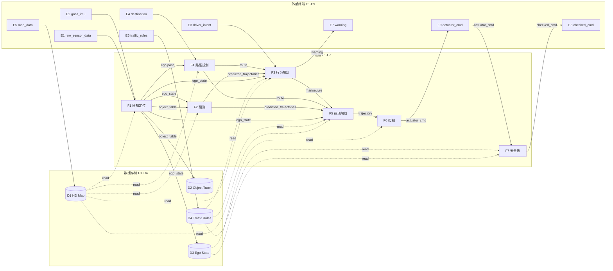
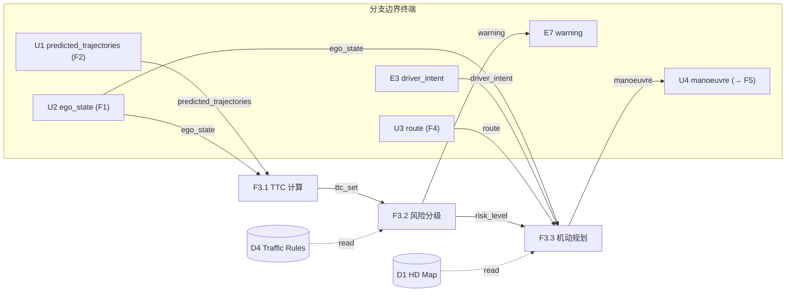

# NL-RQ-ADAS-v1 形式化规格（SOFL）

> **文档名**：`MiniMax-M3.1-Flash-2`
> **源规格**：`NL-RQ-ADAS-v1_spec.md` (v1.0)
> **模型文件**：`ADAS_System.sofl`、`AEB_Branch.sofl`
> **交付内容**：两个 module 完整文本、CDFD 元素与连线清单、open-issues、可追溯性矩阵
> **模型版本**：MiniMax-M3.1-Flash

---

## 目录

1. [建模约定与语法限制](#1-建模约定与语法限制)
2. [Module `ADAS_System`（Level 0）](#2-module-adas_systemlevel-0)
3. [Module `AEB_Branch`（Level 1）](#3-module-aeb_branchlevel-1)
4. [CDFD 元素与连线清单](#4-cdfd-元素与连线清单)
5. [Open Issues](#5-open-issues)
6. [可追溯性矩阵](#6-可追溯性矩阵)
7. [阈值锚点速查](#7-阈值锚点速查)

---

## 1. 建模约定与语法限制

### 1.1 SOFL 记法约定

| 构件 | 形式 |
| --- | --- |
| module head | `\|  \|  \|  \|` / `\| --- \| --- \| --- \|` / `( 入1: 类型, 入2: 类型 ) 出1: 类型 \| 出2: 类型` |
| 端口分隔 | `(` … `)` 内部用 `,` 分隔同端口的多条流；`\|` 分隔不同端口 |
| 类型声明 | `Name = composed of` … `end`，可嵌套引用其它 composed 类型 |
| 过程 | `process 名(入参) out: 出参` … `end_process` |
| 存储访问 | `ext rd 存储名`（只读）/ `ext wr 存储名`（写），与 CDFD 读写连线一一对应 |
| 契约 | `pre <谓词>`；`post if <守卫> then <谓词>` |

### 1.2 允许的算子

`and`、`=`、`<>`、`>`、`>=`、`<=`、`<`、点号字段访问。

**不使用**：`or`、`not`、`=>`、量词、`seq of`。

### 1.3 前置条件约定（本次重跑唯一新增约束）

- **不写** `x <> null` 之类的类型层空检查：SOFL 中值按类型声明默认非空，该检查是同义反复。
- `precondition` 只陈述真实约束：阈值、有效性标志、范围条件。
- 数据有效性通过数据体自带的有效性标志表达：`gnss_valid`、`imu_valid`、`camera_valid`/`radar_valid`/`lidar_valid`、`lead_valid`、`lead_gap_valid`、`route_valid`。

### 1.4 数值来源纪律

- 规范阈值 `N-1 … N-7` **只能**取自规格 §7 的表；
- 假设值 `A-1 … A-7` **只能**取自规格 §8；
- 所有出现在契约中的数字都收敛到 `const` 块，每条 `const` 注明其 N-x / A-x 出处；
- 任何设计决定记入 [Open Issues](#5-open-issues)。

---

## 2. Module `ADAS_System`（Level 0）

整车级 ADAS 车载系统。恰好含规格 §5 的 7 个功能、4 个数据存储（D1–D4）、外部接口（E1–E9）。

```sofl
-- ============================================================================
-- ADAS_System -- SOFL module, Level 0 (vehicle-level ADAS onboard system)
-- Source specification : NL-RQ-ADAS-v1_spec.md (v1.0)
-- Anchors              : R-SCOPE-1..4, R-E-1..2, R-D-1..2, R-L0-1, R-G-1..6,
--                        N-1..N-7 (normative, S7), A-1..A-7 (assumptions, S8)
--
-- SOFL conventions used here
--   head    : port list; "( ... )" = one input port, "," separates the member
--             flows of a port, "|" separates ports, entries are "name: type"
--   types   : Name = composed of <field>: <type>, ... end (nested composed types
--             are referenced by name)
--   process : process <name>(<in>) out: <out>
--             ext rd <store> / ext wr <store>
--             pre  <predicate>
--             post if <guard> then <predicate>
--   ops     : and, =, <>, >, >=, <=, <, field access (dot).
--             "or", "not", "=>", quantifiers and "seq of" are NOT used.
--   preconditions state real constraints (thresholds, validity flags, range
--   conditions). Type-level emptiness checks ("x <> null") are never written,
--   because a SOFL value is non-null by its type declaration; validity is
--   expressed through the validity flags carried by the data itself.
-- ============================================================================

module ADAS_System

-- ---------------------------------------------------------------------------
-- HEAD -- module ports
--   input port  : raw_sensor_data (E1), gnss_imu (E2), driver_intent (E3),
--                 destination (E4), map_data (E5), traffic_rules (E6),
--                 actuator_cmd (E9)
--   output ports : warning (E7), checked_cmd (E8)
--
--   actuator_cmd (E9) is declared in the head because R-L0-1 requires the
--   Level-0 model to carry E1..E9. Its producer is F6 and its consumer is F7
--   (S5 F6, S5.1 "F6 -> F7: actuator command", R-E-2). It is therefore drawn
--   in the CDFD as an in-line interface terminal on the F6 -> F7 flow and no
--   datum enters the module through it (R-E-1). See open issue OI-01.
-- ---------------------------------------------------------------------------
|  |  |  |
| --- | --- | --- |
( raw_sensor_data: SensorFrameSet, gnss_imu: GnssImuSample, driver_intent: DriverIntent, destination: Destination, map_data: MapSegment, traffic_rules: TrafficRules, actuator_cmd: ActuationCommand ) warning: Warning | checked_cmd: CheckedCommand

-- ---------------------------------------------------------------------------
-- CONSTANTS -- only values taken from S7 (normative N-x) and S8 (assumptions
-- A-x). Nothing else is introduced as a number.
-- ---------------------------------------------------------------------------
const t_risk_high           = 3.0     -- A-5  onset of the caution band
const t_fcw                 = 1.5     -- A-5  TTC below which a warning is no longer creditable (N-2)
const warning_credit_ttc    = 2.0     -- N-2  warning shall be present no later than TTC = 2.0 s
const a_emergency           = 6.0     -- A-1  emergency deceleration, sized from N-3 / N-4
const rho                   = 0.1     -- A-2  RSS response time
const a_max_accel           = 2.0     -- A-2  RSS maximum longitudinal acceleration
const a_max_brake           = 4.0     -- A-2  RSS maximum longitudinal deceleration
const a_min_brake           = 4.0     -- A-2  RSS minimum braking (N-6)
const a_comfort_limit       = 3.0     -- A-3  comfortable longitudinal acceleration limit (F6 / F7)
const yaw_rate_limit        = 3.5     -- A-4  yaw-rate envelope, sanity envelope on the localisation output
const yaw_rate_limit_neg    = -3.5    -- A-4  lower bound of the same envelope
const steering_limit        = 1.0     -- A-6  steering command envelope
const steering_limit_neg    = -1.0    -- A-6  lower bound of the same envelope
const prediction_horizon    = 3.0     -- A-7  prediction horizon of F2
const operational_speed_max = 36.111  -- N-1  130 km/h expressed in m/s (see OI-07)
const accel_capability_min  = -6.0    -- A-1  lower bound of the longitudinal actuation envelope (see OI-09)

-- ---------------------------------------------------------------------------
-- TYPES
-- ---------------------------------------------------------------------------
SensorFrameSet = composed of
  frame_count: nat,
  timestamp: real,
  camera_valid: bool,
  radar_valid: bool,
  lidar_valid: bool,
  camera_timestamp: real,
  radar_timestamp: real,
  lidar_timestamp: real
end

GnssImuSample = composed of
  gnss_valid: bool,
  imu_valid: bool,
  position_x: real,
  position_y: real,
  heading: real,
  angular_rate: real,
  acceleration: real
end

DriverIntent = composed of
  requested_cruise_speed: real,
  override_accelerate: bool,
  override_brake: bool,
  override_steer: bool,
  driver_attention: String
end

Destination = composed of
  longitude: real,
  latitude: real,
  route_preferences: String
end

MapSegment = composed of
  road_id: String,
  lane_id: String,
  posted_speed_limit: real,
  curvature: real,
  lane_topology: String
end

TrafficRules = composed of
  posted_speed_limit: real,
  traffic_signal_state: String
end

Warning = composed of
  warning_type: String,
  active: bool
end

CheckedCommand = composed of
  longitudinal_acceleration_cmd: real,
  brake_cmd: real,
  steering_cmd: real
end

ActuationCommand = composed of
  longitudinal_acceleration_cmd: real,
  brake_cmd: real,
  steering_cmd: real
end

ObjectTable = composed of
  object_count: nat,
  object_entries: String,
  lead_object_id: nat,
  lead_position_x: real,
  lead_position_y: real,
  lead_velocity_x: real,
  lead_velocity_y: real,
  lead_object_class: String,
  lead_valid: bool
end

EgoState = composed of
  position_x: real,
  position_y: real,
  speed: real,
  yaw_rate: real,
  acceleration: real,
  last_update_timestamp: real
end

PredictedTrajectories = composed of
  object_count: nat,
  horizon_duration: real,
  trajectory_set: String,
  min_ttc: real,
  lead_gap: real,
  lead_gap_valid: bool,
  lead_speed: real,
  rss_d_min: real
end

Route = composed of
  path_length: real,
  eta: real,
  lane_count: nat,
  lane_geometry: String,
  route_valid: bool
end

Manoeuvre = composed of
  manoeuvre_type: String,
  target_speed: real,
  target_lane_id: String,
  required_deceleration: real
end

Trajectory = composed of
  max_permitted_speed: real,
  max_permitted_acceleration: real,
  horizon_duration: real,
  kinematically_feasible: bool
end

-- ===========================================================================
-- PROCESSES
-- ===========================================================================

-- F1 -- Perception and Localisation (S5 F1, R-D-1: F1 is the owner of D2/D3)
-- reads D1 (S5.1), writes D2 and D3 (S5.1)
process F1 (raw_sensor_data: SensorFrameSet, gnss_imu: GnssImuSample, hd_map: MapSegment) out: object_table: ObjectTable, ego_state: EgoState
ext rd D1
ext wr D2
ext wr D3
pre  raw_sensor_data.frame_count >= 1
pre  raw_sensor_data.timestamp >= 0
pre  raw_sensor_data.camera_valid = true and raw_sensor_data.radar_valid = true and raw_sensor_data.lidar_valid = true
pre  gnss_imu.gnss_valid = true
pre  gnss_imu.imu_valid = true
pre  hd_map.posted_speed_limit >= 0
post object_table.object_count >= 0
post if object_table.object_count > 0 then object_table.lead_valid = true
post if object_table.object_count = 0 then object_table.lead_valid = false
post ego_state.speed >= 0
post ego_state.last_update_timestamp >= 0
post ego_state.yaw_rate <= yaw_rate_limit and ego_state.yaw_rate >= yaw_rate_limit_neg
end_process

-- F2 -- Prediction (S5 F2; only function that computes TTC at Level 0, S5 F2)
-- reads D1, writes no store (S5 F2, R-D-1)
process F2 (object_table: ObjectTable, ego_state: EgoState, hd_map: MapSegment) out: predicted_trajectories: PredictedTrajectories
ext rd D1
pre  object_table.object_count >= 0
pre  ego_state.speed >= 0
pre  ego_state.yaw_rate <= yaw_rate_limit and ego_state.yaw_rate >= yaw_rate_limit_neg
pre  hd_map.posted_speed_limit >= 0
post predicted_trajectories.object_count <= object_table.object_count
post predicted_trajectories.horizon_duration >= prediction_horizon
post predicted_trajectories.min_ttc >= 0
post if object_table.lead_valid = true then predicted_trajectories.lead_gap_valid = true
post if object_table.lead_valid = false then predicted_trajectories.lead_gap_valid = false
post if predicted_trajectories.lead_gap_valid = true then predicted_trajectories.rss_d_min >= 0
end_process

-- F3 -- Behaviour Planning (S5 F3), atomic at Level 0 (R-SCOPE-4)
-- reads D1 and D4, writes no store (S5 F3, S5.1)
process F3 (ego_state: EgoState, traffic_rules: TrafficRules, predicted_trajectories: PredictedTrajectories, driver_intent: DriverIntent, route: Route, hd_map: MapSegment) out: manoeuvre: Manoeuvre, warning: Warning
ext rd D1
ext rd D4
pre  ego_state.speed >= 0
pre  traffic_rules.posted_speed_limit >= 0
pre  predicted_trajectories.min_ttc >= 0
pre  driver_intent.requested_cruise_speed >= 0
pre  route.route_valid = true
post manoeuvre.target_speed >= 0
post manoeuvre.required_deceleration >= 0
post if traffic_rules.posted_speed_limit > 0 then manoeuvre.target_speed <= traffic_rules.posted_speed_limit
post if driver_intent.override_accelerate = true and manoeuvre.manoeuvre_type <> emergency_deceleration then manoeuvre.target_speed >= ego_state.speed
post if predicted_trajectories.lead_gap_valid = true and predicted_trajectories.lead_gap < predicted_trajectories.rss_d_min then manoeuvre.target_speed <= predicted_trajectories.lead_speed
post if warning.active = true then warning.warning_type <> none
post if warning.active = false then warning.warning_type = none
end_process

-- F4 -- Route Planning (S5 F4), writes no store (S5 F4)
-- reads D1 (S5.1)
process F4 (destination: Destination, ego_state: EgoState, hd_map: MapSegment) out: route: Route
ext rd D1
pre  destination.longitude >= -180.0 and destination.longitude <= 180.0
pre  destination.latitude >= -90.0 and destination.latitude <= 90.0
pre  ego_state.speed >= 0
pre  hd_map.posted_speed_limit >= 0
post route.route_valid = true
post route.path_length >= 0
post route.eta >= 0
post route.lane_count >= 1
end_process

-- F5 -- Motion Planning (S5 F5), writes no store (S5 F5)
-- reads D1 and D4 (S5.1)
process F5 (manoeuvre: Manoeuvre, route: Route, ego_state: EgoState, hd_map: MapSegment, traffic_rules: TrafficRules) out: trajectory: Trajectory
ext rd D1
ext rd D4
pre  route.route_valid = true
pre  manoeuvre.target_speed >= 0
pre  manoeuvre.required_deceleration >= 0
pre  ego_state.speed >= 0
pre  traffic_rules.posted_speed_limit >= 0
post if traffic_rules.posted_speed_limit > 0 then trajectory.max_permitted_speed <= traffic_rules.posted_speed_limit
post if manoeuvre.required_deceleration >= 0 then trajectory.max_permitted_acceleration <= 0 - manoeuvre.required_deceleration
post trajectory.max_permitted_acceleration <= a_comfort_limit
post trajectory.horizon_duration >= 0
post trajectory.kinematically_feasible = true
end_process

-- F6 -- Control (S5 F6), writes no store (S5 F6)
-- reads D3 (S5.1); produces E9 (S5 F6, R-E-2)
process F6 (trajectory: Trajectory, ego_state: EgoState) out: actuator_cmd: ActuationCommand
ext rd D3
pre  trajectory.kinematically_feasible = true
pre  trajectory.max_permitted_speed >= 0
pre  ego_state.speed >= 0
post actuator_cmd.longitudinal_acceleration_cmd <= trajectory.max_permitted_acceleration
post actuator_cmd.longitudinal_acceleration_cmd <= a_comfort_limit
post actuator_cmd.longitudinal_acceleration_cmd >= accel_capability_min
post actuator_cmd.brake_cmd >= 0
post actuator_cmd.steering_cmd <= steering_limit and actuator_cmd.steering_cmd >= steering_limit_neg
end_process

-- F7 -- Safety Shield / monitoring and arbitration (S5 F7, R-E-2)
-- reads D3 and D4 (S5.1); produces E8, the only actuation output (R-E-1)
process F7 (actuator_cmd: ActuationCommand, ego_state: EgoState, traffic_rules: TrafficRules) out: checked_cmd: CheckedCommand
ext rd D3
ext rd D4
pre  ego_state.speed >= 0
pre  traffic_rules.posted_speed_limit >= 0
post checked_cmd.longitudinal_acceleration_cmd <= a_comfort_limit
post checked_cmd.longitudinal_acceleration_cmd >= accel_capability_min
post checked_cmd.brake_cmd >= 0
post if actuator_cmd.steering_cmd <= steering_limit and actuator_cmd.steering_cmd >= steering_limit_neg then checked_cmd.steering_cmd = actuator_cmd.steering_cmd
post if actuator_cmd.steering_cmd > steering_limit then checked_cmd.steering_cmd <= steering_limit
post if actuator_cmd.steering_cmd < steering_limit_neg then checked_cmd.steering_cmd >= steering_limit_neg
post if actuator_cmd.longitudinal_acceleration_cmd > a_comfort_limit then checked_cmd.longitudinal_acceleration_cmd <= a_comfort_limit
post if actuator_cmd.longitudinal_acceleration_cmd < accel_capability_min then checked_cmd.longitudinal_acceleration_cmd >= accel_capability_min
post if traffic_rules.posted_speed_limit > 0 and ego_state.speed >= traffic_rules.posted_speed_limit then checked_cmd.longitudinal_acceleration_cmd <= 0
end_process

end module
```

### 2.1 `ADAS_System` 契约要点速览

| 功能 | 输入 | 输出 | `ext rd` | `ext wr` | 量化约束锚点 |
| --- | --- | --- | --- | --- | --- |
| F1 感知定位 | E1, E2, D1 | object_table, ego_state | D1 | D2, D3 | A-4 偏航率包络 |
| F2 预测 | object_table, ego_state, D1 | predicted_trajectories | D1 | — | A-7 时域 ≥ 3 s |
| F3 行为规划 | ego_state, D4, predicted_trajectories, E3, route, D1 | manoeuvre, warning | D1, D4 | — | N-5 RSS 间距 |
| F4 路径规划 | E4, ego_state, D1 | route | D1 | — | 定性（有效性标志 + 非负量） |
| F5 运动规划 | manoeuvre, route, ego_state, D1, D4 | trajectory | D1, D4 | — | D4 限速 + 机动需求 |
| F6 控制 | trajectory, D3 | actuator_cmd (E9) | D3 | — | A-3 舒适限 + A-6 转向包络 |
| F7 安全盾 | E9, D3, D4 | checked_cmd (E8) | D3, D4 | — | A-3 舒适限 + A-6 转向包络 |

---

## 3. Module `AEB_Branch`（Level 1）

细化 F3 的 AEB 分支为 F3.1 → F3.2 → F3.3（规格 §6）。其余 Level 0 功能保持原子。

```sofl
-- ============================================================================
-- AEB_Branch -- SOFL module, Level 1 (refinement of the AEB branch of F3)
-- Source specification : NL-RQ-ADAS-v1_spec.md (v1.0), S6
-- Anchors              : R-SCOPE-4, R-L1-1, R-G-1..6, N-1..N-7, A-1..A-7
--
-- This module refines exactly one Level-0 function: F3 Behaviour Planning.
-- Its three sub-functions are F3.1 (TTC computation), F3.2 (risk
-- classification) and F3.3 (maneuver planning) (R-L1-1). Every other Level-0
-- function stays atomic.
--
-- SOFL conventions, type declarations and operator restrictions are the same
-- as in ADAS_System. The types are repeated here so that this module is
-- self-contained (see open issue OI-08).
-- ============================================================================

module AEB_Branch

-- ---------------------------------------------------------------------------
-- HEAD -- module ports of the branch
--   input port  : predicted_trajectories (from F2), ego_state (from F1),
--                 driver_intent (E3), route (from F4)
--   output ports : warning (E7), manoeuvre (to F5)
--   D1 and D4 are reached through store reads (ext rd) in F3.3 and F3.2.
-- ---------------------------------------------------------------------------
|  |  |  |
| --- | --- | --- |
( predicted_trajectories: PredictedTrajectories, ego_state: EgoState, driver_intent: DriverIntent, route: Route ) warning: Warning | manoeuvre: Manoeuvre

-- ---------------------------------------------------------------------------
-- CONSTANTS -- only values taken from S7 (normative N-x) and S8 (A-x)
-- ---------------------------------------------------------------------------
const t_risk_high           = 3.0     -- A-5  onset of the caution band
const t_fcw                 = 1.5     -- A-5  TTC below which a warning is no longer creditable (N-2)
const warning_credit_ttc    = 2.0     -- N-2  warning shall be present no later than TTC = 2.0 s
const a_emergency           = 6.0     -- A-1  emergency deceleration, sized from N-3 / N-4
const rho                   = 0.1     -- A-2  RSS response time
const a_max_accel           = 2.0     -- A-2  RSS maximum longitudinal acceleration
const a_max_brake           = 4.0     -- A-2  RSS maximum longitudinal deceleration
const a_min_brake           = 4.0     -- A-2  RSS minimum braking (N-6)
const a_comfort_limit       = 3.0     -- A-3  comfortable longitudinal acceleration limit
const yaw_rate_limit        = 3.5     -- A-4  yaw-rate envelope
const yaw_rate_limit_neg    = -3.5    -- A-4  lower bound of the same envelope
const steering_limit        = 1.0     -- A-6  steering command envelope
const steering_limit_neg    = -1.0    -- A-6  lower bound of the same envelope
const prediction_horizon    = 3.0     -- A-7  prediction horizon of F2
const operational_speed_max = 36.111  -- N-1  130 km/h expressed in m/s (see OI-07)
const accel_capability_min  = -6.0    -- A-1  lower bound of the actuation envelope (see OI-09)

-- ---------------------------------------------------------------------------
-- TYPES
-- ---------------------------------------------------------------------------
EgoState = composed of
  position_x: real,
  position_y: real,
  speed: real,
  yaw_rate: real,
  acceleration: real,
  last_update_timestamp: real
end

DriverIntent = composed of
  requested_cruise_speed: real,
  override_accelerate: bool,
  override_brake: bool,
  override_steer: bool,
  driver_attention: String
end

MapSegment = composed of
  road_id: String,
  lane_id: String,
  posted_speed_limit: real,
  curvature: real,
  lane_topology: String
end

TrafficRules = composed of
  posted_speed_limit: real,
  traffic_signal_state: String
end

Warning = composed of
  warning_type: String,
  active: bool
end

PredictedTrajectories = composed of
  object_count: nat,
  horizon_duration: real,
  trajectory_set: String,
  min_ttc: real,
  lead_gap: real,
  lead_gap_valid: bool,
  lead_speed: real,
  rss_d_min: real
end

Route = composed of
  path_length: real,
  eta: real,
  lane_count: nat,
  lane_geometry: String,
  route_valid: bool
end

Manoeuvre = composed of
  manoeuvre_type: String,
  target_speed: real,
  target_lane_id: String,
  required_deceleration: real
end

TTCSet = composed of
  object_count: nat,
  min_ttc: real
end

-- ===========================================================================
-- PROCESSES
-- ===========================================================================

-- F3.1 -- TTC Computation (S6 F3.1)
-- inputs: predicted trajectories (from F2), ego state; output: TTC set
process F3_1 (predicted_trajectories: PredictedTrajectories, ego_state: EgoState) out: ttc_set: TTCSet
pre  predicted_trajectories.object_count >= 0
pre  predicted_trajectories.horizon_duration >= prediction_horizon
pre  ego_state.speed >= 0
post ttc_set.min_ttc >= 0
post if predicted_trajectories.object_count = 0 then ttc_set.object_count = 0
post if predicted_trajectories.object_count > 0 then ttc_set.object_count <= predicted_trajectories.object_count
post if predicted_trajectories.object_count > 0 then ttc_set.min_ttc <= predicted_trajectories.min_ttc
end_process

-- F3.2 -- Risk Classification (S6 F3.2)
-- inputs: TTC set (from F3.1), traffic rules (D4); outputs: risk level, warning (E7)
process F3_2 (ttc_set: TTCSet, traffic_rules: TrafficRules) out: risk_level: String, warning: Warning
ext rd D4
pre  ttc_set.object_count >= 0
pre  ttc_set.min_ttc >= 0
pre  traffic_rules.posted_speed_limit >= 0
post if ttc_set.min_ttc > t_risk_high then risk_level = no_risk
post if ttc_set.min_ttc <= t_risk_high and ttc_set.min_ttc > t_fcw then risk_level = caution
post if ttc_set.min_ttc <= t_fcw then risk_level = critical
post if risk_level = no_risk then warning.active = false and warning.warning_type = none
post if risk_level = caution then warning.active = true and warning.warning_type = caution
post if risk_level = critical then warning.active = true and warning.warning_type = imminent_collision
post if ttc_set.min_ttc <= warning_credit_ttc and ttc_set.min_ttc > t_fcw then warning.active = true
end_process

-- F3.3 -- Maneuver Planning (S6 F3.3)
-- inputs: risk level (from F3.2), ego state, driver intent (E3), route (from
-- F4), D1; output: manoeuvre
process F3_3 (risk_level: String, ego_state: EgoState, driver_intent: DriverIntent, route: Route, hd_map: MapSegment) out: manoeuvre: Manoeuvre
ext rd D1
pre  ego_state.speed >= 0
pre  driver_intent.requested_cruise_speed >= 0
pre  route.route_valid = true
pre  hd_map.posted_speed_limit >= 0
post manoeuvre.target_speed >= 0
post manoeuvre.required_deceleration >= 0
post if risk_level = no_risk then manoeuvre.manoeuvre_type = cruise
post if risk_level = no_risk then manoeuvre.target_speed <= hd_map.posted_speed_limit
post if risk_level = caution then manoeuvre.manoeuvre_type = deceleration
post if risk_level = caution then manoeuvre.required_deceleration > 0
post if risk_level = critical then manoeuvre.manoeuvre_type = emergency_deceleration
post if risk_level = critical then manoeuvre.target_speed = 0
post if risk_level = critical then manoeuvre.required_deceleration >= a_emergency
post if risk_level = critical then manoeuvre.required_deceleration >= a_min_brake
post if risk_level = critical then manoeuvre.required_deceleration > a_max_accel
post if risk_level = critical and ego_state.speed <= operational_speed_max then manoeuvre.manoeuvre_type = emergency_deceleration
post if risk_level = critical and driver_intent.override_accelerate = true then manoeuvre.manoeuvre_type = emergency_deceleration
post if risk_level = critical and driver_intent.override_accelerate = true then manoeuvre.required_deceleration >= a_emergency
post if risk_level = caution and driver_intent.override_accelerate = true then manoeuvre.target_speed >= ego_state.speed
post if risk_level = no_risk and driver_intent.override_accelerate = true then manoeuvre.target_speed >= ego_state.speed
end_process

end module
```

### 3.1 `AEB_Branch` 契约要点速览

| 子功能 | 输入 | 输出 | `ext rd` | 量化约束锚点 |
| --- | --- | --- | --- | --- |
| F3.1 TTC 计算 | predicted_trajectories (F2), ego_state (F1) | ttc_set | — | 目标计数 ≤ 输入目标数、最小 TTC ≤ 上游 min_ttc |
| F3.2 风险分级 | ttc_set (F3.1), D4 | risk_level, warning (E7) | D4 | A-5 分档阈值 3.0 / 1.5；N-2 告警时限 2.0 |
| F3.3 机动规划 | risk_level (F3.2), ego_state (F1), E3, route (F4), D1 | manoeuvre | D1 | A-1 紧急减速 6.0；N-1 速度包络 36.111 m/s；N-6 制动 4.0 / 加速 2.0 |

---

## 4. CDFD 元素与连线清单

### 4.1 `ADAS_System`（Level 0）— 恰好 20 个元素

#### 4.1.1 外部终端（9 个，恰好 E1–E9，R-L0-1）

| 终端 | 数据流 | 类型 | 方向 | 依据 |
| --- | --- | --- | --- | --- |
| E1 | raw_sensor_data | SensorFrameSet | in | §3 |
| E2 | gnss_imu | GnssImuSample | in | §3 |
| E3 | driver_intent | DriverIntent | in | §3 |
| E4 | destination | Destination | in | §3 |
| E5 | map_data | MapSegment | in | §3 |
| E6 | traffic_rules | TrafficRules | in | §3 |
| E7 | warning | Warning | out | §3，唯一面向驾驶员的输出 |
| E8 | checked_cmd | CheckedCommand | out | §3，唯一执行输出（R-E-1） |
| E9 | actuator_cmd | ActuationCommand | 位于 F6→F7 流上的在线接口终端 | §5 F6 / §5.1 / R-E-2；见 OI-01 |

#### 4.1.2 进程（7 个，恰好 F1–F7，R-L0-1）

| 进程 | 输入 | 输出 | 存储读 | 存储写 |
| --- | --- | --- | --- | --- |
| F1 感知定位 | E1, E2, D1 | object_table (D2), ego_state (D3) | D1 | D2, D3 |
| F2 预测 | object_table, ego_state, D1 | predicted_trajectories | D1 | — |
| F3 行为规划 | ego_state, D4, predicted_trajectories, E3, route, D1 | manoeuvre, warning (E7) | D1, D4 | — |
| F4 路径规划 | E4, ego_state, D1 | route | D1 | — |
| F5 运动规划 | manoeuvre, route, ego_state, D1, D4 | trajectory | D1, D4 | — |
| F6 控制 | trajectory, D3 | actuator_cmd (E9) | D3 | — |
| F7 安全盾 | E9, D3, D4 | checked_cmd (E8) | D3, D4 | — |

#### 4.1.3 数据存储（4 个，恰好 D1–D4，R-L0-1）

| 存储 | 内容 | 所有者 | 刷新来源 | 生命周期 |
| --- | --- | --- | --- | --- |
| D1 HD Map Store | MapSegment | F5 / F1 | E5 | 持久 |
| D2 Object Track Store | ObjectTable | F1 | F1 写 | 每周期重建 |
| D3 Ego State Store | EgoState | F1 | F1 写 | 持久 |
| D4 Traffic Rules Store | TrafficRules | F5 | E6 | 持久 |

#### 4.1.4 数据流（33 条，两端均落到已声明元素，R-G-4）

| # | 源 | 宿 | 数据流 | 类型 |
| --- | --- | --- | --- | --- |
| 1 | E1 | F1 | raw_sensor_data | 外部入 |
| 2 | E2 | F1 | gnss_imu | 外部入 |
| 3 | E5 | D1 | map_data | 存储刷新写（OI-04） |
| 4 | E6 | D4 | traffic_rules | 存储刷新写（OI-04） |
| 5 | E3 | F3 | driver_intent | 外部入 |
| 6 | E4 | F4 | destination | 外部入 |
| 7 | F1 | D2 | object_table | 存储写 |
| 8 | F1 | D3 | ego_state | 存储写 |
| 9 | D1 | F1 | map_segment | 存储读 |
| 10 | D1 | F2 | map_segment | 存储读 |
| 11 | D1 | F3 | map_segment | 存储读 |
| 12 | D1 | F4 | map_segment | 存储读 |
| 13 | D1 | F5 | map_segment | 存储读 |
| 14 | D3 | F6 | ego_state | 存储读 |
| 15 | D3 | F7 | ego_state | 存储读 |
| 16 | D4 | F3 | traffic_rules | 存储读 |
| 17 | D4 | F5 | traffic_rules | 存储读 |
| 18 | D4 | F7 | traffic_rules | 存储读 |
| 19 | F1 | F2 | object_table | 进程流 |
| 20 | F1 | F2 | ego_state | 进程流 |
| 21 | F1 | F3 | ego_state | 进程流（OI-05） |
| 22 | F1 | F4 | ego_state (ego pose) | 进程流（OI-05） |
| 23 | F1 | F5 | ego_state | 进程流（OI-05） |
| 24 | F2 | F3 | predicted_trajectories | 进程流 |
| 25 | F2 | F5 | predicted_trajectories | 进程流 |
| 26 | F4 | F3 | route | 进程流 |
| 27 | F4 | F5 | route | 进程流 |
| 28 | F3 | F5 | manoeuvre | 进程流 |
| 29 | F3 | E7 | warning | 外部出 |
| 30 | F5 | F6 | trajectory | 进程流 |
| 31 | F6 | E9 | actuator_cmd | 接口终端（在线） |
| 32 | E9 | F7 | actuator_cmd | 接口终端（在线） |
| 33 | F7 | E8 | checked_cmd | 外部出 |

由连线清单导出的观察（已登记为 open issues）：

- D2 有写者（F1）但无读者：object table 通过流 19 抵达 F2，而非经存储读（§5.1 未给 D2 读）→ **OI-02**
- F1→F3 / F1→F4 / F1→F5 不在 §5.1 项目清单中，但为 §5 中 F3/F4/F5 的输入表所要求，且 F3/F5 不得读 D3（R-D-2）→ **OI-05**
- 流 31/32 以在线接口终端的方式实现 E9 的单一生产者/单一消费者（R-G-4）→ **OI-01**

#### 4.1.5 Level 0 CDFD 示意图



> 实线箭头 = 数据流；虚线箭头 = 存储读取；写入 D2/D3 的连线为实线（写）。

### 4.2 `AEB_Branch`（Level 1）— 仅细化 F3

#### 4.2.1 进程（3 个，恰好 F3.1 / F3.2 / F3.3，R-L1-1）

| 进程 | 输入 | 输出 |
| --- | --- | --- |
| F3.1 TTC 计算 | predicted_trajectories (F2), ego_state (F1) | ttc_set |
| F3.2 风险分级 | ttc_set (F3.1), D4 | risk_level, warning (E7) |
| F3.3 机动规划 | risk_level (F3.2), ego_state (F1), E3, route (F4), D1 | manoeuvre |

#### 4.2.2 数据存储（2 个，本分支内只读）

| 存储 | 读者 |
| --- | --- |
| D1 HD Map Store | F3.3 |
| D4 Traffic Rules Store | F3.2 |

#### 4.2.3 分支边界终端

| 终端 | 数据流 | 类型 | 说明 |
| --- | --- | --- | --- |
| U1 | predicted_trajectories | PredictedTrajectories | 入，由 Level 0 的 F2 产生 |
| U2 | ego_state | EgoState | 入，由 Level 0 的 F1 产生 |
| U3 | route | Route | 入，由 Level 0 的 F4 产生 |
| U4 | manoeuvre | Manoeuvre | 出，被 Level 0 的 F5 消费 |
| E3 | driver_intent | DriverIntent | 入，外部接口 |
| E7 | warning | Warning | 出，外部接口 |

#### 4.2.4 数据流（11 条）

| # | 源 | 宿 | 数据流 | 类型 |
| --- | --- | --- | --- | --- |
| 1 | U1 | F3.1 | predicted_trajectories | 进程流（来自 F2） |
| 2 | U2 | F3.1 | ego_state | 进程流（来自 F1） |
| 3 | U2 | F3.3 | ego_state | 进程流（来自 F1） |
| 4 | F3.1 | F3.2 | ttc_set | 进程流 |
| 5 | D4 | F3.2 | traffic_rules | 存储读 |
| 6 | F3.2 | F3.3 | risk_level | 进程流 |
| 7 | F3.2 | E7 | warning | 外部出 |
| 8 | E3 | F3.3 | driver_intent | 外部入 |
| 9 | U3 | F3.3 | route | 进程流（来自 F4） |
| 10 | D1 | F3.3 | map_segment | 存储读 |
| 11 | F3.3 | U4 | manoeuvre | 进程流（去 F5） |

#### 4.2.5 Level 1 CDFD 示意图



---

## 5. Open Issues

| ID | 问题 | 处理 |
| --- | --- | --- |
| **OI-01** | §3 把 E9 标为 “in”，§5 F6 又声明它是 F6 的输出 | 单一数据体、单一生产者 F6、单一消费者 F7；E9 画成 F6→F7 的在线接口终端，系统只输出 E7/E8 |
| **OI-02** | F2 的 min TTC 无消费者（R-G-5 孤儿） | 内嵌于 `PredictedTrajectories` 数据体，不新增流；建议规格指明消费者或删除该要求 |
| **OI-03** | §5 F2「唯一计算 TTC 的功能」与 §6 F3.1 冲突 | Level 1 保留 F3.1 计算，用 `ttc_set.min_ttc <= predicted_trajectories.min_ttc` 关联 |
| **OI-04** | §4 说 D1 由 E5 刷新、D4 由 E6 刷新，与 R-D-1「仅所有者写」及 §5.1「F1 只写 D2/D3」冲突 | CDFD 画 E5→D1、E6→D4；备选：让 F1 写 D1、F5 写 D4 |
| **OI-05** | F1→F3 / F1→F4 / F1→F5 的 ego_state 流不在 §5.1 清单，但 §5 的输入表要求它们 | 作为具名流显式加入（R-G-4） |
| **OI-06** | N-5 需要「本车—前车纵向间距」载体，且 d_min 公式在 [S4] 外部 | 给 `PredictedTrajectories` 增 4 个字段（lead_gap, lead_gap_valid, lead_speed, rss_d_min），由 F2 计算；未新增函数/存储/流 |
| **OI-07** | N-1/N-4 用 km/h，A-1/A-2 用 m/s²，且限速单位未声明 | 全部速度归一为 m/s，`operational_speed_max = 36.111 m/s` |
| **OI-08** | SOFL 类型语法无集合类型 | 对象条目/逐目标 TTC/轨迹集/车道拓扑用不透明 String 承载；应给记法补 list 类型 |
| **OI-09** | F6/F7 纵向下界规格未给（§5 F6 只引 A-3/A-6） | 下界取 A-1 的 −6.0 m/s²（生产制动能力），A-2 的 4.0 仅作 N-6 的 RSS 剖面界 |
| **OI-10** | N-7 既无数值界也无横向加速度数据载体 | 定性落在 `trajectory.kinematically_feasible` 与 A-6 转向包络；缺数值能力则无法量化 |
| **OI-11** | F1 读 D1 的用途未定义 | 保留强制读，不发明行为 |
| **OI-12** | F4「F3/F5 所需车道几何」结构未定义 | 以 `lane_count` + 不透明 `lane_geometry` 承载 |
| **OI-13** | 给定语法没有常量声明 | 新增 `const` 块，使每个数字单一可追溯到 N-x / A-x |
| **OI-14** | §11-1 L2 驾驶员监控是否需独立功能 | 不新增功能（R-L0-1/R-SCOPE-3）；唯一驾驶员数据是 E3 的注意力状态。若允许扩展则应独立成功能 |
| **OI-15** | §11-2 D3 由 F1 写、F6/F7 读 | 保持 F1 唯一写者（合 R-D-1）；专用写者功能会违反 R-L0-1 |
| **OI-16** | §11-3 无时序/周期时间 | SOFL 算子无时序构造，ρ=0.1 s 与「TTC=2.0 s 前必须告警」被建模为状态谓词 |
| **OI-17** | §11-4 Level 1 是否该细化 F6/F7 | 按 R-SCOPE-4/R-L1-1 细化 F3；F6/F7 链为备选，未建模 |
| **OI-18** | §8 A-5 引用了不存在的 “R-F2-1” | 「预测时域 ≥ 3 s」取自 §5 F2 正文与 A-7 |

### 5.1 Open Issues 详述

**OI-01 — E9 方向冲突（§3 vs §5 F6 vs §5.1 vs R-E-1/R-E-2）**
§3 把 E9 `actuator_cmd` 列为方向 “in”，§5 F6 声明 actuator_cmd (E9) 是 F6 的输出，§5.1 强制 “F6 → F7: actuator command”。
处理：单一数据体、单一生产者 (F6)、单一消费者 (F7)；E9 画为 F6→F7 流上的在线接口终端，系统无数据经其离开（R-E-1 成立），R-G-4 成立。
备选（若规格本意是外部生产者）：E9 改为真外部输入，但会使 F7 对同一数据体有两个生产者，破坏 R-G-4。

**OI-02 — F2 的最小 TTC 无消费者（R-G-5）**
§5 F2 要求 F2 导出最小 TTC，但 §5.1 只把 F2→F3 流定为「predicted trajectories」，且 Level 1 的 F3.1 自行重算 TTC。
处理：把 `min_ttc` 内嵌进 `PredictedTrajectories` 数据体（不新增流、不新增元素），数据体形式上仍被消费；孤儿在此登记。
建议：规格指明 F2 最小 TTC 的消费者，或删除该要求。

**OI-03 — §5 F2/F3 对「谁算 TTC」的冲突**
「F2 shall be the only function that computes TTC」（§5 F2）与 §6 F3.1「Shall compute, for each predicted object, the TTC」直接矛盾。
处理：Level 1 保留 F3.1 的计算（R-L1-1 强制），并以 `ttc_set.min_ttc <= predicted_trajectories.min_ttc` 约束二者一致。

**OI-04 — 存储刷新与 R-D-1 的张力**
§4 称 D1 由 E5 刷新、D4 由 E6 刷新；R-D-1 却规定存储只由其所有者功能写；§5.1 把 F1 的写集限定为 D2、D3。
处理：CDFD 把刷新画为 E5→D1 与 E6→D4（流 3、4），在此登记 R-D-1 张力。
备选：由 F1 写 D1（F1 是 D1 的既定所有者之一）、由 F5 写 D4（D4 的所有者）。

**OI-05 — F1→F3 / F1→F4 / F1→F5 的 ego_state 流**
不在 §5.1 的项目清单里，但为 §5 中 F3/F4/F5 的输入表所要求；且 F3、F5 不得读 D3（R-D-2）。
处理：作为具名流（21、22、23）显式加入以满足 R-G-4。

**OI-06 — N-5（RSS 安全距离）需要数据载体**
F3/F5/F3.3 的规定输入中没有「本车—前车纵向间距」载体，且 [S4] 的式 (1) 在本规格之外，因此 d_min 在此不是常量。
处理：给 `PredictedTrajectories` 数据体增 4 个字段（lead_gap, lead_gap_valid, lead_speed, rss_d_min），由 F2 依据 object table、ego state 与 A-2 参数集计算，使 N-5 能作为 F3 的量化后置条件陈述。未引入新的功能、存储或流。

**OI-07 — 单位归一**
N-1、N-4 以 km/h 给出，A-1/A-2 以 m/s² 给出，`posted_speed_limit` 的单位从未声明。
处理：所有速度字段归一为 m/s；`operational_speed_max = 36.111 m/s` 即 N-1 的 130 km/h。

**OI-08 — SOFL 类型语法无集合类型**
逐目标元组（object table 条目、逐目标 TTC 值、预测轨迹集、车道拓扑、路线偏好）无法声明。
处理：这些内容由不透明 String 字段承载（object_entries、trajectory_set、lane_topology、lane_geometry、route_preferences）；§6 真正需要的聚合量（目标数 + 最小 TTC）在 `TTCSet` 中显式建模。建议为记法补充 list/sequence 类型。

**OI-09 — F6 / F7 的执行包络下界未给出**
§5 F6 只引用 A-3 与 A-6，而纵向下界是必需的。
处理：`accel_capability_min = -6.0 m/s²` 取自 A-1（6.0 m/s² 位于量产制动系统能力之内）；A-2 的 `a_max_brake` / `a_min_brake = 4.0` 仅用作 N-6 的 RSS 剖面界，不作为执行器限制。

**OI-10 — N-7 既无数值也无载体**
N-7 要求指令的横向加速度保持在车辆横向加速度能力内，但 §7/§8 未给数值能力，规定数据中（E8 只含三条指令）也无横向加速度字段。
处理：N-7 以定性方式承载于 F5 的 `trajectory.kinematically_feasible` 与 F6/F7 的 A-6 转向包络。若需量化约束，须补入横向加速度能力数值。

**OI-11 — F1 读 D1 的用途未定义**
§5.1 强制「F1 reads D1」，§4 也把 F1 列为 D1 的共同所有者，但 F1 的任何职责都用不到地图。
处理：保留强制读，不为它编造行为。

**OI-12 — F4 的路线几何内容**
§5 F4 要求提供「F3 和 F5 所需的车道几何」，但几何结构未定义。
处理：以不透明 String 字段 `lane_geometry` 加 `lane_count` 承载。

**OI-13 — 常量不属于给定语法**
任务书只给出「Name = composed of … end」的类型声明形式。
处理：新增 `const` 块，使契约中出现的每个数字都能在单点追溯到 §7（N-x）或 §8（A-x）。

**OI-14 — 规格开放问题 §11-1：L2 交接的驾驶员监控**
未建模为独立功能：R-L0-1 与 R-SCOPE-3 禁止新增第八个功能；规格中唯一的驾驶员监控数据是 E3 的注意力状态，已由 `DriverIntent` 承载。若允许 Level 0 分解增长，独立的驾驶员监控功能才是自然答案。

**OI-15 — 规格开放问题 §11-2：D3 的所有权**
D3 由 F1 写、被 F6/F7 读。模型保持 F1 为唯一写者（满足 R-D-1）；D3 的读由 §5.1 显式指派，所有权划分如规格所述是可接受的。设专用写者功能将违反 R-L0-1。

**OI-16 — 规格开放问题 §11-3：时序**
规格固定了阈值但没有周期时间。SOFL 算子集无时序构造，因此 ρ = 0.1 s（A-2）与 N-2 的「不晚于 TTC = 2.0 s」被建模为对 TTC 值的状态谓词，而非时序约束。紧急分支要真正可判定，需补充时序小节（周期时间、反应时间）。

**OI-17 — 规格开放问题 §11-4：Level 1 细化的选择**
R-SCOPE-4 与 R-L1-1 强制细化 F3 的 AEB 分支，故模型细化 F3。细化 F6/F7 执行链是备选方案，未建模。

**OI-18 — 悬空的要求引用**
§8（A-5）引用「R-F2-1」，但规格中不存在该标识的要求。「预测时域至少 3 s」取自 §5 F2 正文与 A-7。

---

## 6. 可追溯性矩阵

### 6.1 规范要求 R-xx → 模型元素

| 要求 | 对应元素 |
| --- | --- |
| **R-SCOPE-1** | 模块边界；E3 `driver_intent.driver_attention`；OI-14 |
| **R-SCOPE-2** | head 端口（E1–E6 进、E7/E8 出）；CDFD 终端 E1–E9；无传感器/HMI/执行器/云内部元素 |
| **R-SCOPE-3** | F1–F7 契约只写数据上的 pre/post，无算法内部 |
| **R-SCOPE-4** | 两模块；L0 中 F3 原子，L1 中被 F3.1/F3.2/F3.3 细化 |
| **R-E-1** | head 输出端口仅 warning(E7)、checked_cmd(E8)；CDFD 仅流 29、33 离开模块 |
| **R-E-2** | 进程 F7；流 31、32、33；F7 的 post 在包络内重算指令 |
| **R-D-1** | `ext wr` 仅出现在 F1（D2、D3）；刷新边 3/4 见 OI-04 |
| **R-D-2** | `ext rd` 与 §5.1 完全一致（F1:D1, F2:D1, F3:D1+D4, F4:D1, F5:D1+D4, F6:D3, F7:D3+D4）；D2 全模型无读 |
| **R-L0-1** | ADAS_System CDFD 清单：7 进程 + 4 存储 + 9 终端 |
| **R-L1-1** | AEB_Branch CDFD：恰好 F3.1、F3.2、F3.3 |
| **R-G-1** | 每个进程 pre + post，量化约束：F1(A-4)、F2(A-7)、F3(N-5)、F4(定性)、F5(D4+机动)、F6(A-3/A-6)、F7(A-3/A-6)、F3.1(计数/最小值)、F3.2(A-5+N-2)、F3.3(A-1+N-1+N-6) |
| **R-G-2** | 本矩阵 |
| **R-G-3** | 元素全部有据；新增项（E9 表达、4 个字段、const 块、String 承载集合）均登记 OI |
| **R-G-4** | 33 + 11 条具名流，单一生产者/消费者；E9 见 OI-01 |
| **R-G-5** | 每个生产者的消费者已列名；F2 的 min_ttc 孤儿见 OI-02 |
| **R-G-6** | pre 写明所需数据；用有效性标志（gnss_valid、imu_valid、lead_valid、lead_gap_valid、route_valid、传感器有效性标志）守护 post；**全模型未写 `x <> null` 一类类型层空检查** |

### 6.2 阈值与假设 → 模型元素

| 锚点 | 模型元素 |
| --- | --- |
| **N-1** | `const operational_speed_max`；F3_3 的 post「critical and ego_state.speed <= operational_speed_max → emergency_deceleration」 |
| **N-2** | `const warning_credit_ttc = 2.0`；F3_2 的 post「min_ttc <= 2.0 and min_ttc > 1.5 → warning.active = true」；配合 A-5 的 `t_fcw = 1.5` |
| **N-3** | A-1 推导（§7 “Derived threshold”）→ F3_3 的 `required_deceleration >= a_emergency = 6.0`；经 F5 → F6 → F7 传递到执行器 |
| **N-4** | CCRm 包络 60..130 km/h → `operational_speed_max`；CCRb −4 m/s² → `a_min_brake = a_max_brake = 4.0 <= a_emergency = 6.0`（F3_3） |
| **N-5** | F3 的 post「lead_gap < rss_d_min → target_speed <= lead_speed」；两个字段的声明见 OI-06 |
| **N-6** | F3_3 的 posts「required_deceleration >= a_min_brake (4.0)」与「required_deceleration > a_max_accel (2.0)」；时序部分 (ρ) 见 OI-16 |
| **N-7** | F5 的 post `trajectory.kinematically_feasible = true`；F6/F7 转向落在 A-6 内；缺失数值能力见 OI-10 |
| **A-1** | `const a_emergency = 6.0` → F3_3；`const accel_capability_min` → F6、F7 |
| **A-2** | `const` rho、a_max_accel、a_max_brake、a_min_brake → F3_3（N-6）与 F2（rss_d_min，OI-06） |
| **A-3** | `const a_comfort_limit = 3.0` → F5、F6、F7 |
| **A-4** | `const` yaw_rate_limit / yaw_rate_limit_neg = 3.5 → F1 post、F2 pre |
| **A-5** | `const` t_risk_high = 3.0、t_fcw = 1.5 → F3_2 |
| **A-6** | `const` steering_limit / steering_limit_neg = 1.0 → F6、F7 |
| **A-7** | `const prediction_horizon = 3.0` → F2 post（horizon >= 3.0 s）、F3_1 pre；A-5 的 t_risk_high 等于同一时域 |

---

## 7. 阈值锚点速查

| 常量 | 值 | 单位 | 出处 | 使用位置 |
| --- | --- | --- | --- | --- |
| `operational_speed_max` | 36.111 | m/s | N-1（130 km/h） | F3_3 |
| `warning_credit_ttc` | 2.0 | s | N-2 | F3_2 |
| `a_emergency` | 6.0 | m/s² | A-1（由 N-3/N-4 推导） | F3_3 |
| `a_min_brake` / `a_max_brake` | 4.0 | m/s² | A-2（N-6） | F3_3 |
| `a_max_accel` | 2.0 | m/s² | A-2（N-6） | F3_3 |
| `rho` | 0.1 | s | A-2 | 声明保留（时序见 OI-16） |
| `a_comfort_limit` | 3.0 | m/s² | A-3 | F5、F6、F7 |
| `yaw_rate_limit` / `yaw_rate_limit_neg` | ±3.5 | rad/s | A-4 | F1 post、F2 pre |
| `t_risk_high` | 3.0 | s | A-5 | F3_2 |
| `t_fcw` | 1.5 | s | A-5 | F3_2 |
| `steering_limit` / `steering_limit_neg` | ±1.0 | — | A-6 | F6、F7 |
| `prediction_horizon` | 3.0 | s | A-7 | F2 post、F3_1 pre |
| `accel_capability_min` | −6.0 | m/s² | A-1（见 OI-09） | F6、F7 |

---

*文档结束。模型源文件：`ADAS_System.sofl`、`AEB_Branch.sofl`（同目录）。*
