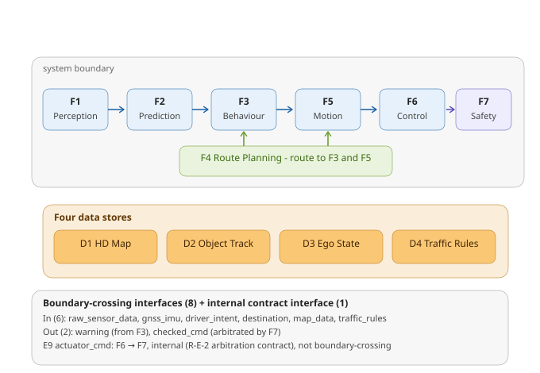
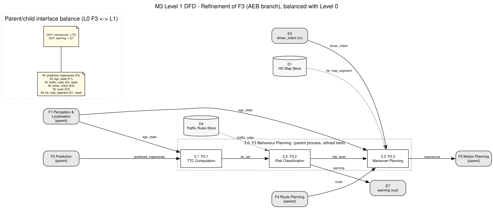
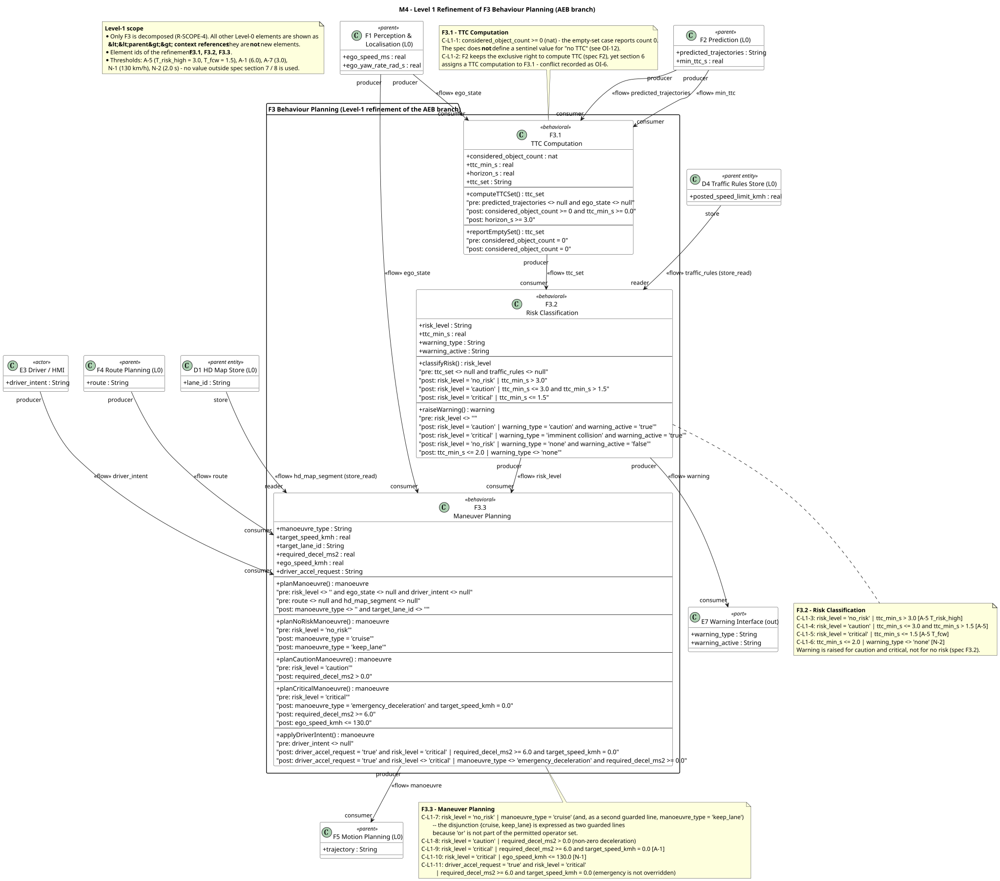
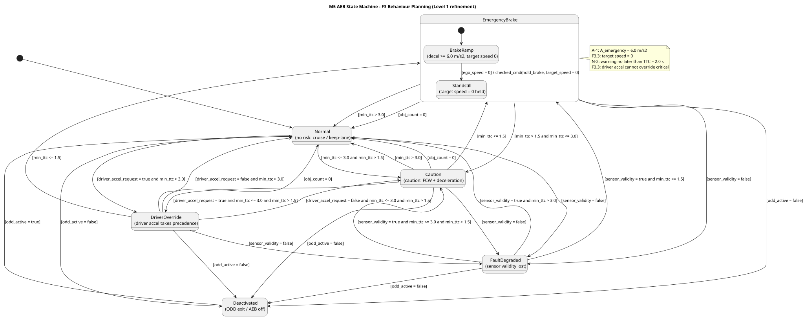
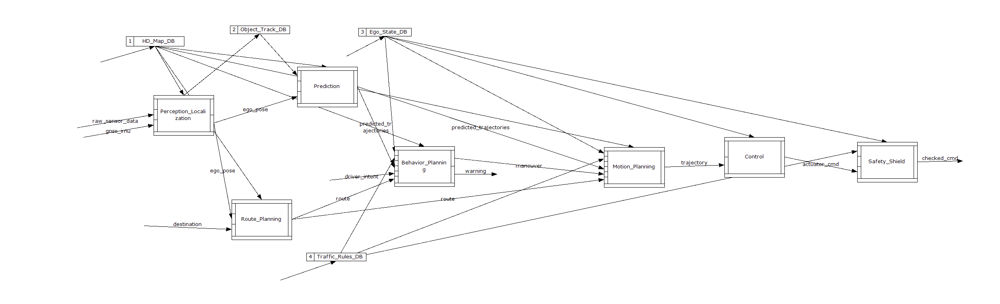

# 自动驾驶系统需求建模：人工 SOFL 与 LLM 生成模型的跨表示法比较

> 中文审核版 · 对应 `paper_draft_v2.md`（英文定稿）。术语首次出现时保留英文缩写（SOFL / CDFD / DFD / UML / MES）；表格数据与引用编号与英文版逐项一致。本版已同步英文 v2 的全部新增内容：2×2 同生成器重跑、D1/D2 整族禁令、Table VII-b/VII-c、Finding 1–4、I4 重算值、已核验参考文献。

---

**摘要**——面向自动驾驶（AD）车载系统的需求必须表达数据流、激活条件与安全攸关契约。SOFL 通过条件数据流图（CDFD）与形式化模块承载这些内容，但手工形式化代价高昂。我们用四种方式对一个整车级 SAE L2 ADAS 建模：手工 SOFL，加上 LLM 生成的数据流图、UML 类图与顺序图，以及状态机；同表示法的 LLM 复刻版用于分离生成者与表示法因素。五项 GQM 指标施加于 44 条原子需求基线。四项结果。(1) 所有模型都覆盖整车级范围。在 Level 1，人工模型覆盖 0.615 的安全需求，而生成的 DFD 与 UML 模型为 1.000；一项受控修订把规范阈值表补入同一个人工模型后，其 Level-1 覆盖度升至 1.000 而其余指标不动，说明该差距度量的是输入版本而非建模质量——代价是 34 次编辑操作、触及 46.7% 的契约子句。(2) 排除空洞守卫后图景改变：按完整五类恒真式族重算，同生成器 SOFL 对 UML 的 Level-1 对比由 1.000/0.600 降至 0.600/0.429，先前的表示法“天花板”大半是假象。(3) 生成器 × 禁令重跑表明，一句话禁令可移除被点名的写法，但其对整体空洞率的影响无法归因于禁令，因为该比率的组内跨度超过组间差异；整族禁令把两个生成器的语法空洞率都推到零，而实质前置条件仍为 0/38 与 3/32，无区分度守卫转而采取生成器特有的形式。(4) 在缺陷注入实验中，与植入缺陷的一致性从 κ = 0.111 到 0.667 不等，取决于评审者模型及其会话上下文。我们认定表示法、提示词约束、评审者模型及其上下文是 AI 辅助需求分析中的影响因素。

**索引词**—需求工程、SOFL、CDFD、大语言模型、自动驾驶、模型比较、形式化规格

---

## 研究对象：系统功能分解

在比较建模表示法之前，先固定四个模型所描述的对象。目标系统是**工作在 SAE L2 级的整车级 ADAS 车载系统**[12]。系统边界即整车：传感器、GNSS/IMU、HMI、执行器与其他道路使用者只作为外部接口出现，不作为内部元素。系统被刻意定义在**功能分配层**——它约束有哪些功能、各自职责、交换哪些数据，但不规定功能内部的任何算法。这一层级正是 CDFD、DFD 与 UML 类图适用的层级。

规格强制规定七个**整车级功能**。**人工构建的 SOFL/CDFD 模型（M1）提供参照功能分解**：它的七个 process 与对 F3 的细化定义了所有模型必须实现的模块结构。该分解被规范地写入统一需求规格，而后者是每个生成代理的唯一输入。因此，M1、M2、M3、M4 与 M5 **在研究设计上**共享同一模块级结构；报告中的差异反映的是各表示法如何表达这一共同结构，而不是对"系统应有哪些功能"产生分歧。生成代理无法访问 CDFD 图本身；共享结构来自规格，而非对图形的照抄。

该功能划分**直接取自 Zhu 等人 [7, Fig. 1] 的模块化流水线**：Sensor → Perception → Prediction → Route Planning → Behaviour Planning → Motion Planning → Control；其中规划阶段按 UniAD [11] 的规划导向分解，进一步拆为行为规划与运动规划。两处主动改造并在此声明：感知与定位合并为一个 process（沿袭早期综述 [9] 的处理），并在 Control 之后追加显式的 Safety Shield 作为横切约束层——[7] 的图中并没有把安全约束画成独立框。Apollo [13] 与 Autoware [14] 仅作为**事后的工业界旁证**，佐证这些模块确实具有边界清晰的接口。本文以 **Level 0** 作为**比较锚点**——即所有模型共有的整车级功能范围——它是 SOFL/CDFD 与 DFD 传统编号的原生术语；UML 模型以主要行为类表达同一范围，状态机则建模 F3 的内部模式。职责边界由统一需求规格固定；模型之间只有个别标签的拼写差异（如 *Localization* 与 *Localisation*）。

**表 I** — 目标系统的 Level-0 功能。

| 编号 | 功能    | 主要职责                                      | 关键输出                     |
| -- | ----- | ----------------------------------------- | ------------------------ |
| F1 | 感知与定位 | 将传感器帧融合为目标跟踪表并计算自车状态；写 D2 与 D3            | `objects`、`ego_pose`     |
| F2 | 预测    | 预测目标 ≥ 3 s 内的运动并推导最小碰撞时间（TTC）；唯一的 TTC 产生者 | `predicted_trajectories` |
| F3 | 行为规划  | 选择目标机动（巡航 / 换道 / 减速 / 紧急制动）并发出驾驶员预警       | `maneuver`、`warning`     |
| F4 | 路径规划  | 计算到达目的地的路径并提供车道几何                         | `route`                  |
| F5 | 运动规划  | 在速度与加速度限制内把机动转换为运动学可行的轨迹                  | `trajectory`             |
| F6 | 控制    | 把轨迹转换为执行器指令                               | `actuator_cmd`           |
| F7 | 安全屏蔽  | 在原始指令到达执行器之前对其进行监控与仲裁                     | `checked_cmd`            |

**规格澄清（F2 与 F3.1）。** 表 I 中"唯一的 TTC 产生者"是 Level-0 的分配陈述：在 Level 0，F2 从自身预测中推导最小 TTC。Level-1 细化**在设计上**对此有不同处理：F3.1 声明的输入是 F2 的**预测轨迹**（而非 F2 的 TTC），因此 F3.1 从这些轨迹**重新计算**逐目标 TTC 集合。两条陈述是一致的——TTC 只在预测—行为规划链内计算，别处不计算；本文在此记录这一读法，而不是悄悄修改已冻结的输入规格，并指出该措辞诱发了不同处理（部分生成模型把最小 TTC 的推导移进了 F3.1）。

主流数据流骨架为：**F1 → F2 → F3 → F5 → F6 → F7 → 执行器**，其中 **F4 向 F3 与 F5 同时提供 `route`**，`warning` 由 F3 直接输出。四个持久存储支撑该流程：**D1** 高精地图、**D2** 目标跟踪、**D3** 自车状态、**D4** 交通规则。规格声明九个外部接口（E1–E9），其中八个跨越整车边界：六个输入（E1 `raw_sensor_data`、E2 `gnss_imu`、E3 `driver_intent`、E4 `destination`、E5 `map_data`、E6 `traffic_rules`）和两个输出（E7 `warning`、E8 `checked_cmd`）。第九个 E9 `actuator_cmd` 由 F6 产生、被 F7 消耗，**完全在边界内部**；规格仍将其声明为接口，以使仲裁需求 R-E-2（*原始指令绝不得直达执行器*）成为可检查的接口契约。因此本文统计八个跨界接口加一个内部契约接口，并把 E9 注册为外部实体的模型视为遵循规格约定，而非建模错误。F7 是刻意设置的设计元素：原始控制指令未经仲裁不得到达执行器——这是对 [7] 流水线的显式扩展，落实了 [4]、[11] 讨论并在工业界由 Apollo 的 Guardian [13] 实现的安全约束层。

**Level 1** 只细化**一个** Level-0 功能：F3 的紧急制动分支。它被分解为 F3.1 TTC 计算 → F3.2 风险分级 → F3.3 机动规划，以 3.0 s 与 1.5 s 的 TTC 阈值为分类依据。其余 Level-0 功能保持原子状态；首先细化行为规划阶段，是因为它承载安全关键的 AEB 决策逻辑 [3]、[11]。这种不对称性对解读结果很重要：M1、M2、M3、M4 在两个层级上可比，而 M5（状态机）建模的是 F3 的*内部模式*，而非与 F3 同级的分解。

> 本节的 Level-0 功能分解与接口清单，对应正文图 1 与表 I。

---

## I. 引言

自动驾驶（AD）系统是需求工程中要求最高的应用领域之一，ISO 26262 [19] 与 ISO 21448 [20] 等功能安全标准对需求陈述的精确性提出了更高要求。整车级高级驾驶辅助系统（ADAS）集成了感知、定位、预测、行为规划、运动规划、控制与安全仲裁。这类系统的需求不仅要表达*数据如何在功能间流动*，还要表达*在什么条件下某个功能被激活*、*它满足什么契约*，以及*顶层功能如何细化为子功能*。非形式化的图与文字难以同时应对这三点。

SOFL（结构化面向对象形式化语言）方法 [1] 应对了这一缺口：SOFL 规格把条件/数据流图（CDFD，区分主动数据流与数据存储访问）与规格模块结合，后者的 process 携带形式化 `pre`/`post` 契约。因此，借助工具支持的 CDFD 与模块构建是汽车需求建模的自然候选。然而，手工构建此类规格成本高昂，自然要问：LLM 能否从同一需求出发生成有用的*补充性*模型——结构化的与面向对象的？

本文分四步研究这一问题：用 SOFL（CDFD 与模块）人工建模 AD 车载系统；让 LLM 构建同一系统的其它结构化与面向对象模型；用 AI 工具反馈评估和比较所有模型；分析影响 AI 辅助需求分析质量的因素。

因为不同表示法的表达能力不同，比较刻意**跨表示法**进行：一个人工 SOFL 模型对三个 LLM 生成的不同表示法模型，全部针对同一份一页自然语言需求规格构建。人工模型在构造上是个例外：它早于该规格，而规格的功能分解正是取自它（第 IV-B 节）。这一设计把生成者（人 vs LLM）与表示法混杂在一起，因此补充一个同表示法对照——LLM 复刻的 SOFL 模型（M2，第 IV-C 节）——把两者分离。

贡献如下：

1. 面向整车级 ADAS 的统一自然语言需求规格，其规范阈值可追溯到 Euro NCAP 协议 [2]、[3] 与 RSS 模型 [4]，并把建模假设与规范值明确分离。
2. 跨三种表示法的四个需求模型，外加一个同表示法 LLM 对照，全部针对同一份规格构建（人工模型是该规格功能分解的来源），以及使跨表示法计分可复现的机器可读交换格式（MES）。
3. 以脚本实现、所有指标均有定义、中间数据全部公开的五指标计分流程。
4. 关于 LLM 生成模型的两项因素观察：带三个禁令层级（无禁令、单一写法禁令、整族禁令）、在两个生成器上进行的生成器 × 禁令重跑，表明一句话子句可移除它点名的写法，而生成器内部的空洞率跨度超过条件间差异；整族子句把语法空洞推到零却不增加实质前置条件——无区分度守卫转为生成器特有的形态（自声明有效性旗标或域公理）；以及一个把表示法因素与生成者因素分离的同表示法对照。
5. 一项缺陷注入研究，含三个评审会话，表明评审者模型及其会话上下文决定 AI 反馈的质量。

---

## II. 背景与相关工作

### A. SOFL、CDFD 与规格模块

一份 SOFL 形式化规格 [1] 由非形式化、半形式化与形式化描述组成。形式化部分包括**规格模块（s-module）**&#x4E0E; **CDFD**。模块声明常量、类型、状态变量（数据存储）、不变式与 process。每个 process 由其在 CDFD 中的连接导出端口签名，并带有如下形式的契约：

```
ext rd / ext wr   <stores>
pre               <predicate>
post              if <guard> then <predicate>
```

CDFD 包含 process、数据存储与两类连接：*主动数据流*（携带数据并激活消费者）与*数据存储访问流*（表示读与写）。CDFD 的语义（含非确定性与激活）已由 Dong 与 Liu [5] 形式化。

这是与普通数据流图（DFD）的关键区别。DFD [6] 表达数据从源经 process 流到汇、并可存于存储；process 的含义写在单独的 process 字典中，通常用自然语言。CDFD 则额外为每个 process 附上形式化契约，并区分携带激活的流与仅传递数据的存储访问。在本研究中这一区别成为实验变量：DFD 与 CDFD 在画布上看起来相似，却相差一整个形式化层。

### B. 面向需求工程的 LLM

需求规格的自动分析早于 LLM 时代：Wilson 等人 [25] 构造了工具辅助的分析器，对自然语言需求规格做度量并暴露由需求描述不佳引入的项目风险。这类工作面向的是需求*文档*；本文所评分的是由这些文档构建出的*模型*。

LLM 已被应用于需求获取、规格生成与质量保证。Lubos 等人 [32] 依照 ISO/IEC/IEEE 29148 [21] 的精神研究基于 LLM、按质量标准对需求的质量保证。在模型生成方面，Cámara 等人 [28] 报告了 ChatGPT 与 UML 的经验——生成的模型往往看似合理但需要仔细的语义审查；Garaccione 等人 [33] 比较了若干 LLM 的 UML 类图生成。与我们的契约更接近的是，Endres 等人 [36] 研究了把自然语言意图翻译成形式化方法后置条件，发现生成的断言可能正确却在区分错误实现上很弱——表 VII-d 也遇到同样的区分。更一般地，*空洞性*（vacuity）在形式化验证中已是成熟问题：Kupferman 与 Vardi [37] 把某个子公式不影响真值的规格定义为空洞满足，并给出检测与见证生成方法。本文的语法守卫只是这一问题的浅层、契约级实例（而非时序逻辑实例），但共同的教训是：检查通过并不等于内容有意义。当 LLM 被用作评审者时，它们需要明确的评分准则与人工佐证 [29]，并倾向于偏爱自己生成的内容 [30]。据我们所知，把 SOFL 这类形式化表示法纳入、同时考察模型选择与会话上下文等评审侧因素的跨表示法比较研究较少。本文贡献了一个输入规格与计分流程均固定的场景，使差异可归因于表示法、具体提示词条款与评审者。

### C. 自动驾驶架构

架构并非需求建模的细枝末节：它决定了结构化模型所挂载契约的那些接口是否真实存在。此处相关的有三类研究架构。

* **模块化流水线。** 驾驶被分解为传感、定位、感知、预测、规划、控制与车辆接口，各阶段之间有显式数据接口；Apollo [13] 与 Autoware 的七层 Architecture 1.0 [14] 是公开的参考实现，Badue 等人 [9] 把这一族作为较早的基线综述。这正是 CDFD、DFD 与 UML 类图天然适配的架构：每个功能都有名字、产生者与消费者。
* **端到端模型。** UniAD [11] 用面向规划的统一模型取代各任务之间的交接；VAD [34] 直接在全向量化场景表示上规划，去掉栅格化中间表示与人工设计的后处理。"感知"与"规划"之间的接口变成学习到的表示，而非具名数据流。
* **视觉-语言-动作（VLA）与双系统模型。** Jiang 等人 [35] 综述自动驾驶 VLA；Hu 等人 [8] 区分端到端 VLA 与双系统 VLA（慢速 VLM 负责推理、快速规划器负责安全关键执行），并把形式化验证列为开放挑战。Zhu 等人 [7] 把上述三族与模块化流水线做了对照。

产业界推进得更快：到 2025–2026 年，若干量产技术栈已宣布端到端或基于 VLA 的架构。本文**不**把厂商公告当作证据——它们由厂商自述、版本间变化频繁，且不公开可供需求模型挂载的接口契约；此处提及只是为了说明：模块化假设是一项范围界定决定，而不是对当前车辆的断言。

**本文采用的架构。** 我们把目标系统限定为 Zhu 等人 [7] 的**模块化整车级 L2 ADAS**，并以 Apollo [13] 与 Autoware [14] 的开放技术栈作为旁证，细节见 §III。在这一流水线上我们追加显式的 **Safety Shield** 作为横切约束层——这是对 [7] 的刻意扩展，落实了 RSS 形式化安全模型 [4] 所讨论、并由 Apollo 的 Guardian [13] 在工业界实例化的安全约束层。采用这一范围的理由在于方法层面：这些表示法把需求挂载到*具名功能之间的具名数据流*上，因此选择一种具有稳定接口的架构，才使跨表示法比较成为可能；端到端与 VLA 系统会恰好移除这些被评分的产物（§VI-D）。

---

## III. 目标系统与统一规格

在比较表示法之前，先固定所有模型所描述的系统：一个**工作在 SAE 2 级的整车级 ADAS 车载系统**[12]。其边界即整车：传感器、GNSS/IMU、HMI、执行器与其他道路使用者只作为外部接口出现。系统定义在**功能分配层**：它约束有哪些功能、各自职责、交换哪些数据，但不规定功能内部的算法。这正是 CDFD、DFD 与 UML 类图适用的层级。

规格强制规定七个整车级功能（表 I）。人工构建的 SOFL/CDFD 模型（M1）提供**参照功能分解**：其七个 process 与对 F3 的细化定义了所有模型必须实现的模块结构。该分解被规范地写入统一规格，而后者是每个生成代理的唯一输入。因此，所有模型**在研究设计上**共享同一模块级结构，报告中的差异反映的是各表示法如何表达这一共同结构，而非对系统应有哪些功能产生分歧。代理无法访问 CDFD 产物。

该功能划分沿袭 Zhu 等人 [7, Fig. 1] 的模块化流水线——Sensor → Perception → Prediction → Route Planning → Behaviour Planning → Motion Planning → Control——其中规划阶段按 UniAD [11] 拆为行为规划与运动规划。两处主动改造：感知与定位合并为一个 process（沿袭 [9]），并在 Control 之后追加显式 Safety Shield 作为横切约束层（[7] 未画成独立框）。Apollo [13] 与 Autoware [14] 仅作为事后旁证，佐证这些模块具有边界清晰的接口。本文以 **Level 0** 为比较锚点，即所有模型共有的整车级功能范围；它是 SOFL/CDFD 与 DFD 编号的原生术语，UML 模型以主要行为类表达同一范围，状态机则建模 F3 的内部模式。职责边界由规格固定，只有个别标签的拼写不同（如 *Localization* 与 *Localisation*）。

**表 I** — 目标系统的 Level-0 功能（见"研究对象"节）。

**规格澄清（F2 与 F3.1）。** 见"研究对象"节的同名说明：F2 是 Level-0 唯一的 TTC 产生者，而 F3.1 从 F2 的预测轨迹而非 TTC 重新计算逐目标 TTC 集合；两条陈述一致，本文记录该读法而不改动已冻结的规格。



> **图 1.** 整车级 ADAS 的 Level-0 功能分解（本文实例化）。主数据流骨架为 F1 → F2 → F3 → F5 → F6 → F7；F4 向 F3 与 F5 提供 `route`。四个存储与外部接口支撑该流程。八个接口跨越整车边界（6 入 + 2 出），E9 `actuator_cmd` 为 F6 → F7 的内部契约接口，不跨界（R-E-2 仲裁契约）。本图是*本文规格*的示意；M1 的对应工具截图见图 5。

---

## IV. 研究方法

### A. 研究问题

- **RQ1.** 对整车级 ADAS，四个模型——人工 SOFL、LLM 生成的 DFD、LLM 生成的 UML 类图与顺序图、LLM 生成的 UML 状态机——在五个质量指标下的相对优势是什么？
- **RQ2.** 表示法如何独立于模型由谁产出来约束质量？
- **RQ3.** 哪些提示词层面的因素可测量地影响 LLM 生成需求模型的质量？（输入粒度保持固定，因此未检验。）
- **RQ4.** 评审者模型及其会话上下文如何影响对这些模型的 AI 反馈质量？

### B. 统一输入规格

可比性要求生成模型使用单一输入。我们撰写了一页自然语言规格 `NL-RQ-ADAS-v1`，作为所有 LLM 生成（M2–M5）的唯一提示词上下文。人工模型在构造上是一个例外：其 CDFD 绘于 2026 年 11 月 14–15 日，早于 11 月 17 日编制的规格，而规格的功能分解正是**取自** M1，阈值表则是之后才加入的。因此 M1 并未把这份文档当作输入；共享的功能清单是设计使然，而非共享提示词（第 IV-C 节）。该规格包含：

- 七个强制整车级功能（F1–F7）及职责边界，取自 CDFD 基线；
- 四个持久数据存储（D1–D4）及其 owner；
- 九个外部接口（E1–E9）；
- 对 F3 的 Level-1 细化，把 AEB 分支拆为三个子功能（F3.1–F3.3）；
- 七条带可引用来源的规范阈值 **N-1…N-7**，以及七条明确标注的建模假设 **A-1…A-7**。

规范值包括 AEB 工作至 130 km/h [3]、TTC > 1.5 s 的前向碰撞预警且 cut-out 场景以 TTC = 2.0 s 设置 [2]、以及超过 30 km/h 的碰撞速度降低加分 [2]。RSS 纵向安全距离 [4] 作为带集成方自定义参数集的功能需求采纳；参考实现确认 RSS 参数可由用户配置 [10]。假设包括 6.0 m/s² 的紧急减速，其取值由 30 km/h 降低标准在最坏 CCRm 闭合速度 30.6 m/s 下推算。

每条需求子句带一个 ID，这些 ID 是可追溯性矩阵的锚点。

原子需求基线把类阈值原子标为 TH-1…TH-7。映射固定：TH-1…TH-6 分别与 N-1…N-6 一一对应，TH-7 汇集假设导出值（A-1 紧急减速、A-5 风险阈值、A-7 预测时域）。两套标识符是同一批子句的不同视图，不是互相冲突的需求集。

### C. 模型集

**表 II** — 本研究比较的模型。

| 编号 | 模型           | 表示法                       | 生成者                        | 层级         |
| -- | ------------ | ------------------------- | -------------------------- | ---------- |
| M1 | 人工 SOFL 基线   | CDFD + 模块                 | 人，使用 SOFL 工具               | L0 + L1    |
| M3 | 结构化模型        | DFD（Yourdon/DeMarco）      | Tencent Hunyuan 4 Flash，单次 | L0 + L1    |
| M4 | 面向对象模型       | UML 类图 + 顺序图              | MiniMax-M3.1-Flash，单次      | L0 + L1    |
| M5 | 行为面向对象模型     | UML 状态机                   | Tencent Hunyuan 4 Flash，单次 | L1（AEB 行为） |
| M2 | *同表示法对照*（补充） | SOFL CDFD + 模块（与 M1 同一方言） | MiniMax-M3.1-Flash，单次      | L0 + L1    |

**来源。** 所有生成与评审访问均通过对话式聊天框架进行，使用提供方默认解码参数；温度在框架内不可控也未变化，因此解码方差属于单次设定的一部分（第 VII 节）。产物日期：M1 的 Level-0 CDFD 绘于 2026 年 11 月 14–15 日，模块于 11 月 17 日前完成；统一规格（含阈值表 N-1…N-7）编制于 11 月 17 日；M2 与 M4 于 11 月 17 日从该规格生成；M3 与 M5 在提示词修订后于 11 月 22–23 日生成；评审者 A 运行于 11 月 22–23 日，评审者 B 与 C 为 11 月 23 日。由于 M1 的 CDFD 早于规格，M1 从未收到阈值表作为输入——第 V-A 节与 Finding 2 会回到这一点。

M2 是**为分离两个因素而引入的补充对照**：它是从同一规格盲生成的 LLM 复刻 SOFL 模型；由于它与 M1 共享表示法、与 M4 共享生成者，它把"人 vs LLM"因素与表示法因素分离（第 VI-B 节）。

每个生成代理运行在**隔离上下文**中，只收到统一规格与一份表示法指南；没有代理看过 M1，从而避免锚定在人工模型上。模型来源（生成者、生成日期、遍数、提示词摘要）记录在每个交换文件中。必须披露一处模型—生成器分配带来的后果：M3 与 M5 的生成者（Tencent Hunyuan 4 Flash）与下文评审者 A 是*同一个模型*，因此缓解自偏好偏差 [30] 的评审者—生成者分离只对 M2、M4 以及后来的评审者 B、C（DeepSeek-v4-pro，与所有生成者不同族）完全成立。评审者 A 对 M3、M5 的检出原则上可能因自我识别而偏高；干净会话对比（第 V-B 节）未发现有计数层面的偏高，但此处为完整性说明该风险。

人工模型 M1 由三部分检查器验证：(i) CDFD 结构与端口槽位一致性，(ii) 模块语法，(iii) 两者之间的关联一致性——process 集合、端口签名与槽位导出流、`ext rd`/`ext wr` 与存储连接、`pre`/`post` 中无悬空引用。全部检查通过。本研究另建了人工模型的第二个版本 M1.1：把规范阈值表以同一记法补入 M1，保持相同架构与相同端口槽位；它已在 SOFL 工具中加载并确认可正常渲染，并通过同一套三部分检查器，因而是与 M1 同一地位的**工具产物**，而非文件级修订；第 V-A2 节报告其评分与该次修订的代价。

**生成模型长什么样。** 图 2–图 4 给出*生成器实际产出的*工件，用各自表示法的标准工具渲染，而非手绘重画：M3 的 DOT 源用 Graphviz，M4 与 M5 的 UML 源用 PlantUML。三者细化的都是同一个 Level-1 对象——紧急制动分支 F3，分解为 TTC 计算、风险分级与机动规划——因此三个面板可直接对照。把它们并排，使本文的核心观察变得可见而非断言：**三种表示法的差别不在覆盖了什么，而在把约束放在哪里。** DFD（图 2）覆盖同样的三个步骤，但其语义存放在外部的过程字典里，因为 DFD 没有契约构造。类图（图 3）把同样的约束留在模型内部，作为 OCL 操作守卫，原则上检查器能够触及。状态机（图 4）同样把约束留在模型内，但作为迁移标签——存在，却在结构上是三者中最难导航的，因此评审者漏报迁移的情况更不可靠（§V-B）。

> **图 2.** M3，AI 生成的 Level-1 DFD，由生成器自己的 DOT 源渲染。虚线框是父过程 F3，三个编号方框是它的细化。每个过程的语义位于随附的过程字典中，而不在图里——契约的结构对应物是缺席的，这正是表 IV 中 M3 的 I4 加星号所记录的性质。



> **图 3.** M4，AI 生成的 Level-1 UML 类图，由生成器自己的 PlantUML 源渲染。同样的三个步骤以 F3.1、F3.2、F3.3 出现，同样的约束以类上的 OCL 操作守卫出现——`min_ttc > 3.0`、`decel_req >= 6.0`、关键制动期间排除驾驶员加速。生成器自己的注释块（复现于左上角）记录了它被告知的元素数量规则，以及它未做自检。



> **图 4.** M5，同一 AEB 分支的 AI 生成 UML 状态机，由生成器自己的 PlantUML 源渲染。同样的三步逻辑以状态序列而非三个函数出现，每一条约束都位于 `[守卫] / 效果` 形式的迁移标签里。完全没有契约构造，而且由于约束附着在*迁移*而非具名函数上，评审者必须读完整个图才能判断某个守卫是否存在——这正是 §V-B 报告的迁移删除检出缺口的机制。为保证可读性，此处省略了迁移的*效果*部分而保留全部守卫；未经删减的渲染随复现材料一并提供。



> **图 5.** M1，用 SOFL 工具构建的人工 Level-0 CDFD。七个过程、四个数据存储与边界接口，由作者用该工具的原生记法绘制，是工具画布的直接截图而非重画。



> *M1 的 Level-1 AEB 分支 CDFD（`BehaviorPlanning.cdfd`，分解为 TTC 计算、风险分级与机动规划）的工具截图随复现材料提供（`fig_M1_cdfd_L1_tool.png`）；它与图 2–图 4 细化的是同一个对象，可直接对照。三个生成模型的 Level-0 视图同样随复现材料提供而不在此复现，因为 Level 0 由规格为所有模型固定（§III），不携带可区分信息；图 2–图 4 的 Level-1 视图才是比较所倚重的。*

### D. 模型交换格式（MES）

为比较不同表示法表达的模型，我们定义了一份机器可读 schema，含元素、存储、外部实体、流、可追溯性、开放问题与来源。M1 由已验证的工具产物经脚本转换；M2–M5 直接输出 MES。九个 MES 文件都解析为严格 JSON。该 schema 是下文所有指标的基础。

### E. 质量指标

跨表示法模型质量没有公认标准。因此我们**提出**一个基于原子需求的框架，以 GQM [15] 与 SEQUAL 质量框架 [22] 为依据，含五个指标（均在 0..1，越高越好）。需求质量属性遵循 ISO/IEC/IEEE 29148 [21]，歧义分量基于需求异味 [24]。这是本文提出的方法，而非执行某个既有标准。

共同基线是从统一规格拆出的 44 条原子需求清单（Level 0 为 31 条，Level 1 为 13 条）。它由一人与一个 LLM 独立产出。覆盖度逐条人工标注（1.0 完全、0.5 部分、0 缺失），因为自动文本匹配被发现有偏于 MES 交换文件详略程度不同的问题。该三档量表按要素分解操作化：把一条需求拆成它所断言的构成要素（一个数值界、一个适用条件、一组参数），核对模型产物写出了其中几个 —— 要素全部写出记 1.0，触及需求但至少一个要素未写出记 0.5，一个要素都未写出记 0。已写出的要素既可以是契约条款，也可以是把它与该需求挂钩的追溯说明。两份独立产出原子清单之间的重合度计算如下：两段文本都切分为小写英文/数字词与汉字二元组；两个原子的相似度为其词集的 Jaccard 重叠，另加同类别 +0.10、同源子句 +0.15 的加分；以 0.30 接受阈值的贪心最佳匹配在人工 44 原子清单与 LLM 46 原子清单间得到 37 对匹配。我们将其报告为**匹配对比率** 37/46 = 0.804——不是 Jaccard 指数，也不是评审者间一致性系数。作为参照，严格的集合 Jaccard 为 37/(44 + 46 − 37) = 0.698，人工原子中被匹配到的比例为 37/44 = 0.841；三者回答的问题不同，不可混用。最终 44 原子基线采用人工清单；九个仅 LLM 产生的原子保留在合并报告中但不计入计分，以免把 LLM 特有的拆分强加给所有模型。


**表 III** — 质量指标及其操作定义。

| 编号 | 指标     | 操作定义                                                                                                                                                                                                         |
| -- | ------ | ------------------------------------------------------------------------------------------------------------------------------------------------------------------------------------------------------------ |
| I1 | 需求覆盖度  | Σ(每条需求得分)/N；完全 = 1.0，部分 = 0.5，缺失 = 0；对照原子清单人工标注；安全关键子集单独报告 [19]–[21]                                                                                                                                         |
| I2 | 精确度    | 在规格中有据的元素 / 模型元素总数。*有据*按结构判断，不采用模型自身的追溯字段：若元素 (i) 带占位 id（X*nn*）而无 "extracted" 说明，或 (ii) 其名字命中幻觉模式列表（fault、degradation、deactivation、override、空状态名）且无对应开放问题声明，则算作无据。该名字级规则无法检测细微内容幻觉，这也是 I2 区分度弱的原因之一（第 V-A 节） |
| I3 | 一致性    | 0.5 × 可解析流端点 + 0.3 × 有声明输入的元素 + 0.2 × (1 − 孤儿产生者比率)，另加工具语法检查 [22]                                                                                                                                            |
| I4 | 形式化精确度 | 0.4 × 有*有效* `pre` + 0.3 × 有量化约束 + 0.3 × (1 − 歧义词比率) [23]、[24]。前置条件仅在移除空洞守卫族后至少保留一条子句时才算*有效*——即仅由类型即可判定的五类形式（`x <> null`、`x = x`、`nat ≥ 0`、`x <> ''`、`if true then`）——并使用与表 VII-c 分层分解相同的分类器；空洞守卫出现次数单独报告（表 VII）                                                                        |
| I5 | 缺陷检出率  | 植入缺陷，让隔离的评审者找出；见第 IV-F 节 [17]、[18]、[26]                                                                                                                                                                      |

I3 与 I4 的权重先验固定（形式化权重最高，其次是量化内容，再次是歧义）。对八组权重向量（和为 1）的敏感性检查（`formal_criterion_checker.py`）显示，论文所依赖的每一个排序都不变：同生成器 SOFL 对 UML 在 Level 1（M2 0.600 > M4 0.429，且八组权重下均如此）、人工对 DFD 在 Level 0（M1 0.914 > M3 0.871，且八组均如此）、人工对 UML 在 Level 1（M1 0.800 > M4 0.429，且八组均如此）。但该指标对它所采用的*判据*仍然敏感，而判据是与权重分离的另一个自由参数：在分层分解的严格读法下——前置条件只有包含一条把输入与阈值或另一个量比较的子句才算有效——人工基线降到 Level 0 的 0.514 与 Level 1 的 0.533，前者低于 DFD 模型（0.700）。关键在于，即便在这一读法下人工模型在 Level 1 仍高于 UML 模型（0.533 对 0.486），因此严格判据并不会抹掉人工对 UML 的对比。因此本文把 I4 报告为"在给定判据下的前置条件卫生度"，并把分层分解与之并列报告而非以其取代。I1–I4 描述模型，I5 衡量施加于模型的*评审者*。由于各表示法不可通约（第 VII 节），指标逐维度报告，不计算综合分。计分器统计的数字阈值**只从约束字段**提取，以免把"5.1"这类章节号误当作需求。所有脚本与原始数据均已公开；重跑 `score_models_v2.py` 可复现本文所有数字。

### F. 缺陷注入协议

为获得真实的 AI 评审反馈，我们向每个模型注入六个缺陷（共 24 个）：需求遗漏、与规范阈值矛盾（DEF-2）、错误的比较算子、缺失数据流（DEF-4）、措辞歧义（DEF-5）、可追溯性信息删除（DEF-6）。隔离的 LLM 评审者对植入缺陷不知情，用固定评分准则在单个会话内对每个模型检查三轮。设计遵循基于变异的故障注入 [17]、[18] 与重复检查实验 [26]、[27]；使用与生成者不同的评审者缓解了 [30] 报告的自偏好偏差。

使用三个评审会话。**评审者 A** 为 Tencent Hunyuan 4 Flash。**评审者 B** 为 DeepSeek-v4-pro，其会话已读过评审者 A 的结果（*污染*会话）；B 还额外产出了第四轮*锚定*结果，其中显式展示了 A 的发现。**评审者 C** 为 DeepSeek-v4-pro，处于*干净*会话，从未见过任何评审输出，结构与 A、B 相同（同一会话内连续三轮）。因此 B 与 C 只在评审者拥有的先前评审上下文量上不同，从而形成上下文污染阶梯：无（C）、会话内有 A 的结果（B）、显式展示 A 的发现（B-anchored）。

检出按缺陷清单计分。植入集之外的报告计入基于注入的误报率，再人工审计其是否指向真实的原生缺陷。与真值的一致性用 Cohen's κ [16] 按轮汇总衡量，并按 Landis 与 Koch [31] 解读。误报率定义为每次评审中"不对应任何植入缺陷的发现数 / 该次评审的*全部*发现数"——而非除以缺陷槽位数；汇总值把集外报告求和除以发现求和（A：19/73；B：4/61；C：31/122；B-anchored：3/23）。混淆矩阵建立在 72 个正观察上（4 模型 × 6 缺陷 × 3 轮）：某轮报告了植入缺陷为 TP，漏掉为 FN。由于每个缺陷槽位都在每个模型中植入，设计不含自然负例；因此负侧通过镜像 72 个正槽位构造——一条集外报告填入一个负槽位（FP），其余槽位计为 TN（TN = 72 − FP）。κ 由该对称矩阵计算，对这一构造敏感；必须与原始检出率和 FP 数一起解读。

---

## V. 结果

### A. Level 0 与 Level 1 质量（表 IV）

**表 IV** — 各模型与各层级的指标 I1–I4（I1 来自 `coverage_manual.json` 的人工标注；I2–I4 来自 `score_models_v2.py` / `scores_v2.json`）。I4 排除了空洞守卫；排除前的值保留在括号内，以便看出排除本身的影响。排除项是完整的五类恒真式族，由与表 VII-c 相同的分类器施加（`formal_criterion_checker.py`）；对 M1–M5，两型排除与五族排除给出相同的 I4 值，故括号列记录的是排除的规模而非另一种度量。M1.1 是补入规范阈值表后的人工模型（第 V-A2 节）：它是针对输入版本混淆的对照项，而非第七个竞争模型。

| 指标 | M1 SOFL (L0) | M1.1 (L0) | M2 SOFL-LLM (L0) | M3 DFD (L0) | M4 UML (L0) | M1 (L1) | M1.1 (L1) | M2 (L1) | M3 (L1) | M4 (L1) | M5 (L1) |
|---|---:|---:|---:|---:|---:|---:|---:|---:|---:|---:|---:|
| I1 需求覆盖度 | 1.000 | 1.000 | 1.000 | 1.000 | 1.000 | 0.615 | 1.000 | 0.808 | 1.000 | 1.000 | 0.615 |
| I2 精确率 | 1.000 | 1.000 | 1.000 | 1.000 | 1.000 | 1.000 | 1.000 | 1.000 | 1.000 | 1.000 | 1.000 |
| I3 一致性 | 0.749 | 0.749 | 0.601 | 0.624 | 0.596 | 0.737 | 0.737 | 0.458 | 0.458 | 0.571 | 0.748 |
| I4 形式化精确度 | 0.914 (0.914) | 0.914 (0.914) | 0.557 (0.957) | 0.871\* (0.871) | 0.614 (0.957) | 0.800 (0.800) | 0.800 (0.800) | 0.600 (1.000) | 1.000\* (1.000) | 0.429 (0.600) | 0.771 (0.771) |


\* DFD 没有原生契约构造：M3 的前置条件是生成者写进 process 字典的输入有效性约束，MES 转换把它们记录到计分器读取的同一字段。因此 M3 的 I4 衡量的是*被记录的约束内容*，而非表示法原生的形式化，须连同星号一起解读。

由此得到四点观察。

第一，**所有模型都完整覆盖整车级需求**（Level 0 的 I1 = 1.000）：七个功能、四个存储与九个接口由规格强制规定，没有模型能遗漏它们而不显得明显不完整。因此 Level-0 覆盖度不区分模型。第二，**差异出现在 Level 1**：人工 SOFL 模型只覆盖 0.615 的 AEB/阈值需求，漏掉五条阈值子句（TH-1/3/4/5/6，即 N-1/3/4/5/6），而 LLM 生成的 DFD 与 UML 模型全部覆盖。这一比较必须与来源日期（第 IV-C 节）一起解读：M1 的 CDFD 绘制于阈值表编制之前，因此其缺口是需求版本差异而非建模缺陷。第 V-A2 节用受控实验直接检验这一点——把阈值表补入同一个人工模型后，Level-1 覆盖度升至 1.000 而其余指标不动；即当初把人工基线与生成模型区分开的那一列度量的是规格的编制日期，而非建模质量。第三，**精确率（I2）对每个模型都是 1.000**，因而不起区分作用，尽管评审者发现了真实的原生缺陷，如重复元素 id 与空的 provenance 字段（第 V-B 节）。表 III 的结构定义是可操作的，但它是名称级规则，无法检测细微的内容幻觉；因此 I2 只作为**健全性检查**报告，而非起区分作用的证据。第四，**形式化精确度（I4）按排除空洞守卫重算后图景显著改变**：在 Level 0，人工 SOFL 模型最高（0.914），DFD 次之（0.871，带非原生契约星号），LLM SOFL 复刻版（0.557）与 UML 模型（0.614）都远低于排除前的值；在 Level 1，DFD 最高（1.000，带星号），其后是人工 SOFL 模型（0.800）、状态机（0.771），以及两个提示词允许 null 守卫写法的模型（M2 0.600、M4 0.429）。排除前的读法——Level 0 上因 OCL 而以 UML 最高、Level 1 上 SOFL 复刻版 1.000——是把空洞守卫计为前置条件所造成的假象。

### A2. 输入版本混淆的对照实验（M1.1）

人工模型与生成模型在 Level-1 覆盖度上的差距有两种候选解释：人工模型在规格层面本就不完整，或它构建于阈值表存在之前。第二种可以检验，本节即做此检验。

**M1.1** 是把规范阈值表补入人工模型后的版本。除此之外一切不变：Level-0 架构、process 集合、CDFD 连接与端口槽位与 M1 逐字节相同，同一套三部分检查器对两个模块均通过（`validate_sofl_model.py`：CDFD 结构、模块语法、CDFD 与模块的关联一致性）。它也已在 SOFL 工具中加载并确认可正常渲染，因而是与 M1 同一地位的工具产物而非文件级修订。该编辑补入 §7 与 §8 所要求、而 M1 契约所缺的约束，用的正是该记法自身的手段——前置条件与带守卫的后置条件——并在两个复合类型上新增三个字段，供那些阈值得以约束的量有处安放。具体地：`PlanManeuver` 新增前置条件 `ego_state.speed<=130.0`（N-1）；`Prediction` 产出 `lead_gap` 与 `lead_speed`；`Motion_Planning` 产出 `min_gap`、`decel_limit` 与 `lateral_accel`，并约束 `min_gap<=predicted_trajectories.lead_gap`（N-5）与 `decel_limit>=4.0`（N-6）；`Control` 与 `Safety_Shield` 落实制动轮廓 `brake_cmd>=decel_limit` 与 `accel_cmd<=2.0`（N-6）及横向包络（N-7）。N-3 与 N-4 不写作约束值：在 §7 中

**表 IV-A** — 人工模型在补入阈值表之前与之后的对比。I1 取自 `coverage_manual.json` 的人工标注；I2–I4 来自 `score_models_v2.py`；修订代价来自 `measure_revision_cost.py` / `revision_cost_m1_to_m1_1.json`。

| | M1 (L0) | M1.1 (L0) | M1 (L1) | M1.1 (L1) |
|---|---:|---:|---:|---:|
| I1 需求覆盖度 | 1.000 | 1.000 | 0.615 | **1.000** |
| I2 精确率 | 1.000 | 1.000 | 1.000 | 1.000 |
| I3 一致性 | 0.749 | 0.749 | 0.737 | 0.737 |
| I4 形式化精确度 | 0.914 | 0.914 | 0.800 | 0.800 |
| I4（严格内容判据） | 0.514 | 0.514 | 0.533 | 0.533 |

**表 IV-B** — 修订代价，M1 → M1.1。

| 度量 | 数值 |
|---|---|
| 契约子句数（前 → 后，L0 / L1） | 21 → 30 / 15 → 15 |
| 契约子句新增 / 删除 / 修改 | 9 / 0 / 9（L0）；1 / 1 / 1（L1） |
| 复合类型新增字段 | 5（`TrajectorySet.min_gap`、`.decel_limit`、`.lateral_accel`；`PredictedTrajectory.lead_gap`、`.lead_speed`） |
| 新增追溯行 | 8（N-1、N-3、N-4、N-5、N-7、A-2、A-6、A-7） |
| **契约级修订率** | **21 处编辑 / 45 条子句 = 46.7%** |
| 编辑操作总数 | 34（契约 21 + 类型字段 5 + 追溯 8） |
| Level 1 的 I1 变化 | 0.615 → 1.000 |

由此得到三点结果。第一，**Level-1 的覆盖度缺口是输入版本效应，而非建模能力差异。** 有了阈值表，同一个人工模型、同一记法、同一架构，Level-1 的 I1 达到 1.000，与生成的 DFD 与 UML 模型完全持平。原始比较中把人工基线与生成模型区分开的那一列，度量的是规格的编制日期，不是建模质量。第二，**其余指标不受该修订影响**：I2、I3、I4 在两个层级上完全相同，统一五族口径与严格内容口径皆然（0.514 / 0.533）。新增子句都是实质的阈值比较，因此它们提高了覆盖度，却没有在任一方向上移动前置条件卫生度。第三，**这次修订并不便宜**：需要 34 次离散编辑操作、触及 46.7% 的契约子句，并在两个复合类型上新增五个字段。三条阈值无需任何契约（N-2 由既有子句覆盖，N-3 与 N-4 由 A-1 覆盖）；其余五条各自需要一条新的前置条件合取项、一条新的带守卫后置条件，或——就 N-5 与 N-6 而言——在既有类型上新增数据字段，使约束有可约束之物。这正是原版 M1 从未支付的代价，因为它从未拿到那份表。

M1.1 不是第七个模型，也不参与比较；它是对一个混淆因素的对照项，并且与其余模型一样接受同一套指标、同一分类器与同一检查器的评分。其产物在 `models/M1_1_manual_plus_thresholds/`。

**表 IV-C** — 三种打标口径下的 Level-1 I1，用于检验 Level-1 覆盖度结论是否依赖某一项有争议的判断（`coverage_criterion_sensitivity.py`）。口径 A 为全文采用：规格中由另一阈值推导出的阈值，若模型写出了该推导值即算覆盖。口径 B 只在模型产物中点名该阈值时才算；口径 C 要求独立契约。三种口径下所有模型同向移动，排序不变。

| 模型 | A（本文采用） | B（需点名） | C（需独立契约） |
|---|---:|---:|---:|
| M1 | 0.615 | 0.615 | 0.615 |
| M1.1 | 1.000 | 1.000 | 0.846 |
| M2 | 0.808 | 0.808 | 0.769 |
| M3 | 1.000 | 1.000 | 0.846 |
| M4 | 1.000 | 1.000 | 0.846 |
| M5 | 0.615 | 0.615 | 0.615 |
| *排序* | M1 = M5 < M2 < M1.1 = M3 = M4 | 相同 | 相同 |

承载 Level-1 结论的三条关系——M1 低于 M1.1、M1.1 与 M3/M4 持平、M1.1 高于 M2——在三种口径下均成立。故 Level-1 打标中唯一有争议的判断并非结论的承重点。打标另经第二位标注者独立核对：其重标了 30 个有判别力的判断，一致性 κ = 0.650（第 VII 节，威胁 4）。

### B. 缺陷注入（表 V 与表 VI）

表 V 按评审会话报告三轮的平均检出率（找到六个植入缺陷的比例）与基于注入的误报率（集外发现 / 该次评审全部发现；第 IV-F 节）。逐轮值、并集与方差见补充文件（`review_round*.json`）。

**表 V** — 各评审会话的平均检出（Det）与误报率（FP）。A：Hunyuan 4 Flash；B：污染会话中的 DeepSeek-v4-pro；C：干净会话中的 DeepSeek-v4-pro。C 的分模型 FP 不可得。

| 模型         |     A Det |  A FP |     B Det |  B FP |     C Det |  C FP |
| ---------- | --------: | ----: | --------: | ----: | --------: | ----: |
| M1 人工 SOFL |     0.778 | 0.095 |     0.833 | 0.000 |     0.667 |     — |
| M3 LLM DFD |     0.611 | 0.218 |     0.722 | 0.000 |     0.556 |     — |
| M4 LLM UML |     0.611 | 0.167 |     0.833 | 0.000 |     0.556 |     — |
| M5 LLM 状态机 |     0.611 | 0.476 |     0.500 | 0.229 |     0.389 |     — |
| **总体**     | **0.653** | 0.260 | **0.722** | 0.066 | **0.542** | 0.254 |
| 汇总 κ [31]  |     0.389 |       |     0.667 |       |     0.111 |       |

汇总混淆矩阵：评审者 A 为 TP = 47、FN = 25、FP = 19、TN = 53；评审者 B 为 TP = 52、FN = 20、FP = 4、TN = 68。矩阵建立在 72 个正观察上（第 IV-F 节）；负侧为镜像构造 TN = 72 − FP，故按构造 TN + FP = 72。每个缺陷槽位在每个模型中被观察三次，因此 72 个观察并不独立（见下文的自锚定警告）。

两位评审者在*排序*上一致：M1 在每次会话中检出最高或并列最高（在 B 下与 M4 并列），M5 在 B、C 下检出最低、在 A、B 下误报率最高。他们在*水平*上分歧。A 与 B 的 κ 差距（0.389 对 0.667）主要来自误报侧（植入集外报告 19 对 4），其次才来自检出（真检出 47 对 52），其中 B 对可追溯性删除缺陷（DEF-6）更敏感，而 A 三轮全漏。A 与 B 都漏掉了 M5 的流删除缺陷（DEF-4），转而报告模型原有的缺少 `route`/`D1`/`risk-level` 流——这是真实但*非植入*的缺口；因此缺失流缺陷在以转移为基础的表示法中难以定位。每个模型六个缺陷，一个缺陷对应检出率 0.167，故不应过度解读单格差异。

一项检查针对自偏好：评审者 A 与 M3、M5 的生成者同属一个模型族。比较两个*干净*评审者——同族的 A 与跨族的 C——在这些模型上的表现：在 M3 上两者并集计数相同（各四个，但发现的缺陷类型不同：DEF-1/3/4/5 对 DEF-1/3/4/6），在 M5 上 A 多一次命中恰好是上述误判的流报告。因此未发现有清晰的计数层面自我偏高，尽管构成差异暗示了族特异的注意力。这些是单一注入设计下的观察，不是可推广的效应估计。

**上下文阶梯。** 表 VI 保持评审者模型不变（DeepSeek-v4-pro），只改变先前评审上下文。

**表 VI** — 上下文污染阶梯。

| 条件                     |    M1 |    M3 |    M4 |    M5 |  **平均检出** | Cohen's κ |   误报率 |
| ---------------------- | ----: | ----: | ----: | ----: | --------: | --------: | ----: |
| C — 干净会话               | 0.667 | 0.556 | 0.556 | 0.389 | **0.542** |     0.111 | 0.254 |
| B — 污染（会话内读过 A）        | 0.833 | 0.722 | 0.833 | 0.500 | **0.722** |     0.667 | 0.066 |
| B-anchored（显式展示 A 的发现） | 1.000 | 0.667 | 1.000 | 0.500 | **0.792** |     0.667 | 0.130 |

方向是反直觉的：在注入对齐的检出上，污染*改善*了分数（单调 0.542 → 0.722 → 0.792）。读过先前评审相当于一个隐式评分准则：它把评审者的注意力集中到前一位评审者报告的缺陷类别上，并压制这些类别之外的报告。逐缺陷的画像证实了注意力的迁移：干净会话是唯一在**全部四个**模型中检出 DEF-6 的条件（评审者 A 从未检出；B 在三个模型中检出；锚定轮在两个模型中检出），而污染与锚定条件在 DEF-4、DEF-5——即 A 报告中强调的类别——上优于干净会话。

干净会话的"误报"大多是不在注入集中的*真实*模型缺陷：其 122 条发现中有 31 条涉及在干净文件中已核实存在的问题（重复元素 id、空的 `owner`/`source` 字段、悬空流、一个未被写入的存储），而污染会话中此类报告只有 4 条。因此误报率惩罚了对原生缺陷的彻底排查，应读作"植入集之外的报告"，而非错误警报。由于 κ 依赖于同一计数，干净会话的低 κ（0.111）部分反映了同一效应，κ 应与检出率和报告的已核实占比一起解读。两项审计发现限定了这些数字。(i) 一个植入缺陷（M3 的阈值矛盾 DEF-2）没有可观察的表现，因为其唯一载体——一条含 "6.0" 的可追溯性说明——在同一次注入中被 DEF-6 删除；所有评审者按构造都"漏掉"该槽位，M3 可达的检出至多为 5/6。(ii) 每个条件内的三轮在同一会话中是连续的，因此后续轮以先前轮自锚定（干净会话的发现数从 36 → 39 → 47，逐轮检出从 0.458 → 0.500 → 0.667）；轮的方差不可读作独立重复。最后，C 与 B 的差距是*上下文加会话随机性*的上界，而非纯上下文效应。

### C. 提示词约束对比（表 VII、VII-b、VII-c、VII-d）

`<> null` 写法在模型集中提供了一项非计划的对比。早期生成（M2 与 M4）的提示词带有包含 `<>` 的算子白名单，但没有明确禁止 null 检查写法。后期生成（M3 与 M5）多收到一句话：*不要写 `x <> null`；值按类型非空，该检查是空洞的*。

**表 VII** — 按提示词条件的空洞 null 守卫出现次数（MES 契约字段上的 token 计数），以及表 IV 排除空洞守卫前后的 I4。对 M4，该计数分解为 31 个 `x <> null` 守卫与六个单引号空串守卫（`x <> ''`），合计 37 个；M2 不含空串变体。只有前置条件子集进入 I4。

| 模型              | 提示词禁令？ | 出现次数 | I4 排除前 (L0/L1) | I4 排除后 (L0/L1) |
| --------------- | ------ | ---: | -------------: | -------------: |
| M2（LLM SOFL 复刻） | 否      |   57 |  0.957 / 1.000 |  0.557 / 0.600 |
| M4（LLM UML）     | 否      |   37 |  0.957 / 0.600 |  0.614 / 0.429 |
| M3（LLM DFD）     | 是      |    0 |  0.871 / 1.000 |             不变 |
| M5（LLM 状态机）     | 是      |    0 |     0.771 (L1) |             不变 |

形式化精确度上的后果是实质性的：排除空洞守卫使 M2 的汇总 I4 减少 0.400、M4 减少 0.514（表 IV），因此任何基于这两个模型原始 I4 值的论断都必须改用重算值。然而表 VII 不能把那些零归因于禁令，因为禁令与生成者族共变（M3、M5 由 Hunyuan，M2、M4 由 MiniMax）；下面的同生成器重跑把两个因素分离。该实验还暴露了一种纯语法检查抓不到的失效模式：每一条这样的前置条件都形式良好、只使用允许的算子，却在语义上全部空洞。本文把它作为迭代记录报告：人工审查发现问题后，早期提示词被修订。

**同生成器重跑（表 VII-b）。** 为把禁令与生成者习惯分离，两个族都在干净会话中用相同规格与表示法指南重新提示，采用 2×2 核心设计（生成器 × 单一写法禁令），在预算允许处设置重复——MiniMax-带禁令、Hunyuan-无禁令、以及后来补充的当前提示词 MiniMax-无禁令三格各两次独立重复——并各跑一次另外三个条件：Hunyuan-带禁令格（C），以及在 MiniMax（D1）和 Hunyuan（D2）上覆盖整个恒真式族的整族禁令。所有运行使用 `experiment_kit/prompt_rerun/` 中的工具包；D2 是对一次导出失败（D0，已归档留审）的成功重跑。

**表 VII-b** — 同生成器重跑。M2（MiniMax，无禁令）为基线；A 对同一生成器加一句话禁令；B 在无禁令下重跑 Hunyuan；C 给 Hunyuan 同一句话；D1 与 D2 分别给 MiniMax 与 Hunyuan 覆盖整个恒真式族而非单一写法的禁令。计数是按 `and` 切分后 `pre`/`post` 体上的子句级计数；*空洞*汇总 `x <> null`、`x = x`、`nat ≥ 0`、`x <> ''` 与 `if true then`；*有效前置条件*统计至少有一条非空洞前置条件的 process，即 I4 采用的判据。

| 条件     | 生成器     |    禁令 | 重复 | `<> null` | `x = x` | `nat ≥ 0` | `<> ''` | `if true` |   空洞率 | 有效前置条件 |
| ------ | ------- | ----: | -: | --------: | ------: | --------: | ------: | --------: | ----: | -----: |
| M2（历史基线） | MiniMax |     否 |  1 |        57 |       0 |         2 |       0 |        33 | 50.3% |   0/10 |
| B3（当前提示词） | MiniMax |     否 |  1 |       105 |       0 |         4 |      16 |         0 | 25.2% |   1/10 |
| B4（当前提示词） | MiniMax |     否 |  2 |         0 |       0 |         2 |       5 |         0 |  2.5% |  10/10 |
| A      | MiniMax |     是 |  1 |         0 |       0 |         5 |       0 |        13 | 10.0% |  10/10 |
| A      | MiniMax |     是 |  2 |         0 |       0 |         4 |       0 |         0 |  2.3% |  10/10 |
| D1     | MiniMax | 是（整族） |  1 |         0 |       0 |         0 |       0 |         0 |  0.0% |  10/10 |
| B      | Hunyuan |     否 |  1 |         0 |      51 |         0 |       0 |         0 | 26.8% |   0/10 |
| B      | Hunyuan |     否 |  2 |         0 |       0 |         3 |       6 |         0 |  5.7% |  10/10 |
| C      | Hunyuan |     是 |  1 |         0 |       0 |         7 |       6 |         0 |  6.2% |  10/10 |
| D2     | Hunyuan | 是（整族） |  1 |         0 |       0 |         0 |       0 |         0 |  0.0% |  10/10 |

九次重跑都精确复现了功能级清单（十个 process、全部八条规范与假设阈值），因此差异只限于守卫的语义质量。由此得到四条结果；逐条件的逐子句分析、表 VII-c 的分层分解与表 VII-d 的实质率拆解随复现材料提供，不在正文复现。

1. **在生成器内部，禁令移除了被点名的写法，而无禁令基线的波动很大。** 用当前无禁令提示词补跑的两次 MiniMax（B3、B4）分别写出 105 与 0 个 `<> null` 守卫，空洞率 25.2% 与 2.5%，有效前置条件 1/10 与 10/10——这一跨度远大于它们与带禁令运行（A1/A2：0 个 `<> null`、10.0%/2.3%、10/10）的差距。由于无禁令条件本身在三次运行间横跨 2.5%–50.3%，*整体*空洞率的下降无法有把握地归因于禁令；生成器内部唯一稳健的效果发生在被点名的写法上。

2. **跨生成器看，写法计数不是禁令效应，且取代形式是生成器特有的。** Hunyuan 在无任何禁令时不写 `<> null`，因此 M3 与 M5 的零值不需要禁令来解释；空洞只是迁移了位置——一次无禁令重复把每条前置条件写成自等式链（`x = x`，51 条子句，0/10 有效），另一次在每个组合类型里引入 `valid: nat` 字段并以 `valid = 1` 为守卫。在整族禁令下迁移目标再次不同：MiniMax 把 38 条前置条件大多迁入 `x.valid = 1`（作用在它给每个组合类型都加上的 `valid` 字段上，28/38），其 33 条旗标守卫中有 17 条检验系统自己产生的信号、运行时不可能失败；Hunyuan 根本不声明 `valid` 字段，把 32 条中的 26 条迁入实值字段上的域公理（`speed ≥ 0`、`posted_speed_limit > 0`、`path_length > 0`、经纬度范围）。两者都达到 0.0% 语法空洞，实质前置条件为 0/38 与 3/32。因此扩展黑名单没有单一终点形态，写法清单与禁止自声明旗标的规则都抓不到两者。

3. **只按单一模式计数会误排模型。** 若仅按 `<> null` 出现次数排名，看起来最干净的那次运行恰恰有*最差*的实质前置条件数：一次 0 个 `<> null` 的 Hunyuan 重复其有效前置条件为 0/10、空洞率 26.8%，与 M2（50.3%、0/10）难以区分；而严格遵守单一写法句的那次仍带 13 条恒真式。空洞必须在恒真式族上计数，且恒真式守卫不得计入契约内容。

4. **前置条件槽位就是人与机器建模者都会写下无区分度守卫的地方。** 人工模型的 29 条前置条件中只有一条是实质的：26 条是非负性或范围公理，2 条是有效性旗标；所有生成运行呈现同样模式（表 VII-c）。需求内容在后置条件里，且留在那里——实质子句占 45.7–75.3%，人工模型为 52.9%（表 VII-d）。因此黑名单改变的是前置条件槽位的*形式*而非契约内容的多少，基于前置条件的指标衡量的是惯用法卫生而非规格内容。


同类残余空洞也对照我们自己的指标做了核验。M2 的 33 条 `if true then` 守卫与 2 条 `nat ≥ 0` 子句**全部位于后置条件**；其前置条件子集只有 37 条 `x <> null` 守卫，因此排除项已移除其前置侧空洞的 100%，其 I4（Level 0 为 0.557）并未因该残余而被抬高。把表 IV 括号列所用的双模式排除换成完整五类族，对 M1–M5 复现出每一个值不变，统一分类器也完全复现表 VII-c 的分层分解。前置条件项真正敏感的是*判据*而非权重：只有当前置条件含一条把输入与阈值或另一个量比较的子句时才计有效，会把人工基线降到 Level 0 的 0.514 与 Level 1 的 0.533，在 Level 0 低于 DFD 模型（0.700）。因此 I4 必须读作“在给定判据下的前置条件卫生度”，而非规格内容的度量——第 VII 节把这一点写明。
**表 VII-c** — 前置条件分层分解（`experiment_kit/prompt_rerun/precondition_tiers.py`）。*T1* 恒真式，仅由类型判定；*旗标（自造）* 生成者自己声明的 `valid` 字段上的有效性旗标；*公理* 不可能失败的域界（`speed ≥ 0`、经纬度范围、`path_length > 0`）；*实质* 阈值或字段间关系。第五类——接口规格为 E1/E2 声明的逐传感器有效性旗标上的守卫——未列入各列（A、C、D1、D2 各有五条；M1、M2、B 中没有），因此每行之和等于 *pre* 减去该计数。*内容率* = 实质 / pre。重复以 r1/r2 表示。

| 条件 | pre | T1 | 旗标（自造） | 公理 | 实质 | 内容率 |
|---|---:|---:|---:|---:|---:|---:|
| M1 人工（人工参照） | 29 | 0 | 2 | 26 | 1 | 3% |
| M2 MiniMax，无禁令 | 37 | 37 | 0 | 0 | 0 | 0% |
| B3 / B4 MiniMax，无禁令（当前） | 98 / 31 | 95 / 1 | 1 / 0 | 0 / 30 | 0 / 0 | 0.0% / 0.0% |
| A MiniMax，单一禁令（r1 / r2） | 36 / 44 | 4 / 3 | 0 / 3 | 26 / 29 | 1 / 4 | 2.8% / 9.1% |
| D1 MiniMax，整族禁令 | 38 | 0 | 28 | 5 | 0 | 0% |
| B Hunyuan，无禁令（r1 / r2） | 34 / 42 | 34 / 2 | 0 / 39 | 0 / 1 | 0 / 0 | 0.0% / 0.0% |
| C Hunyuan，单一禁令 | 40 | 9 | 0 | 23 | 3 | 8% |
| D2 Hunyuan，整族禁令 | 32 | 0 | 0 | 24 | 3 | 9% |

**表 VII-d** — 前置条件与后置条件中的实质子句率（`experiment_kit/prompt_rerun/contract_content_analysis.py`）。若一个子句把输入或输出约束到某个阈值或另一个字段，或把输出赋值为枚举/常量，则算实质；域公理、0/1 旗标与五类恒真式均排除。*post（严格）* 只统计 `then` 后的谓词；*post（含守卫）* 连同 `if` 守卫一起统计。本表是诊断性补充，**不改变 I4 或表 IV 的任何分数**。

| 条件 | pre 实质率 | post 实质率（严格） | post 实质率（含守卫） | pre 条数 | post 条数 |
|---|---:|---:|---:|---:|---:|
| M1 人工（人工参照） | 3.4% | 52.9% | 48.1% | 29 | 51 |
| M2 MiniMax，无禁令 | 0.0% | 45.7% | 37.7% | 37 | 81 |
| B3 / B4 MiniMax，无禁令（当前） | 0.0% / 0.0% | 70.4% / 63.4% | 73.9% / 54.9% | 98 / 31 | 250 / 112 |
| A MiniMax，单一禁令 | 9.1% | 67.6% | 66.1% | 44 | 74 |
| D1 MiniMax，整族禁令 | 0.0% | 65.4% | 60.8% | 38 | 78 |
| B Hunyuan，无禁令 | 0.0% | 73.6% / 46.1% | 65.4% / 44.3% | 34 / 42 | 72 / 76 |
| C Hunyuan，单一禁令 | 7.5% | 71.8% | 65.3% | 40 | 78 |
| D2 Hunyuan，整族禁令 | 9.4% | 75.3% | 66.1% | 32 | 77 |

### D. 作为证据的 AI 反馈

LLM 扮演两个角色：**生成者**（M2–M5）与**评审者**（第 V-B 节）。两个角色保持分离，因为 LLM 评审者会识别并偏爱自己生成的内容 [30]，而 LLM 作为裁判的评估需要明确的评分准则与人工佐证 [29]。评审输出对照缺陷清单（植入缺陷）计分，对清单外的报告做人工裁定；人工 SOFL 模型不是真值。与注入真值的一致性从轻微（干净会话 C，κ = 0.111）、一般（A，κ = 0.389）到高度一致（B，κ = 0.667）。由于植入集外的报告包含真实的原生缺陷，这里的 κ 衡量的是与注入设计的对齐程度，而非评审质量本身。数据确实支持的是：AI 反馈不是"这个 LLM"的属性，而是*具体*评审者模型及其*会话上下文*的属性：同一个模型在干净会话与看过先前评审输出后，达到的检出率不同、报告的缺陷也不同。这主张采用基于工具与人工的核验，尤其是接口一致性，并主张跨模型评审三角验证，而非单一裁判。

---

## VI. 讨论

### A. RQ1：相对优势

没有模型占优；各画像互补（表 IV、表 V）。人工 SOFL 模型（M1）有最高的 Level-0 一致性（0.749）与最高的 Level-0 形式化精确度（0.914），被评审时检出率最高或并列最高，但在 Level 1 漏掉五条阈值子句（I1 = 0.615）；M1.1 对照表明这是输入版本效应——把阈值表补入同一模型后其 Level-1 I1 升至 1.000 而其余指标不动（第 V-A2 节）。LLM 生成的 DFD（M3）覆盖全部 Level-1 需求并达到最高的 Level-1 I4（1.000，带表 IV 的非原生契约星号），但 Level-1 一致性最低（0.458，与 M2 相同）。UML 类图与顺序图模型（M4）在静态结构与交互顺序上最强，但按空洞守卫排除后既不占 I4 两端之任何一端（Level 0 为 0.614；Level 1 为 0.429，最低）。状态机（M5）有最高的 Level-1 一致性（0.748），在模式与迁移行为上最强，但只建模 F3 的内部模式，且最常被报出植入集之外的报告。这些是互补画像，不是排名。I4 各值应读作给定判据下的前置条件卫生度，而非规格内容的度量（第 V-C 节、第 VII 节）；两个 LLM SOFL/UML 模型在 Level 0 的比较也无法与运行间波动区分（第 VI-B 节）。

### B. RQ2：表示法作为天花板

若干分数差异是**表示法效应而非生成者效应**。状态机无法表达 Level-0 功能清单，DFD 没有原生后置条件构造，UML 关联边只能弱承载数据流方向、在我们的生成中需要显式角色标注。任何忽略这些天花板的比较都会错误得出某生成者优于另一个的结论。

同表示法对照（M2）把这一论证变成数据。可以得到两组对比：

* **表示法固定下的人 vs LLM（M1 与 M2，均为 SOFL）。** 在 Level 1，就构建时的样子而言，LLM 复刻比人工基线覆盖更多规范阈值（I1 = 0.808 对 0.615）：M1 完全漏掉五条阈值子句（TH-1/3/4/5/6），而 M2 只漏 TH-3、部分持有 TH-4/5/6，并记录了逐原子证据。但该差距不是生成者属性：当同一个人工模型获得阈值表后（M1.1），其 Level-1 覆盖度达到 1.000——复刻版的优势在于生成时就持有该表，而不在于表示法或生成者（第 V-A2 节）。反过来，M2 的契约含 57 个空洞 `x <> null` 守卫，而人工基线避免了这一写法——正是提示词对比（第 V-C 节）针对的写法；该差异在修订后依然存在，因为 M1.1 新增的子句都是实质阈值比较。在此例中，人工基线在需要判断处更强，复刻在需要枚举处更完整。
* **生成者固定，SOFL vs UML（M2 与 M4，均为 MiniMax-M3.1-Flash）。** 排除空洞守卫前，Level-1 形式化精确度在 SOFL 下为 1.000、UML 下为 0.600；排除后（表 IV）为 0.600 对 0.429，因此排除前的对比大半是假象，并不确立表示法天花板。幸存下来的更窄：在 Level 1，SOFL 复刻的优势完全来自量化约束项（其 3 个 process 全部带定量后置条件，而 UML 模型是 7 个元素中的 3 个），与契约内生于表示法一致。Level 0 的排序反转（0.557 对 0.614），而这里的方差检验是决定性的：对同一生成器与提示词的三次当前提示词重跑重算 I4，得到的 Level-0 区间 0.527–0.679 同时容纳两个值，因此 Level-0 的对比**无法与运行间波动区分**。Level 1 的同一检验给出区间 0.543–0.580：上限是复刻版在该重跑计分下的 0.580，另两次为 0.543 与 0.547；UML 的 0.429 落在整个区间之外，因此 Level-1 的对比成立（`experiment_kit/prompt_rerun/rerun_i4_range.py`）。表 IV 把复刻版记为 0.600，是因为主计分器使用了不同的量化约束分母；这 0.020 的差异是两个脚本的计分口径差，而非第四次运行，且两个值都没有低到会影响与 UML 的比较。所以 Level-1 的观察依赖于一个通过方差检验的对比，而 Level-0 的那个尚未决；M4 在 Level 0 上为 0.614（排除前 0.957），因此该对比只涉及 Level-1 的类图与顺序图模型，而非一般意义上的 UML。

对 M2 有两点测量警告。其一致性分数（Level 0 为 0.601、Level 1 为 0.458）被与 M3 共有的计分约定假象压低：外部实体以 id 注册（E1…E9）而计分器归一化名字，Level-1 子文档引用了在子文档内无法解析的父层元素。这些不是接口缺陷。其原始形式化精确度也被空洞 null 守卫抬高；表 IV 报告的是修正值，也是本文每一处比较所用的值。

第三个警告涉及*判据*而非权重。在第 IV-C 节的严格读法下——只有把输入与阈值或另一个量比较的前置条件才算有效——人工基线降到 Level 0 的 0.514 与 Level 1 的 0.533：它在 Level 0 落到 DFD 模型之下（0.514 对 0.700），Level 0 的表示法天花板因此完全消失；但在 Level 1 仍高于 UML 模型（0.533 对 0.486），人工对 UML 的对比得以保留。在同一严格读法下，SOFL 复刻相对 UML 仍保持 Level-1 优势（0.600 对 0.486）。我们不把严格读法作为主指标，因为它是在用一个其作者本就无意达到的判据去评判人工基线——人工基线的前置条件里根本没有阈值；但我们把它报告出来，好让偏好严格判据的读者无需自行重建即可看到它的结果。

### C. RQ3/RQ4：影响因素

我们按因素*在分析流水线中的作用位置*（输入、提示词、生成者、评审者、目标）组织，并对每个因素陈述本研究提供的证据及其强度。下面的发现遵循*现象、数据、解释、建议*的模式。

**表 VIII** — 本研究中影响 AI 需求分析质量的因素。

| 侧 | 因素 | 本研究中的证据 | 强度 |
|---|---|---|---|
| 输入 | 规格粒度与可形式化程度 | 未变化：只用了一份规格。Level-0 全覆盖（31/31 原子）源自强制的功能清单 | 未检验 |
| 提示词 | 对空洞写法的明确禁令 | 生成器 × 禁令矩阵，两个生成器上都含整族层级（表 VII-b）：单一写法句确实消除了被点名写法（无禁令的 MiniMax 三次重复中有 2 次出现，带禁令的两次中 0 次出现）；但整体空洞率不能归因于该句，因为同一生成器与提示词的三次无禁令重跑横跨 2.5–50.3%，两次带禁令横跨 2.3–10.0%，组内跨度大于组间差异；整族句在两个生成器上都达到 0.0% 语法空洞，实质前置条件为 0/38 与 3/32 | 对被点名写法弱（样本小，且整体比率与运行间方差混杂）；整族句带来的语法空洞归零效应在两个生成器上一致 |
| 生成者 | 生成器模型选择 | 表示法与禁令相同，两族趋同（A 2.3–10.0% 对 C 6.2% 空洞率，有效都是 10/10）；无禁令时它们*用哪种*恒真式不同（null 守卫对自等式），在相同整族禁令下再次分歧（自声明旗标对域公理，两者都是 0.0% 空洞）；生成器内跨度（B1 26.8% 对 B2 5.7%）大于生成器间差距 | 弱（生成者决定无区分度守卫的形态，不决定空洞水平；重复方差主导） |
| 评审者 | 评审者模型与会话上下文 | 干净 / 污染 / 锚定下检出 0.542 → 0.722 → 0.792（表 VI）；κ 与误报画像相应变化 | 中等（每条件单次运行；与会话随机性混杂） |
| 目标 | 表示法形式化强度 | 同一生成器（M2 对 M4）：排除空洞守卫后 Level-1 I4 0.600 对 0.429（排除前 1.000 对 0.600）；SOFL 优势归结为量化后置条件项；DFD 无原生后置条件构造。方差检验：Level-0 区间 0.527–0.679 同时容纳两者，故该层对比无法与运行间波动区分；Level-1 区间 0.543–0.580 只容纳 M2，故该层对比成立（`experiment_kit/prompt_rerun/rerun_i4_range.py`） | 弱（Level-1 结论通过方差检验，Level-0 结论未决；八组替代权重下排序均稳定，但效应小、部分由提示词驱动，且在严格内容判据下不稳健——第 IV-E 节） |
| 目标 | 分解深度 | Level 0 一致性范围 0.596–0.749，Level 1 为 0.458–0.748 | 弱（Level 0 与 Level 1 使用不同原子集与模型集） |

另有两个因素仍是出于设计而非测量的假设：**领域知识注入**（在输入中引用 RSS 与 Euro NCAP 应减少数值幻觉）与**评审闭环**（把 AI 反馈回灌到模型中）。

**Finding 1 — 压制被点名的写法并不增加实质内容。** *现象：* 禁止某个被点名的写法会移除该写法，而取代它的无区分度守卫采取生成器特有的形式；它既不提高整体空洞率，也不增加实质前置条件。*数据：* 被点名的写法 `x <> null` 在无禁令的 MiniMax 三次重复中有 2 次出现，在带禁令的两次中 0 次出现；但无禁令重复的整体空洞率本身已横跨 2.5–50.3%，带禁令的横跨 2.3–10.0%，组内跨度大于组间差异，因此该比率不能归因于该子句。禁止全部五个点名形式（D1、D2）在两个生成器上都把语法空洞压到 0.0%，而实质前置条件仍为 0/38 与 3/32（表 VII-c）：MiniMax 把守卫迁入它给每个组合类型都加上的自声明 `valid` 旗标，Hunyuan 迁入实值字段上的域公理。人工基线在前置条件槽位上表现相同，29 条前置条件中只有 1 条是实质的（表 VII-c 与表 VII-d 共用同一个分类器）。*解释：* 前置条件槽位就是人与机器建模者在需求内容属于后置条件时都会写下无区分度守卫的地方，而内容留在后置条件里——实质子句占 45.7–75.3%，人工模型为 52.9%。*建议：* 不要扩大黑名单；采用一条判据——守卫只有在把输入与阈值或另一个量比较、且不依赖模型引入的旗标或按领域约定成立的界时，才计为契约内容——并报告逐次重复值，因为该维度上的组内方差超过组间差异。

**Finding 2 — Level 0 上覆盖度不区分模型；人工模型的 Level-1 遗漏是输入版本效应，且可由构造证明。** *现象：* 没有模型遗漏 Level-0 需求，而人工基线遗漏五条 Level-1 阈值子句；把阈值表补入该基线后缺口完全消失。*数据：* M1–M4 覆盖 31/31 Level-0 原子；Level-1 I1 为 0.615（M1、M5）对 0.808（M2）对 1.000（M3、M4）。在受控修订 M1.1——同架构、同记法、经同一检查器的人工模型补入阈值表——Level-1 I1 由 0.615 升至 1.000，而 I2、I3、I4 在两个层级上均不变，统一口径与严格内容口径皆然；该修订耗费 34 次编辑操作、覆盖 45 条契约中的 46.7%，新增两个复合类型上的五个字段与八行追溯。*解释：* LLM 模型从统一规格生成，而 M1 的 CDFD 早于该阈值表（第 IV-C 节）；M1.1 对照显示，把该表交给人工模型即可完全复现生成模型的 Level-1 覆盖度，故这些遗漏是需求版本差异而非建模能力差异。这次修订并非零成本：N-5 与 N-6 需要新的数据字段，因为人工模型的类型此前并未携带这些阈值所要约束的量，因此一份阈值表可能带来数据模型变更而不仅是子句变更。此外，与时序无关的是，阈值表中给出的值比规格强制规定的结构更容易被漏掉；本研究未变动规格，故“是否易被引用”本身无法检验。*建议：* 在用模型与规格对比之前先固定输入版本——并为其隐含的修订工作量做预算，因为一份阈值表可能要求新的数据字段而不仅是新的子句；把规范值写成可引用的子句，把假设标为假设，并在规格不强制答案之处度量覆盖度。

**Finding 3 — 表示法与形式化（试探性；Level-0 的对比无法与运行间波动区分）。** *现象：* 生成器固定时，SOFL 复刻相对 UML 模型的 Level-1 优势在排除空洞守卫后从 1.000 对 0.600 缩至 0.600 对 0.429，而在 Level 0 排序反转（0.557 对 0.614）。*数据：* 表 IV（排除前后值）；残余的 Level-1 SOFL 优势归结为量化后置条件项（3/3 个 process 对 3/7 个元素）；DFD 无原生后置条件构造。对同一生成器与提示词的三次当前提示词重跑重算 I4，得到的 Level-0 区间为 0.527–0.679，同时容纳 SOFL 复刻的 0.557 与 UML 模型的 0.614，因此 Level-0 的排序**无法与运行间波动区分**；Level 1 的区间为 0.543–0.580，容纳复刻的 0.580 而不容纳 UML 的 0.429，因此 Level-1 的排序通过了同一检验（`experiment_kit/prompt_rerun/rerun_i4_range.py`）。*解释：* 表面上 SOFL 与 UML 的形式化差距大半是提示词驱动（null 守卫写法），而非表示法驱动；剩下的是 SOFL 后置条件在 Level 1 更一致地承载定量内容。*建议：* 按所重视的维度选择表示法（契约：SOFL；枚举：DFD 与类图；模式：状态机），比较形式化精确度前一律排除空洞守卫，把 DFD 式约束字典与原生契约构造分开报告，并把任何小于组内区间的 I4 对比当作未决而非排序结论。按第 VI-B 节的重跑区间，Level-0 的差异落在波动范围内而 Level-1 的差异（UML 低于三次复刻运行的全部）不在，这正是保留 Level-1 结论而暂缓 Level-0 结论的原因。

**Finding 4 — 评审者模型及其上下文决定 AI 反馈质量。** *现象：* 相同的缺陷模型在不同评审者与上下文下得到不同判决。*数据：* κ = 0.389（A）对 0.667（B）；检出 0.542（干净 C）→ 0.722（污染 B）→ 0.792（锚定 B）；干净会话还报告了最多的真实原生缺陷（122 条发现中的 31 条）。*解释：* 先前评审输出充当隐式评分准则，同时迁移焦点与盲区，而干净会话探索更广。*建议：* 绝不依赖单一评审者；轮换评审者模型，保留一些不含先前判决的评审会话，并把检出率与集外报告的已核实占比一起报告。

**错误类型归因。** 把计分与评审中观察到的缺陷与遗漏分组：(i) *遗漏集中在规范阈值*——人工基线的五处 Level-1 遗漏（以及 M2 的一处）都是位于规格阈值表而非功能叙述中的 TH-x 子句，这是人与 LLM 作者共有的主流偏置；(ii) *幻觉型错误罕见且呈写法形态*——主要的合成内容缺陷是空洞 null 守卫，只在非禁令提示下产生，另有评审者把 M5 合法的复合状态误读为幻觉；(iii) *跨模型不一致是术语性的*——拼写漂移（*Localization* 与 *Localisation*）与共享数据流的重复（`route` 供两个消费者）反复出现，统一规格已大体固定，共用术语表可消除剩余部分。

### D. 目标架构作为可能的进一步因素（展望）

本研究对此没有测量；我们把它作为由领域文献促成的假设陈述。规格假定的模块化流水线（感知、定位、预测、规划、控制）在各功能之间有稳定接口，CDFD、DFD 与 UML 类模型能精确描述这些接口。端到端与 VLA 架构 [7]、[8]、[11]、[34]、[35] 把这些接口消融进学习到的表示；当"感知"与"规划"之间没有命名接口时，结构化需求模型就没有可挂载契约的对象。这并不使 LLM 用处变小，但改变了哪些建模产物是有意义的。这类架构的形式化验证仍是开放挑战 [8]，这抬高了 SOFL 这类形式化基线的价值。检验该假设需要把比较扩展到端到端系统（第 VIII 节）。

---

## VII. 效度威胁

1. **结构代理与不可通约性。** I1–I4 衡量元素的存在性、可解析性与形式化程度，而非需求的真伪；一个模型可能在误述安全属性的同时得高分。I3 假定固定的功能清单，而状态机不满足这一点；I4 偏袒自带契约的表示法。流端点解析使用归一化名字匹配，原则上无法排除误匹配。因此指标应逐维度解读，结构分数必须伴随专家判断一起报告。
2. **M1 的抽取偏差。** M1 的 MES 由已验证的工具产物自动导出。其 I3 值（Level 0 为 0.749）被 `outSide → store` 刷新流压低——这些流在语义上合法，但结构上看似没有消费者。这是转换假象，不是建模缺陷。
3. **单一输入、每个模型单次运行。** 每个主模型（M1–M5）从一份规格只生成一次，因此模型衡量的是一个配置，而非生成者的方差。只有提示词对比做了重复，且不均等：MiniMax-带禁令与 Hunyuan-无禁令两格各两次，Hunyuan-带禁令格与两个整族变体（MiniMax D1、Hunyuan D2）各一次（表 VII-b）。仅两次无禁令 Hunyuan 重复就在有效前置条件上相差 0/10 对 10/10，大于同一维度上的条件间差异；因此条件 C 的零结果只基于单次运行，报告为"无可检测效应"而非等价界。两个整族条件都是单次运行：D1 的对照伙伴是 A（同生成器、同协议），D2 的是 C（同生成器、单一写法句），因此每个对比在禁令范围上都是单变量，都不继承历史基线警告。D2 还包含模型自身的自查表，为其公理的可满足性辩护；表 VII-c 的分层是我们在产物上逐条判断的结果，不是模型的自述。本威胁的早期版本曾指出无禁令 MiniMax 格只有历史 M2（11 月 17 日、早期提示词）；现已补上两次当前提示词重复（B3、B4），该不对称已消解。取而代之的是另一项限制：当前提示词无禁令重复自身的空洞率横跨 2.5%–25.2%（加上 M2 为 50.3%），超过带禁令运行的跨度（2.3–10.0%）。因此即便基线已是当前版，组内方差仍限制了对禁令"总体空洞率"效应的任何断言。主模型的分数应读作单次抽样，提示词效应应按重复而非分布估计来读。生成器身份在产品模型选择标签层面识别，而非权重层面：所有生成与评审都经对话框架、使用默认解码运行，不能排除会话间提供方的更新。因此"同一生成器"指研究窗口内同一框架中的同一选择，衡量每个声称效应的标尺是格内重复——而非固定的 checkpoint。
4. **M1 与规格同源；单一标注者，并有第二标注者核对。** 规格中的功能分解取自 M1，因此 Level-0 覆盖度在很大程度上是构造性的；规格连同阈值表是在 M1 的 CDFD 绘制*之后*编制的，因此 M1 的 Level-1 阈值遗漏反映输入版本而非建模质量（Finding 2）。M1.1 对照界定了该效应——补入阈值表后人工模型的 Level-1 覆盖度达到 1.000——但它无法为原始 M1 分离两种效应，因为 M1 与规格同源；要做到这一点需要一份独立于 M1 编写的规格，那也会同时消除 Level-0 比较的构造性质。M1.1 本身由作者修订，因此它证明的是阈值表*要求什么*，而非第二位独立建模者从该表*会产出什么*，其修订代价应读作第二位建模者所面临工作量的下界。覆盖度标签是带逐原子证据的人工语义判断，由单一标注者（作者，也是 M1 的构建者）做出。第二位标注者独立重标了 30 个有判别力的判断（承载全部模型间差异的 5 条阈值原子），与主标注的一致性为未加权 κ = 0.650（线性加权 0.723，完全一致率 80.0%）；在恒为覆盖的对照集上一致率仅 54.2%，说明第二标注者在明确成立的条目上亦系统性偏严，故判别力集的一致性应结合这一偏移解读。该一致性属中等至高度一致区间。本文另以敏感性分析处置唯一有争议的判断：当模型只写出了由另一阈值推导出的数值时，该推导来源阈值是否算被覆盖（N-3 与 N-4 均由 A-1 推导）。按三种判据重算 Level-1 I1——本文采用的口径、只在模型产物中点名该阈值才记分的口径、以及要求独立契约的口径——所有模型同向移动且模型间排序不变（表 IV-C）；因此 Level-1 的覆盖度结论不依赖该判断。另提供一份直接瞄准有判别力原子的双标注工具包（44 条中的 5 条，承载全部模型间差异，另配随机恒为 1 的对照集）与 κ 脚本，置于 `experiment_kit/second_annotator_kit/`；其中含标注者手册、空白填答表与脚本，以便该流程被重复或扩展。
5. **只用两个评审者做评审元评估。** 一致性用两个评审者模型量化，两者都是专有的、经同一对话框架访问。评审者 B 的盲化缺口（其会话已见过 A 的输出）由干净会话重复（评审者 C，表 VI）量化，但 C 与 B 的差距是*上下文加会话随机性*的上界，因为两个会话是同一随机模型的独立运行。会话内的轮次是自锚定的，因此汇总 κ 把相关观察当作独立。
6. **注入设计。** 注入缺陷会相互作用：在 M3 中，阈值矛盾（DEF-2）只存在于后来被 DEF-6 删除的可追溯性说明内，没有留下可观察表现。更一般地，字符串级变异可能把表现留在后续变异会移除的字段中，因此计分前应验证每个缺陷的可观察性。误报率还把噪声与真实发现混在一起（干净会话 122 条报告中有 31 条是真实缺陷），且负例项目的定义影响 κ。对 M5，所有评审者都标记了一个真实的非注入缺口，而非植入缺陷，因此该槽位的检出计数是精确度的下界。
7. **同表示法对照的警告。** M2 是与 M4 同 LLM 族的单次生成，因此 M2 对 M4 的对比固定了生成者，但继承了单次运行方差。其 I3 被与 M3 共有的计分约定假象压低；其原始 I4 被空洞 null 守卫抬高，修正值（表 IV）把同生成器 SOFL 对 UML 在 Level 1 的对比缩小到接近持平。同类残余空洞不会进一步压低它：M2 契约中的 33 条 `if true then` 守卫与 2 条 `nat ≥ 0` 子句全部位于后置条件，其前置条件子集 100% 是 `x <> null`，因此把表 IV 的排除项从双模式换成五类族，不改变任何模型的任何 I4 值。剩下的暴露在相反方向，且是公开披露而非隐藏：在严格内容判据下人工基线降到生成模型之下（第 IV-E 节、第 VI-B 节）。

---

## VIII. 结论与后续工作

我们把一个人工构建的 SOFL 需求模型与三个 LLM 生成模型（DFD、UML 类图/顺序图、UML 状态机）比较，另加一个同表示法 LLM 对照，针对同一份整车级 ADAS 规格、以 44 条原子需求基线评估。所有模型都覆盖规格强制规定的整车级范围；在 Level 1，人工基线漏写五条规范阈值而生成模型全部覆盖，而一项受控修订——把阈值表补入该同一人工模型——完全弥合了该差距，说明此前的缺失是输入版本而非建模质量，其代价是 34 次编辑操作、触及 46.7% 的契约子句，这正是一份阈值表的真实价格。表示法的差别在于它们能表达什么，而非覆盖了什么：DFD 把语义放在图外，类图把语义放在图内的操作守卫上，状态机也放在图内但附着于迁移而非具名函数——这正是评审者漏掉一条迁移时更难报告的原因。同表示法对照分离了生成者因素与表示法因素，并显示看似表示法天花板的相当一部分其实是生成者效应。覆盖度标签另经一位独立第二标注者在 30 个有判别力的判断上核对（一致性中等，未加权 κ = 0.650、完全一致率 80.0%），唯一有争议的标注判据另由表 IV-C 的敏感性分析覆盖。
提示词子句若点名某个空洞写法，会压制该写法；但它既不提高整体空洞率——运行间跨度超过条件间差异——也不增加实质前置条件：前置条件槽位正是人与机器建模者都会写下无区分度守卫的地方，而需求内容留在后置条件里。因此可迁移的建议是一条判据（什么才算契约内容），而非更长的黑名单。
含三个评审会话的缺陷注入实验表明，LLM 评审者检出约一半到四分之三的植入缺陷，与注入真值的一致性从轻微到高度一致不等，取决于评审者模型及其会话上下文，且人工基线在每个会话下检出率最高或并列最高。先前的评审输出充当隐式评分标准：它提高了与植入集对齐的检出，同时传递了上一位评审者的盲区。
后续工作包括：(i) 给 Hunyuan 单一禁令格补第二次重复，使两个生成器在每个提示词条件下都有两次观测；(ii) 改变可引用领域知识粒度的提示消融；(iii) 把比较扩展到端到端架构，以检验架构适宜性假设；(iv) 用可公开访问的第三个评审者模型复现上下文阶梯。
---

## 参考文献

[1] S. Liu, *Formal Engineering for Industrial Software Development: Using the SOFL Method*. Berlin, Germany: Springer, 2004, doi:10.1007/978-3-662-07287-5.


[2] Euro NCAP, *Assisted Driving — Highway and Interurban Assist Systems Protocol*, v1.1, Oct. 2025.

[3] Euro NCAP, *Assessment Protocol — Safety Assist*, v9.1, Nov. 2021.

[4] S. Shalev-Shwartz, S. Shammah, and A. Shashua, "On a formal model of safe and scalable self-driving cars," arXiv:1708.06374, 2017 (v6, 2018); IEEE P2846.

[5] J. S. Dong and S. Liu, "The semantics of extended SOFL," in *Proc. 26th Int. Comput. Software Appl. Conf. (COMPSAC)*, Oxford, U.K., Aug. 2002, pp. 653–658.

[6] T. DeMarco, *Structured Analysis and System Specification*. New York: Yourdon Press, 1978.

[7] Y. Zhu, S. Wang, W. Zhong, N. Shen, Y. Li, S. Wang, Z. Li, C. Wu, Z. He, and L. Li, "A survey on large language model-powered autonomous driving," *Engineering*, vol. 63, pp. 190–203, 2026, doi:10.1016/j.eng.2025.07.038 (preprint arXiv:2409.14165, 2024).

[8] T. Hu, X. Liu, S. Wang, et al., "Vision-language-action models for autonomous driving: past, present, and future," arXiv:2512.16760, 2025 (v2, Jan. 2026).

[9] C. Badue et al., "Self-driving cars: A survey," *Expert Syst. Appl.*, vol. 165, 2021.

[10] Intel, *ad-rss-lib: High-Level Design — Key Design Decisions and Alternatives*, 2019.

[11] Y. Hu et al., "Planning-oriented autonomous driving," in *Proc. CVPR*, 2023 (Best Paper).

[12] SAE International, *J3016_202104: Taxonomy and Definitions for Terms Related to Driving Automation Systems for On-Road Motor Vehicles*, Apr. 2021, doi:10.4271/J3016_202104.

[13] Baidu Apollo, "Apollo open platform: core software modules," official documentation. [Online]. Available: https://apollo.auto/developer.html

[14] Autoware Foundation, "Architecture 1.0," Autoware Documentation, 2024. [Online]. Available: https://docs.autoware.org/2.0.0/design/autoware-architecture-v1

[15] V. R. Basili, G. Caldiera, and H. D. Rombach, "The goal question metric approach," in *Encyclopedia of Software Engineering*, J. J. Marciniak, Ed. Wiley, 1994, pp. 528–532.

[16] J. Cohen, "A coefficient of agreement for nominal scales," *Educational and Psychological Measurement*, vol. 20, no. 1, pp. 37–46, 1960, doi:10.1177/001316446002000104.

[17] Y. Jia and M. Harman, "An analysis and survey of the development of mutation testing," *IEEE Trans. Software Eng.*, vol. 37, no. 5, pp. 649–678, 2011, doi:10.1109/TSE.2010.62.

[18] M. Papadakis, M. Kintis, J. Zhang, Y. Jia, Y. Le Traon, and M. Harman, "Mutation testing advances: an analysis and survey," in *Advances in Computers*, vol. 112. Elsevier, 2019, pp. 275–378.

[19] ISO 26262:2018, *Road vehicles — Functional safety*.

[20] ISO 21448:2022, *Road vehicles — Safety of the intended functionality*.

[21] ISO/IEC/IEEE 29148:2018, *Systems and software engineering — Life cycle processes — Requirements engineering*.

[22] K. Lindland, G. Sindre, and A. Sølvberg, "Understanding quality in conceptual modeling," *IEEE Software*, vol. 11, no. 2, pp. 42–49, 1994.

[23] D. L. Moody, "The physics of notations: Toward a scientific basis for constructing visual notations in software engineering," *IEEE Trans. Software Eng.*, vol. 35, no. 6, pp. 756–779, 2009.

[24] H. Femmer, D. Méndez Fernández, S. Wagner, and S. Eder, "Rapid quality assurance with requirements smells," *Journal of Systems and Software*, vol. 123, pp. 190–213, 2017.

[25] W. M. Wilson, L. H. Rosenberg, and L. E. Hyatt, "Automated analysis of requirement specifications," in *Proc. ICSE*, 1997, pp. 161–171.

[26] A. Porter, L. Votta, and V. R. Basili, "Comparing detection methods for software requirements inspections: A replicated experiment," *IEEE Trans. Software Eng.*, vol. 21, no. 6, pp. 563–575, 1995.

[27] C. Wohlin, P. Runeson, M. Höst, M. C. Ohlsson, B. Regnell, and A. Wesslén, *Experimentation in Software Engineering*. Springer, 2012.

[28] F. Cámara, J. Troya, L. Burgueño, and A. Vallecillo, "On the assessment of generative AI in modeling tasks: An experience report with ChatGPT and UML," *Software and Systems Modeling*, vol. 22, pp. 781–793, 2023.

[29] L. Zheng et al., "Judging LLM-as-a-Judge with MT-Bench and Chatbot Arena," in *Proc. NeurIPS*, 2023.

[30] A. Panickssery, N. Weng, J. Hilton, and J. Kaplan, "LLM evaluators recognize and favor their own generations," in *Proc. NeurIPS*, 2024.

[31] J. R. Landis and G. G. Koch, "The measurement of observer agreement for categorical data," *Biometrics*, vol. 33, no. 1, pp. 159–174, 1977.

[32] S. Lubos et al., "Leveraging LLMs for the quality assurance of software requirements," in *Proc. RE*, 2024, pp. 389–397, doi:10.1109/RE59067.2024.00046.

[33] G. Garaccione, D. M. Calabrese, R. Coppola, and L. Ardito, "A comparison of different Large Language Models for the generation of UML class diagrams," in *Proc. MODELS-C*, 2025, pp. 541–545, doi:10.1109/MODELS-C68889.2025.00078.

[34] B. Jiang, S. Chen, Q. Xu, et al., "VAD: vectorized scene representation for efficient autonomous driving," in *Proc. IEEE/CVF ICCV*, 2023, doi:10.1109/ICCV51070.2023.00766 (preprint arXiv:2303.12077).

[35] S. Jiang, Z. Huang, K. Qian, et al., "A survey on vision-language-action models for autonomous driving," arXiv:2506.24044, 2025.

[36] M. Endres, S. Fakhoury, S. Chakraborty, and S. K. Lahiri, "Can large language models transform natural language intent into formal method postconditions?," *Proc. ACM Softw. Eng.*, vol. 1, no. FSE, art. 84, 2024, doi:10.1145/3660791.

[37] O. Kupferman and M. Y. Vardi, "Vacuity detection in temporal model checking," *Int. J. Softw. Tools Technol. Transf.*, vol. 4, no. 2, pp. 224–233, 2003, doi:10.1007/s100090100062.

---

## 附录 A — 复现说明

下列所有产物均已公开于仓库 <https://github.com/xzy1208/Analysis-of-Requirements-for-AD>。本地文件采用表中所示的英文名（`NL-RQ-ADAS-v1_spec.md`、`score_table_v2.md`）。M1 的 SOFL 工具产物（`System.cdfd`、`System.fModule`、`BehaviorPlanning.cdfd/.fModule`）位于 `models/M1_manual_human/`，并已与 SOFL 工具工程中的终版核对：模块与 Level-1 文件逐字节相同，Level-0 CDFD 仅在一个 GUI 连线坐标值上不同，端点、连接点与类型均无变化。人工模型的阈值表修订版 M1.1（第 V-A2 节）位于 `models/M1_1_manual_plus_thresholds/`，含同样的四个工具文件及其 MES 转换，且通过与 M1 相同的三部分检查器。

**插图。** 论文中的插图要么是本文自身规格的示意（图 1），要么是本文自身产物的渲染——由对应表示法的标准工具生成（M3 的 DOT 源用 Graphviz，M4 与 M5 的 UML 源用 PlantUML）——因此与这些产物本身适用相同的条款。本文不复现任何第三方图。M3 与 M4 的 Level-0 视图、以及 M5 未经删减的渲染，在 `figures/final/` 中提供供查验，但不在正文中复现。

| 产物 | 位置 |
|---|---|
| 统一需求规格 | `NL-RQ-ADAS-v1_spec.md` |
| MES schema | `MES_schema.md` |
| 人工 SOFL 模型 | `models/M1_manual_human/System.cdfd`、`.fModule`、`BehaviorPlanning.*` |
| SOFL 关联校验器 | `validate_sofl_model.py` |
| LLM 模型 | `models/M3_AI_DFD/`、`models/M4_AI_UML/`、`models/M5_AI_StateMachine/` |
| 同表示法对照模型 | `models/M2_AI_SOFL_single/` |
| 交换文件 | `models/M1_manual_human/`、`models/M3_AI_DFD/MES_*.json` 等 |
| 计分脚本与原始分数 | `score_models_v2.py`、`models/scores_v2.json` |
| 人工覆盖度标签（逐原子证据） | `coverage_manual.json` |
| 覆盖度打标判据的敏感性分析（表 IV-C、威胁 4） | `coverage_criterion_sensitivity.py`、`coverage_criterion_sensitivity.json` |
| 双标注工具包（判别力导向版：5 条有判别力原子 + 随机恒为 1 对照集；κ 脚本）——**本次已执行**（30 个有判别力判断上 κ = 0.650；发给第二标注者的交付包在 `handover/`）| `experiment_kit/second_annotator_kit/`（`build_annotator_workbook.py` 生成标注者手册与填答表，`finalize_second_rater.py` 计算 κ 并生成回填句，`HOWTO_通俗版.md`、`DECISION.md`） |
| M1.1（人工模型的阈值表修订版，第 V-A2 节） | `models/M1_1_manual_plus_thresholds/`（`System.cdfd`、`System.fModule`、`BehaviorPlanning.cdfd/.fModule`、`MES_M1.1_L0.json`、`MES_M1.1_L1.json`）、`add_m1_1_coverage.py` |
| M1 → M1.1 修订代价测算 | `measure_revision_cost.py`、`revision_cost_m1_to_m1_1.json` |
| 同表示法对照分析 | `same_notation_control.json` |
| 提示词约束重跑：提示词、原始输出、分析 | `experiment_kit/prompt_rerun/`（`PROMPT_A_*`…`PROMPT_D_*`、`outputs/A1…D2` 及当前提示词无禁令 MiniMax 的 `B3`/`B4`（`D0_*` 保留为导出失败记录）、`analyze_rerun.py`、`rerun_analysis.json`、`RERUN_RESULTS.md`） |
| 前置条件分层分解（表 VII-c） | `experiment_kit/prompt_rerun/precondition_tiers.py`、`precondition_tiers.json` |
| 统一形式判据检查器（表 IV、VII-b、VII-c；权重敏感性） | `formal_criterion_checker.py`、`formal_criterion_results.json` |
| pre/post 实质率诊断（表 VII-d） | `experiment_kit/prompt_rerun/contract_content_analysis.py`、`contract_content_results.json` | |
| 表 VII-d 行生成器（保持表与分类器同源） | `experiment_kit/prompt_rerun/table_vii_d.py` |
| SOFL 重跑的 I4 运行间区间（Finding 3、第 VI-B 节） | `experiment_kit/prompt_rerun/rerun_i4_range.py`、`rerun_i4_range.json` |
| 含定义的完整分数表 | `score_table_v2.md` |
| 缺陷清单（真值） | `defect_manifest.json` |
| 评审者 A 各轮（Tencent Hunyuan 4 Flash） | `review_round1/2/3.json` |
| 评审者 B 各轮（DeepSeek-v4-pro，污染会话） | `review_roundB1/B2/B3.json`、`review_anchored.json` |
| 评审者 C 各轮（DeepSeek-v4-pro，干净会话） | `review_roundC1/C2/C3.json` |
| 跨评审者分析 | `cross_reviewer_analysis.py`、`cross_reviewer_results.json` |
| 上下文阶梯分析（A/B/C + 锚定） | `context_ladder_analysis.py`、`context_ladder_results.json` |
| 图源与渲染流水线（图 1–图 5） | `figures/`——`figures/final/`（SVG/PNG，全部由本文自身产物渲染）、`figures/pdf/`（LaTeX 可用矢量 PDF）、`figures/build_pdf.py`（基于 Chrome 的 SVG→PDF）、`figures/_pl/`（PlantUML/Graphviz 渲染中间产物）。界定架构时查阅的第三方原图保留在 `figures/_src/`，但不在论文中复现 |
| 复现材料 | `experiment_kit/second_annotator_kit/`、`experiment_kit/prompt_rerun/` |
| 供独立复现的盲评工具包 | `blind_review_pack/`（脱敏输入 + 提示词） |

---

> 译制说明：本中文版为审核用途，对应英文定稿 `paper_draft_v2.md`。任何数据、数值或引用编号以英文版为准。已核验参考文献的核验记录见英文版参考文献前的 HTML 注释。


