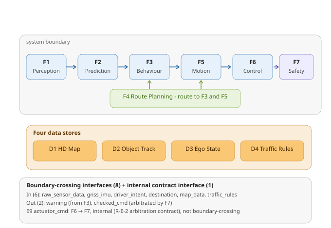
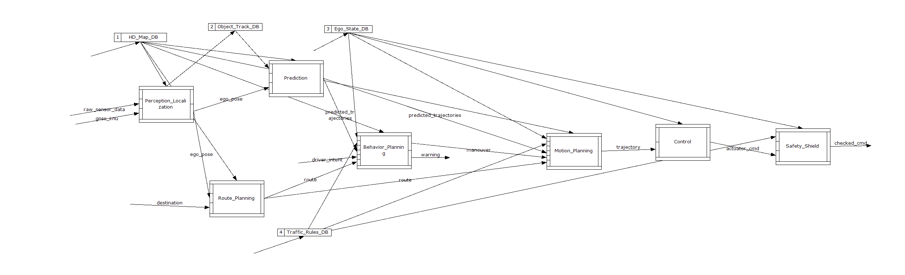
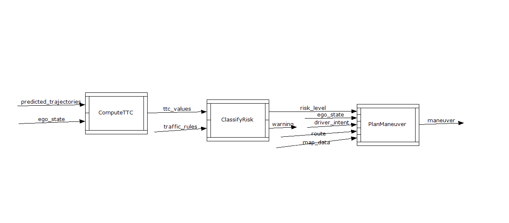
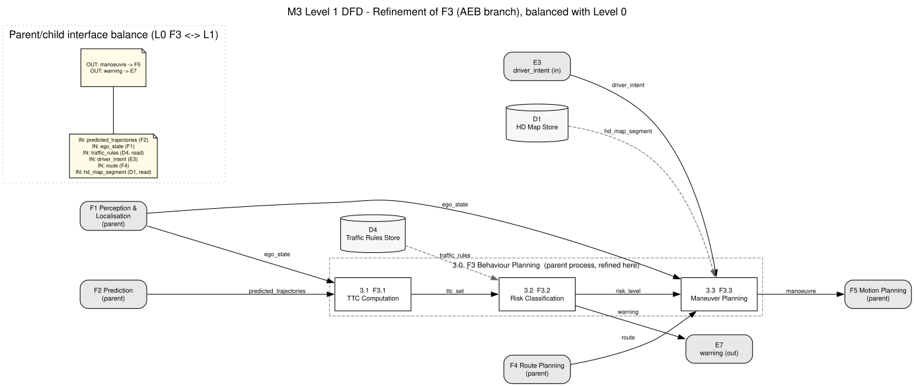
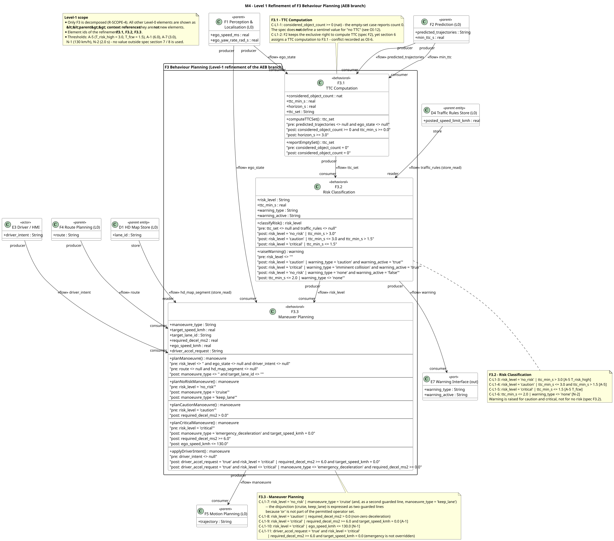
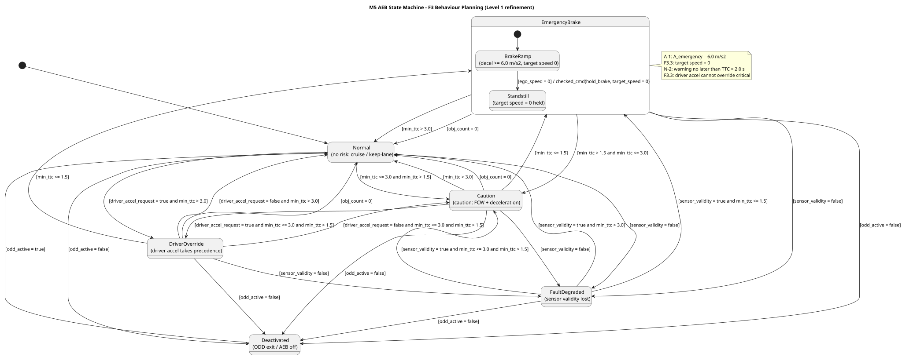

% Requirements Modeling for Autonomous Driving Systems:
% A Cross-Notation Comparison of Manual SOFL and LLM-Generated Models
% Graduate course report, draft v3 (final). All figures are present; the SOFL-tool screenshots in Fig. 2 were captured by the author from the tool GUI.

# Requirements Modeling for Autonomous Driving Systems: A Cross-Notation Comparison of Manual SOFL and LLM-Generated Models

**Abstract**—Requirements for the onboard systems of autonomous vehicles have to state data flows, activation conditions and safety-critical contracts. The SOFL method covers these through Condition/Data Flow Diagrams (CDFDs) and formal modules, but writing them by hand is costly. This report models a vehicle-level SAE Level-2 driver-assistance system in four ways: a manual SOFL model, and three LLM-generated models (a data-flow diagram, UML class and sequence diagrams, and a state machine). An LLM-generated SOFL replica serves as a same-notation control. We compare the models on five indicators against a baseline of 44 atomic requirements, and ask LLM reviewers to find defects that we planted in each model. Four findings stand out. First, all models cover the vehicle-level scope. At Level 1 the manual model covers only 0.615 of the safety requirements, but adding the missing threshold table to the same model restores coverage to 1.000 at a cost of 34 edit operations, so the gap reflects input versioning rather than modelling skill. Second, once vacuous guards are excluded, the apparent advantage of SOFL over UML at Level 1 shrinks from 1.000 versus 0.600 to 0.600 versus 0.429. Third, banning a vacuous idiom in the prompt removes that idiom but does not demonstrably lower overall vacuity, and a family-wide ban removes syntactic vacuity while substantive preconditions stay at 0 of 38 and 3 of 32. Fourth, agreement between reviewers and the planted defects ranges from κ = 0.111 to 0.667 depending on the reviewer model and its context. We conclude that notation, prompt constraints, and the reviewer's model and context all affect the quality of AI-assisted requirements analysis.

**Index Terms**—requirements engineering, SOFL, CDFD, large language models, autonomous driving, model comparison, formal specification

---

## I. Introduction

Autonomous driving (AD) is one of the most demanding application areas for requirements engineering. Functional-safety standards such as ISO 26262 [19] and ISO 21448 [20] require requirements to be stated precisely, and a vehicle-level advanced driver assistance system (ADAS) combines perception, localisation, prediction, behaviour and motion planning, control and safety arbitration. A requirements model for such a system has to say not only what data flows between functions, but also under which conditions a function is activated, what contract it satisfies, and how a top-level function is refined into sub-functions. Informal diagrams and prose handle all three poorly.

The SOFL (Structured Object-oriented Formal Language) method [1] addresses this gap. A SOFL specification combines a Condition/Data Flow Diagram (CDFD), which separates active data flows from data-store access, with a specification module whose processes carry formal `pre` and `post` contracts. Tool-supported construction of CDFDs and modules is therefore a natural candidate for automotive requirements. Building such a specification by hand is expensive, however, and it is natural to ask whether large language models (LLMs) can produce useful complementary models, both structured and object-oriented, from the same requirements, and how good those models are.

This report examines the question in four steps. We model an AD onboard system manually with SOFL (a CDFD and a module); we have LLMs build other structured and object-oriented models of the same system; we evaluate and compare all models using feedback from AI reviewers; and we analyse which factors influence the quality of AI-assisted requirements analysis.

Because notations differ in what they can express, we compare across notations: one manual SOFL model against three LLM-generated models in different notations (a data-flow diagram, UML class and sequence diagrams, and a UML state machine), all built against the same one-page natural-language specification. The manual model is an exception. It was drawn before the specification was compiled, and the specification's functional decomposition was taken from it (Section III). Since this design confounds who produced a model with the notation it uses, we add an LLM-generated SOFL replica (M2) as a same-notation control. We investigate four research questions:

* **RQ1.** What are the relative strengths of the four models, measured on five quality indicators?
* **RQ2.** How does the notation constrain quality, independently of who produced the model?
* **RQ3.** Which prompt-level factors measurably affect the quality of LLM-generated requirement models? (The granularity of the input is held fixed and is therefore not tested.)
* **RQ4.** How do the reviewer model and its conversational context affect the quality of AI feedback on these models?

The contributions are as follows.

1. A unified natural-language specification of a vehicle-level ADAS, with normative thresholds traceable to Euro NCAP protocols [2], [3] and to the Responsibility-Sensitive Safety (RSS) model [4], and with modelling assumptions kept separate from normative values. A machine-readable exchange format (MES) makes scoring across notations reproducible.
2. A five-indicator scoring procedure on a 44-atom requirements baseline, implemented as a script, with all intermediate data published alongside the report.
3. Two controlled checks on confounds in the comparison: a revised manual model that isolates the effect of input versioning, and a generator-by-prohibition rerun that isolates the effect of prompt constraints.
4. A defect-injection study with three reviewer sessions, showing how the reviewer model and its session context shape the quality of AI feedback.

Section II reviews related work, Section III describes the target system and its specification, Section IV the method, and Section V the results. Section VI discusses the research questions and the influencing factors, Section VII lists threats to validity, and Section VIII concludes.

---

## II. Background and Related Work

### A. SOFL, CDFD and specification modules

A SOFL specification [1] consists of informal, semi-formal and formal descriptions. Its formal part has two components, a specification module (s-module) and a CDFD. The module declares constants, types, state variables (data stores), invariants and processes. Each process has a port signature derived from its CDFD connections and a contract of the form

```
ext rd / ext wr   <stores>
pre               <predicate>
post              if <guard> then <predicate>
```

The CDFD contains processes, data stores and two kinds of connection: active data flows, which carry data and activate the consumer, and data-store access flows, which represent reads and writes. Dong and Liu [5] formalise its semantics, including non-determinism and activation.

A CDFD resembles an ordinary data flow diagram (DFD) [6], in which data moves from a source through processes to a sink and may be held in stores, and in which the meaning of each process is written in a separate process dictionary, usually in natural language. The difference is that a CDFD attaches a formal contract to every process and distinguishes activation-carrying flows from data-only store access. The two notations look alike on the canvas but differ by a whole formalisation layer, and this difference becomes an experimental variable in our study.

### B. LLMs for requirements engineering

Automated analysis of requirement documents predates LLMs. Wilson et al. [25] built a tool that measures natural-language specifications and flags the risks created by poorly stated requirements. That work targets requirement documents, whereas the artefacts graded here are models built from such documents.

LLMs have since been applied to elicitation, specification generation and quality assurance. Lubos et al. [32] use LLMs to assess requirements against quality criteria in the spirit of ISO/IEC/IEEE 29148 [21]. For model generation, Cámara et al. [28] report an experience with ChatGPT and UML in which generated models are often plausible but need careful semantic review, and Garaccione et al. [33] compare several LLMs on UML class-diagram generation. Closer to our contracts, Endres et al. [36] study how well LLMs translate natural-language intent into formal postconditions and find that generated assertions can be correct yet weak at telling faulty implementations apart. In formal verification the corresponding problem is called vacuity: Kupferman and Vardi [37] call a specification vacuously satisfied when some part of it does not affect its truth value. The trivially true guards we meet in Section V-D are a shallow, contract-level instance of the same problem. When LLMs act as evaluators, they need an explicit rubric and human corroboration [29] and tend to favour their own output [30].

To our knowledge, comparisons that span several notations, include a formal notation such as SOFL, and also vary reviewer-side factors such as model choice and session context are rare. Our study fixes the input specification and the scoring procedure, so that differences can be traced to the notation, to particular prompt clauses and to the reviewer.

References [36] and [37] were checked against their publisher records: Endres et al. appears in *Proceedings of the ACM on Software Engineering* 1 (FSE, Article 84), 2024, DOI 10.1145/3660791, and Kupferman and Vardi in *STTT* 4(2), 224–233, 2003, DOI 10.1007/s100090100062. Both are retained.

### C. Architectures of autonomous driving

Architecture determines whether the interfaces that a structured model attaches its contracts to actually exist. Research on driving architectures falls into three families. Modular pipelines split driving into sensing, localisation, perception, prediction, planning, control and a vehicle interface, with explicit data interfaces between the stages. Apollo [13] and Autoware [14] are open reference implementations, and Badue et al. [9] survey the family. This is the architecture for which CDFDs, DFDs and UML class models are natural, since every function has a name, a producer and consumers. End-to-end models such as UniAD [11] and VAD [34] replace task hand-offs with a unified, planning-oriented model, so the interface between perception and planning becomes a learned representation rather than a named data flow. Vision-language-action (VLA) and dual-system models go further. Jiang et al. [35] survey VLA models for driving, Hu et al. [8] distinguish end-to-end from dual-system VLA and list formal verification among the open challenges, and Zhu et al. [7] contrast all three families with the modular pipeline.

We therefore scope the target system to the modular, vehicle-level Level-2 ADAS of Zhu et al. [7], corroborated by Apollo [13] and Autoware [14] (Section III). To this pipeline we add an explicit Safety Shield, a cross-cutting constraint layer that realises the safety layer of the RSS model [4] and is instantiated industrially in Apollo's Guardian module [13]. The reason is methodological. These notations attach requirements to named data flows between named functions, so a stable architecture is what makes a comparison across notations possible; end-to-end and VLA systems would remove the very artefacts we grade (Section VI-D). Industry announcements of end-to-end stacks are not cited as evidence, because they are vendor-described and publish no interface contracts for a requirements model to attach to.

---

## III. Target System and Unified Specification

We first fix the system that all models describe: a vehicle-level ADAS onboard system operating at SAE Level 2 [12]. The system boundary is the vehicle. Sensors, GNSS/IMU, the human-machine interface, the actuators and other road users appear only as external interfaces. The system is specified at the functional-allocation level: the specification says which functions exist, what each is responsible for and which data they exchange, but not the algorithm inside a function. This is the level at which CDFDs, DFDs and UML class models apply.

**Specification.** All LLM-generated models were built from one one-page natural-language specification, `NL-RQ-ADAS-v1`, which was the only input given to each generator. It contains seven mandatory vehicle-level functions (F1–F7) with responsibility boundaries; four data stores (D1–D4) with owners; nine external interfaces (E1–E9); a Level-1 refinement of F3 into three sub-functions (F3.1–F3.3) for the automatic emergency braking (AEB) branch; seven normative thresholds (N-1 to N-7) with citable sources; and seven modelling assumptions (A-1 to A-7) that are explicitly marked as assumptions. Every clause carries an ID, and these IDs anchor the traceability matrix.

The normative values include AEB operation up to 130 km/h [3], forward-collision warning at a time-to-collision (TTC) above 1.5 s with the cut-out scenario staged at TTC = 2.0 s [2], and an impact-speed reduction of more than 30 km/h [2]. The RSS longitudinal safety distance [4] is adopted as a functional requirement with an integrator-defined parameter set, as the reference implementation allows [10]. The assumptions include a 6.0 m/s² emergency deceleration, sized from the 30 km/h reduction criterion at the worst-case closing speed of 30.6 m/s. In the coverage baseline of Section IV-C the threshold-like atoms are labelled TH-1 to TH-7: TH-1 to TH-6 correspond to N-1 to N-6, and TH-7 bundles the assumption-derived values (A-1, A-5 and A-7).

**Provenance of the manual model.** The manual model M1 was not built from this document. Its Level-0 CDFD was drawn on 14–15 November 2026, before the specification was compiled on 17 November. The specification's functional decomposition was taken from M1, and its threshold table was added afterwards. The seven functions therefore appear in every model by design, and the differences between models reflect how each notation expresses that common structure, not disagreement about which functions the system should have. M1, however, never saw the threshold table. Section V-B returns to this point with a revised model, M1.1, that isolates its effect.

**Functional decomposition.** The seven functions follow the modular pipeline of Zhu et al. [7, Fig. 1] (Sensor, Perception, Prediction, Route Planning, Behaviour Planning, Motion Planning, Control), with planning divided into behaviour and motion planning as in UniAD [11]. We made two deliberate adaptations: Perception and Localisation are merged into one process, following [9], and an explicit Safety Shield is appended after Control, which [7] does not draw as a separate box. Apollo [13] and Autoware [14] serve only as corroboration that these modules have well-defined interfaces. We use Level 0, the vehicle-level scope common to all models, as the comparison anchor. It is native to SOFL/CDFD and DFD numbering; the UML models express the same scope as their main behavioural classes, and the state machine models the internal modes of F3.

**Table I** — Level-0 functions of the target system.

| ID | Function | Principal responsibility | Key outputs |
|---|---|---|---|
| F1 | Perception & Localisation | Fuse sensor frames into a tracked-object table and compute the ego state; writes D2 and D3 | `objects`, `ego_pose` |
| F2 | Prediction | Predict object motion over ≥ 3 s and derive the minimum time-to-collision (TTC); the only TTC producer | `predicted_trajectories` |
| F3 | Behaviour Planning | Select the target manoeuvre (cruise / lane change / deceleration / emergency braking) and issue driver warnings | `maneuver`, `warning` |
| F4 | Route Planning | Compute route to destination and supply lane geometry | `route` |
| F5 | Motion Planning | Convert the manoeuvre into a kinematically feasible trajectory within speed and acceleration limits | `trajectory` |
| F6 | Control | Convert the trajectory into actuator commands | `actuator_cmd` |
| F7 | Safety Shield | Monitor and arbitrate the raw command before it reaches the actuators | `checked_cmd` |

One clause of the specification needs a note. Table I calls F2 the "only TTC producer". At Level 0 this is an allocation statement: F2 derives the minimum TTC from its own predictions. The Level-1 refinement differs slightly by design: the declared input of F3.1 is F2's predicted trajectories, not F2's TTC, so F3.1 recomputes the per-object TTC set from them. The two clauses are consistent in that TTC is computed only within the prediction and behaviour-planning chain, but the wording invited different readings, and some generated models moved the minimum-TTC derivation into F3.1. We record this reading here instead of editing the frozen specification.

The main data-flow backbone is F1 → F2 → F3 → F5 → F6 → F7 → actuators. F4 supplies the route to both F3 and F5, and F3 emits the driver warning directly. Four persistent stores support the flow: D1 HD map, D2 object track, D3 ego state and D4 traffic rules. Of the nine declared interfaces, eight cross the vehicle boundary: six inputs (E1 `raw_sensor_data`, E2 `gnss_imu`, E3 `driver_intent`, E4 `destination`, E5 `map_data`, E6 `traffic_rules`) and two outputs (E7 `warning`, E8 `checked_cmd`). The ninth, E9 `actuator_cmd`, is produced by F6 and consumed by F7 entirely inside the boundary. The specification declares it as an interface anyway, so that the arbitration requirement R-E-2 (the raw command shall never reach the actuators directly) becomes a checkable interface contract. We therefore count eight boundary-crossing interfaces plus one internal contract interface, and we treat a model that registers E9 as an external entity as following the specification's convention, not as making an error.

Level 1 refines exactly one Level-0 function, the emergency-braking branch of F3. It is decomposed into F3.1 TTC computation, F3.2 risk classification and F3.3 manoeuvre planning, classified by TTC thresholds of 3.0 s and 1.5 s. All other Level-0 functions stay atomic; behaviour planning is refined first because it carries the safety-critical AEB decision logic [3], [11]. This asymmetry matters for interpreting the results: M1, M2, M3 and M4 are comparable at both levels, whereas M5 (a state machine) models the internal modes of F3 rather than a sibling decomposition of it.

**Fig. 1.** Level-0 functional decomposition of the vehicle-level ADAS as instantiated in this study. The data-flow backbone runs F1 → F2 → F3 → F5 → F6 → F7, and F4 supplies the route to both F3 and F5. Eight interfaces cross the vehicle boundary (six inputs and two outputs); E9 `actuator_cmd` is an internal F6 → F7 contract interface (R-E-2) and does not cross it. The figure is a schematic of our specification; the SOFL-tool view of M1 is shown in Fig. 2.



---

## IV. Research Method

### A. Models and generation

Table II lists the five models. M1 is the manual SOFL baseline, drawn by one of the authors with the SOFL tool. M3, M4 and M5 are the LLM-generated data-flow, UML class-and-sequence, and UML state-machine models. M2 is a supplementary control, an LLM-generated SOFL replica produced from the same specification. Because it shares its notation with M1 and its generator with M4, it separates the effect of who produced a model from the effect of the notation (Section VI-B). M5 covers only Level 1 (the AEB behaviour), since a state machine has no natural Level-0 function inventory.

**Table II** — Models compared in this study.

| ID | Model | Notation | Producer | Level |
|---|---|---|---|---|
| M1 | Manual SOFL baseline | CDFD + module | Human, with SOFL tool | L0 + L1 |
| M3 | Structured model | DFD (Yourdon/DeMarco) | Tencent Hunyuan 4 Flash, single pass | L0 + L1 |
| M4 | Object-oriented model | UML class + sequence diagrams | MiniMax-M3.1-Flash, single pass | L0 + L1 |
| M5 | Behavioural object-oriented model | UML state machine | Tencent Hunyuan 4 Flash, single pass | L1 (AEB behaviour) |
| M2 | *Same-notation control* (supplementary) | SOFL CDFD + module (same dialect as M1) | MiniMax-M3.1-Flash, single pass | L0 + L1 |

Each generator ran in an isolated context and received only the specification and a notation guide. None was shown M1, which prevents anchoring on the human model. All generator and reviewer access went through conversational chat interfaces with the providers' default decoding parameters, so temperature could be neither controlled nor varied, and decoding variance is part of the single-run setting (Section VII). M1's Level-0 CDFD was drawn on 14–15 November 2026 and its modules were completed by 17 November. The specification was compiled on 17 November, and M2 and M4 were generated from it on the same day. M3 and M5 were generated on 22–23 November, after the generation prompts had been revised. The three reviewer sessions ran on 22–23 November (A) and on 23 November (B and C). Provenance (producer, date, number of passes and a prompt summary) is recorded in every exchange file.

One consequence of this assignment must be stated. Hunyuan 4 Flash generated M3 and M5 and also serves as reviewer A, so the separation between generator and reviewer that mitigates self-preference bias [30] holds fully only for M2 and M4 and for reviewers B and C (DeepSeek-v4-pro, a different family from all generators). A comparison of the clean review sessions (Section V-C) finds no count-level inflation for reviewer A, but the risk remains.

M1 was validated with a three-part checker covering CDFD structure and port-slot consistency, module syntax, and the consistency between the two (process sets, port signatures against slot-derived flows, `ext rd` and `ext wr` against store connections, and the absence of dangling references in `pre` and `post`). All checks pass. A second version, M1.1, was built for the control experiment of Section V-B by adding the normative threshold table to M1 in the same notation, on the same architecture and with the same port slots. It was loaded and rendered in the SOFL tool and passes the same checker, so it is a tool artefact of the same standing as M1.

Figures 2 to 5 show the models themselves. M1 is shown as a screenshot from the SOFL tool. The generated models are renderings of the generators' own sources (Graphviz for the DOT source of M3, PlantUML for M4 and M5), not hand-redrawn figures. The three generated models refine the same Level-1 object, the emergency-braking branch of F3, which is decomposed into TTC computation, risk classification and manoeuvre planning, so they can be compared directly. The comparison makes the main observation visible: the three notations differ less in what they cover than in where they put the constraints. The DFD (Fig. 3) keeps the semantics of each process in an external process dictionary, because a DFD has no contract construct. The class diagram (Fig. 4) keeps the same constraints inside the model as OCL operation guards. The state machine (Fig. 5) also keeps them inside the model, but as transition labels, which makes them the hardest of the three to navigate; this is why a reviewer who misses a transition reports it less reliably (Section V-C).

**Fig. 2.** M1, the manual model, as constructed in the SOFL tool: (a) the Level-0 CDFD (`System.cdfd`) with its seven processes, four data stores and boundary interfaces; (b) the Level-1 refinement of F3 (`BehaviorPlanning.cdfd`), the emergency-braking branch decomposed into TTC computation, risk classification and manoeuvre planning. Both panels are captures of the tool canvas, not redrawings. Panel (b) is the same Level-1 object that Figs. 3–5 render for the generated models, so the four can be compared directly.





**Fig. 3.** M3, the LLM-generated DFD at Level 1, rendered from the generator's own DOT source. The dashed box is the parent process F3 and the three numbered boxes are its refinement. The semantics of each process live in an accompanying process dictionary, so the structural counterpart of a contract is absent; this is what the asterisk on M3's I4 in Table IV records.



**Fig. 4.** M4, the LLM-generated UML class diagram at Level 1, rendered from the generator's own PlantUML source. The three steps appear as F3.1, F3.2 and F3.3, and the constraints appear as OCL operation guards on the classes, for example `min_ttc > 3.0`, `decel_req >= 6.0`, and the exclusion of driver acceleration during critical braking. The generator's own note block, in the upper left, records the element-count rule it was given and states that it performed no self-review pass.



**Fig. 5.** M5, the LLM-generated UML state machine for the same AEB branch, rendered from the generator's own PlantUML source. The three-step logic appears as a state sequence, and every constraint sits in a transition label of the form `[guard] / effect`. There is no contract construct, and because a constraint is attached to a transition rather than to a named function, a reviewer has to read the whole diagram to say whether a given guard is present. This is the mechanism behind the transition-deletion detection gap reported in Section V-C. For legibility the transition effects are omitted here and all guards are retained.



### B. Model Exchange Schema (MES)

To compare models expressed in different notations we defined a machine-readable schema with elements, stores, external entities, flows, traceability, open issues and provenance. M1 was converted from its validated tool artefacts by a script, and M2–M5 emitted MES directly. All nine MES files parse as strict JSON. The schema is the basis of every indicator reported below.

### C. Quality indicators

Quality of models across notations has no agreed standard. We therefore propose a framework based on atomic requirements, grounded in the Goal-Question-Metric approach [15] and the SEQUAL quality framework [22], with five indicators on a scale from 0 to 1 (higher is better). Requirement quality attributes follow ISO/IEC/IEEE 29148 [21], and the ambiguity component builds on requirements smells [24]. This is a method proposed by this study, not the execution of an existing standard.

The common baseline is a list of 44 atomic requirements decomposed from the specification (31 at Level 0 and 13 at Level 1). A human and an LLM each decomposed the specification independently, and the two lists were merged. The human list is the scoring baseline; nine LLM-only atoms are kept in the merge report but are not scored, so that LLM-specific decompositions are not imposed on every model. To describe the overlap between the two lists we aligned atoms greedily by token overlap (the Jaccard similarity of word and character-bigram sets, with small bonuses for an identical category or source clause, and an acceptance threshold of 0.30). This gave 37 matched pairs between the 44-atom human list and the 46-atom LLM list. We report the result as a matched-pair ratio, 37/46 = 0.804. It is not a Jaccard index or an inter-rater agreement coefficient: the strict set-overlap Jaccard index is 37/(44 + 46 − 37) = 0.698, and the fraction of human atoms that were matched is 37/44 = 0.841.

Coverage is labelled by hand, atom by atom, because automatic text matching was biased by the different verbosity of the exchange files. Each requirement is split into the elements it asserts, such as a numeric bound, an applicable condition or a parameter set. A model scores 1.0 if its artefact states every element, 0.5 if it touches the requirement but leaves at least one element unstated, and 0 if it states none. An element may appear as a contract clause or as a traceability note that ties it to the requirement.

**Table III** — Quality indicators and their operational definitions.

| ID | Indicator | Operational definition |
|---|---|---|
| I1 | Requirement coverage | Sum of per-requirement scores divided by N (full = 1.0, partial = 0.5, absent = 0), labelled manually against the atomic list; the safety-critical subset is reported separately [19]–[21] |
| I2 | Precision | Elements grounded in the specification divided by all model elements. Groundedness is judged structurally, not from the model's own trace fields: an element is ungrounded if it carries a placeholder id without an "extracted" note, or if its name matches a hallucination-pattern list (fault, degradation, deactivation, override and empty-state names) without a matching open-issue declaration. This name-level rule cannot detect subtle content hallucination, so I2 serves as a sanity check rather than a discriminating indicator |
| I3 | Consistency | 0.5 × resolvable flow endpoints + 0.3 × elements with declared inputs + 0.2 × (1 − orphan-producer ratio), plus tool syntax checks [22] |
| I4 | Formal precision | 0.4 × share of processes with an effective `pre` + 0.3 × share with quantified constraints + 0.3 × (1 − ambiguous-word ratio) [23], [24]. A precondition is effective only if at least one of its clauses survives the removal of vacuous guards, the five forms that the type alone decides (`x <> null`, `x = x`, `nat ≥ 0`, `x <> ''` and `if true then`) |
| I5 | Defect detection rate | Plant defects, let an isolated reviewer look for them, and score the detections (Section IV-D) [17], [18], [26] |

The weights in I3 and I4 were fixed in advance (formality weighted highest, then quantitative content, then ambiguity). A sensitivity check over eight weight vectors that sum to one leaves every ordering used later in this report unchanged: M2 above M4 at Level 1, M1 above M3 at Level 0, and M1 above M4 at Level 1. I4 is, however, sensitive to the criterion it applies, which is a separate matter from the weights. Under a stricter reading, in which a precondition counts only if it compares an input with a threshold or another field, the manual baseline falls to 0.514 at Level 0 and 0.533 at Level 1, the former below the DFD model (0.700). Crucially, the manual model still exceeds the UML model at Level 1 under this reading (0.533 against 0.486), so the strict criterion does not erase the manual-over-UML contrast. We therefore interpret I4 as precondition hygiene under a stated criterion, not as a measure of specification content, and we report the strict variant alongside it.

I1 to I4 describe a model, whereas I5 describes the reviewer applied to the model. Because the notations are not commensurable (Section VII), we report the indicators one by one and compute no composite score. Numeric thresholds are counted only from constraint fields, so that section numbers such as "5.1" are not mistaken for requirements.

### D. Defect-injection protocol

To obtain actual AI review feedback, we planted six defects in each model (24 in total): a requirement omission; a contradiction with a normative threshold (DEF-2); an incorrect comparison operator; a missing data flow (DEF-4); ambiguous wording (DEF-5); and the deletion of traceability information (DEF-6). Isolated LLM reviewers, blind to the planted defects, examined each of the four models three times per session using a fixed rubric. The design follows mutation-based fault injection [17], [18] and replicated inspection experiments [26], [27]. Using reviewers that differ from the generators mitigates self-preference bias [30].

Three sessions were run. Reviewer A is Hunyuan 4 Flash. Reviewer B is DeepSeek-v4-pro in a session that had already read A's results (a contaminated session); B also produced a fourth, anchored round in which A's findings were shown to it explicitly. Reviewer C is DeepSeek-v4-pro in a clean session that had seen no review output, with the same three-round structure as A and B. B and C therefore differ only in how much prior review context the reviewer had, which gives a context ladder: no context (C), A's results in the session (B), and A's findings shown explicitly (B-anchored).

Detections are scored against the list of planted defects. Findings that match no planted defect are counted in a false-positive rate, defined as the number of such findings divided by all findings of the review, and are then checked by hand to see whether they point to genuine flaws that were already in the model. Agreement with the planted defects is measured by Cohen's κ [16], pooled over rounds and read on the Landis–Koch scale [31]. The confusion matrices are built on 72 positive observations (4 models × 6 defects × 3 rounds): a planted defect that is reported is a true positive, and one that is missed is a false negative. Because every defect slot is planted in every model, the design has no natural negatives. We therefore build the negative side by mirroring the positive slots, so that each out-of-set report fills one negative slot (a false positive) and the remaining slots count as true negatives (TN = 72 − FP). κ is sensitive to this construction and must be read together with the raw detection rate and the false-positive count.

---

## V. Results

### A. Level-0 and Level-1 scores

**Table IV** — Indicators I1–I4 by model and level. I4 excludes vacuous guards, and the values before the exclusion are given in parentheses. M1.1 is the manual model after the normative threshold table has been added (Section V-B); it is a control, not a sixth competitor. The asterisk marks M3: a DFD has no native contract construct, so M3's I4 reflects the input-validity constraints that its generator wrote into the process dictionary and that the conversion stored in the field the scorer reads. It measures recorded constraint content, not notation-native formalisation.

| Indicator | M1 (L0) | M1.1 (L0) | M2 (L0) | M3 (L0) | M4 (L0) | M1 (L1) | M1.1 (L1) | M2 (L1) | M3 (L1) | M4 (L1) | M5 (L1) |
|---|---:|---:|---:|---:|---:|---:|---:|---:|---:|---:|---:|
| I1 Requirement coverage | 1.000 | 1.000 | 1.000 | 1.000 | 1.000 | 0.615 | 1.000 | 0.808 | 1.000 | 1.000 | 0.615 |
| I2 Precision | 1.000 | 1.000 | 1.000 | 1.000 | 1.000 | 1.000 | 1.000 | 1.000 | 1.000 | 1.000 | 1.000 |
| I3 Consistency | 0.749 | 0.749 | 0.601 | 0.624 | 0.596 | 0.737 | 0.737 | 0.458 | 0.458 | 0.571 | 0.748 |
| I4 Formal precision | 0.914 (0.914) | 0.914 (0.914) | 0.557 (0.957) | 0.871\* (0.871) | 0.614 (0.957) | 0.800 (0.800) | 0.800 (0.800) | 0.600 (1.000) | 1.000\* (1.000) | 0.429 (0.600) | 0.771 (0.771) |

Table IV shows four things.

First, all models fully cover the vehicle-level requirements (I1 = 1.000 at Level 0). The seven functions, four stores and nine interfaces are mandated by the specification, so no model can leave them out without being visibly incomplete, and Level-0 coverage does not discriminate between models.

Second, differences appear at Level 1. The manual model covers only 0.615 of the AEB and threshold requirements, omitting five threshold clauses (TH-1, 3, 4, 5 and 6, that is N-1, 3, 4, 5 and 6), whereas the generated DFD and UML models cover all of them and the SOFL replica covers 0.808. Read together with the provenance dates, this is a requirements-version difference and not a modelling defect, because M1 was drawn before the threshold table existed. Section V-B tests this directly.

Third, precision (I2) is 1.000 for every model and therefore does not discriminate, although the reviewers found genuine flaws such as duplicate element ids and empty provenance fields (Section V-C). Since the rule is name-level and cannot detect subtle content hallucination (Table III), we treat I2 as a sanity check and not as evidence.

Fourth, formal precision (I4) changes substantially once vacuous guards are excluded. At Level 0 the manual model is highest (0.914) and the DFD follows (0.871, with the asterisk), while the SOFL replica (0.557) and the UML model (0.614) fall far below their values before the exclusion. At Level 1 the DFD is highest (1.000, asterisked), followed by the manual model (0.800), the state machine (0.771) and the two models whose prompts allowed the null-guard idiom (M2 0.600, M4 0.429). Without the exclusion, UML would appear highest at Level 0 (0.957, thanks to its OCL invariants) and the SOFL replica would reach 1.000 at Level 1; both values are artefacts of counting vacuous guards as preconditions.

### B. Controlling for the input version (M1.1)

The Level-1 coverage gap between the manual model and the generated models has two candidate explanations: the manual model is less complete as a specification, or it was built before the threshold table existed. The second explanation can be tested. M1.1 is the manual model with the threshold table added. The Level-0 architecture, the process set, the CDFD connections and the port slots are unchanged, and the same checker passes on both modules.

The edit adds the constraints that the specification's thresholds require and that M1's contracts lacked, written in the notation's own idiom (preconditions and guarded postconditions), together with five new fields on two composed types where a threshold needs a quantity the model did not previously carry. `PlanManeuver` gains the precondition `ego_state.speed <= 130.0` (N-1). `Prediction` produces `lead_gap` and `lead_speed`. `Motion_Planning` produces `min_gap`, `decel_limit` and `lateral_accel` and constrains `min_gap <= predicted_trajectories.lead_gap` (N-5) and `decel_limit >= 4.0` (N-6). `Control` and `Safety_Shield` enforce the braking profile `brake_cmd >= decel_limit` and `accel_cmd <= 2.0` (N-6) and the lateral envelope (N-7). N-3 and N-4 are not written as constraint values, because the specification gives them as the derivation basis of the assumption A-1 and the intermediate figures (30 km/h, 110 km/h, 30.6 m/s) are not constraints. M3 and M4 received the same treatment: their traceability tables record N-3 and N-4 as realised through A-1.

**Table V** — The manual model before and after the threshold table is added.

| Indicator | M1 (L0) | M1.1 (L0) | M1 (L1) | M1.1 (L1) |
|---|---:|---:|---:|---:|
| I1 Requirement coverage | 1.000 | 1.000 | 0.615 | **1.000** |
| I2 Precision | 1.000 | 1.000 | 1.000 | 1.000 |
| I3 Consistency | 0.749 | 0.749 | 0.737 | 0.737 |
| I4 Formal precision | 0.914 | 0.914 | 0.800 | 0.800 |
| I4, strict criterion | 0.514 | 0.514 | 0.533 | 0.533 |

**Table VI** — Cost of the revision from M1 to M1.1.

| Measure | Value |
|---|---|
| Contract clauses before and after (L0 / L1) | 21 → 30 / 15 → 15 |
| Contract clauses added / removed / modified | 9 / 0 / 9 (L0); 1 / 1 / 1 (L1) |
| New fields on composed types | 5 (`TrajectorySet.min_gap`, `.decel_limit`, `.lateral_accel`; `PredictedTrajectory.lead_gap`, `.lead_speed`) |
| New traceability rows | 8 (N-1, N-3, N-4, N-5, N-7, A-2, A-6, A-7) |
| Contract-level revision rate | 21 edits over 45 clauses = 46.7% |
| Total edit operations | 34 (21 contract, 5 type-field, 8 traceability) |
| Change in I1 at Level 1 | 0.615 → 1.000 |

Three results follow. First, the Level-1 coverage deficit was an input-versioning effect. With the threshold table available, the same manual model, in the same notation and on the same architecture, reaches I1 = 1.000 at Level 1 and so matches the generated DFD and UML models. The Level-1 column that separated the manual baseline from the generated models was largely measuring the date on which the specification was compiled, not the quality of the modelling. Second, the other indicators do not move: I2, I3 and I4 are identical for M1 and M1.1 at both levels, under the main and the strict criterion alike. The added clauses are substantive threshold comparisons, so they raise coverage without changing precondition hygiene in either direction. Third, the revision is not cheap. It took 34 edit operations, touched 46.7% of the contract clauses and added five new fields. Three thresholds needed no new contract (N-2 is covered by existing clauses, and N-3 and N-4 are derived from A-1). Each of the remaining four (N-1, N-5, N-6 and N-7) needed a new precondition conjunct or guarded postcondition, and N-5 and N-6 also needed new data fields so that the constraint had something to constrain. This is the cost that M1 never paid, because it was never given the table.

The one contestable judgement in the Level-1 labelling is whether a threshold that the specification derives from another threshold counts as covered when only the derived value appears (N-3 and N-4, both derived from A-1). Table VII recomputes Level-1 I1 under three criteria. Criterion A, used throughout this report, counts such a threshold as covered when the derived value appears; criterion B credits N-3 and N-4 only where the model artefact names them; criterion C requires an independent contract. All three criteria move the models in the same direction and leave their order unchanged (M1 and M5 lowest, then M2, then M1.1, M3 and M4 level). The three relations that carry the Level-1 findings, namely M1 below M1.1, M1.1 level with M3 and M4, and M1.1 above M2, hold under every criterion.

**Table VII** — Level-1 I1 under three labelling criteria.

| Model | A (used here) | B (names them) | C (independent contract) |
|---|---:|---:|---:|
| M1 | 0.615 | 0.615 | 0.615 |
| M1.1 | 1.000 | 1.000 | 0.846 |
| M2 | 0.808 | 0.808 | 0.769 |
| M3 | 1.000 | 1.000 | 0.846 |
| M4 | 1.000 | 1.000 | 0.846 |
| M5 | 0.615 | 0.615 | 0.615 |

An independent second rater also re-labelled the 30 discriminating judgements, that is, the five threshold atoms that carry all of the variation between models, across six models. Agreement was κ = 0.650 (unweighted; 0.723 linearly weighted; 80.0% exact agreement). On a control set of eight always-covered atoms, however, agreement was only 54.2%, so the second rater was systematically stricter than the primary rater even on unambiguous cases, and the agreement on the discriminating set should be read with that offset in mind.

### C. Defect injection

Table VIII gives, for each reviewer session, the mean detection rate over three rounds (the fraction of the six planted defects that were found) and the false-positive rate (Section IV-D). Per-round values are in the supplementary files.

**Table VIII** — Mean detection (Det) and false-positive rate (FP) by reviewer session. A: Hunyuan 4 Flash. B: DeepSeek-v4-pro in a contaminated session. C: DeepSeek-v4-pro in a clean session. Per-model FP is not available for C.

| Model | A Det | A FP | B Det | B FP | C Det | C FP |
|---|---:|---:|---:|---:|---:|---:|
| M1 manual SOFL | 0.778 | 0.095 | 0.833 | 0.000 | 0.667 | — |
| M3 LLM DFD | 0.611 | 0.218 | 0.722 | 0.000 | 0.556 | — |
| M4 LLM UML | 0.611 | 0.167 | 0.833 | 0.000 | 0.556 | — |
| M5 LLM state machine | 0.611 | 0.476 | 0.500 | 0.229 | 0.389 | — |
| **Overall** | **0.653** | 0.260 | **0.722** | 0.066 | **0.542** | 0.254 |
| Pooled κ [31] | 0.389 | | 0.667 | | 0.111 | |

The pooled confusion matrices are TP = 47, FN = 25, FP = 19, TN = 53 for reviewer A and TP = 52, FN = 20, FP = 4, TN = 68 for reviewer B. The pooled false-positive rates are 19/73 for A, 4/61 for B, 31/122 for C and 3/23 for the anchored round. Each defect slot is observed three times per model, so the 72 observations are not independent.

The reviewers agree on the ranking of the models. M1 has the highest or tied-highest detection in every session (tied with M4 under B), and M5 has the lowest detection under B and C and the highest false-positive rate under A and B. The reviewers differ in level. The gap in κ between A and B (0.389 against 0.667) comes mostly from the false-positive side (19 against 4 reports outside the planted set) and only secondarily from detection (47 against 52 true detections), where B is more sensitive to the traceability-deletion defect (DEF-6), which A missed in all three rounds. Both A and B miss the planted flow deletion (DEF-4) in M5 and report instead the model's existing lack of a route flow, a genuine but unplanted gap. Missing flows are therefore hard to localise in a transition-based notation. With six defects per model, one defect corresponds to 0.167 in detection, so differences in single cells should not be over-interpreted.

A further check addresses self-preference. Reviewer A shares its model family with the generator of M3 and M5. Comparing the two clean reviewers, A (same family) and C (other family), on those models gives equal union counts on M3 (four defects each, though of different types: DEF-1, 3, 4 and 5 against DEF-1, 3, 4 and 6), and on M5 A's one-hit advantage is exactly the misattributed flow report mentioned above. We find no clear count-level inflation, although the difference in composition hints at family-specific attention. These observations come from a single injection design and are not general effect estimates.

**Context ladder.** Table IX holds the reviewer model fixed (DeepSeek-v4-pro) and varies only the prior review context.

**Table IX** — Context ladder.

| Condition | M1 | M3 | M4 | M5 | Mean detection | Cohen's κ | FP rate |
|---|---:|---:|---:|---:|---:|---:|---:|
| C: clean session | 0.667 | 0.556 | 0.556 | 0.389 | **0.542** | 0.111 | 0.254 |
| B: contaminated (read A in the session) | 0.833 | 0.722 | 0.833 | 0.500 | **0.722** | 0.667 | 0.066 |
| B-anchored (shown A's findings) | 1.000 | 0.667 | 1.000 | 0.500 | **0.792** | 0.667 | 0.130 |

The direction is counter-intuitive: on detection of planted defects, prior context improves the scores (0.542, 0.722, 0.792). Reading a previous review acts as an implicit rubric. It focuses the reviewer on the defect categories that the previous reviewer reported and suppresses reports outside them. The per-defect profile supports this. The clean session was the only condition that detected DEF-6 in all four models (reviewer A never; B in three models; the anchored round in two), whereas the contaminated and anchored conditions did better than the clean session on DEF-4 and DEF-5, the categories emphasised in A's reports.

The clean session's false positives are largely genuine flaws of the models that were not planted. Thirty-one of its 122 findings concern issues verified to be present in the clean files (duplicate element ids, empty owner or source fields, dangling flows, an unwritten store), against 4 such reports in the contaminated session. The false-positive rate therefore penalises thoroughness on native defects, and it should be read as the rate of reports beyond the planted set, not of wrong alarms. Because κ depends on the same count, the low κ of the clean session (0.111) partly reflects the same effect, and κ should be read together with the detection rate and the verified share of reports.

Two points qualify the numbers. First, one planted defect (the threshold contradiction DEF-2 in M3) had no observable manifestation: its only carrier, a traceability note containing "6.0", was removed by DEF-6 in the same injection run. All reviewers miss this slot by construction, and M3's achievable detection is at most 5/6. Second, the three rounds in each condition are consecutive rounds of one session, so later rounds are anchored on earlier ones (in the clean session the number of findings rose from 36 to 39 to 47 and the per-round detection from 0.458 to 0.500 to 0.667). Variation between rounds must not be read as independent replication. Finally, the gap between C and B is an upper bound on context plus session randomness, not a pure context effect.

### D. Prompt constraints and vacuous guards

A pattern in the generated contracts offers an unplanned contrast across the model set. M2 and M4 contain many preconditions such as `x <> null`, which are vacuous because values are non-null by type. The early prompts for M2 and M4 contained an operator whitelist that included `<>` but no prohibition of the null-check idiom. For the later generations (M3 and M5) we added one sentence: do not write `x <> null`, because values are non-null by type and the check is vacuous.

**Table X** — Occurrences of the vacuous null guard by prompt condition (token counts over the contract fields of the exchange files), and I4 before and after the exclusion of vacuous guards. For M4 the count consists of 31 `x <> null` guards and 6 single-quoted empty-string guards (`x <> ''`); M2 contains no empty-string variant. Only the precondition subset enters I4.

| Model | Prohibition in prompt? | Occurrences | I4 before (L0 / L1) | I4 after (L0 / L1) |
|---|---|---:|---:|---:|
| M2 (LLM SOFL replica) | No | 57 | 0.957 / 1.000 | 0.557 / 0.600 |
| M4 (LLM UML) | No | 37 | 0.957 / 0.600 | 0.614 / 0.429 |
| M3 (LLM DFD) | Yes | 0 | 0.871 / 1.000 | unchanged |
| M5 (LLM state machine) | Yes | 0 | 0.771 (L1) | unchanged |

The consequence for formal precision is material: excluding vacuous guards lowers M2's I4 by 0.400 at both levels and M4's by 0.343 at Level 0 and 0.171 at Level 1, so any claim built on the raw values of these two models would be misleading. The table cannot, however, attribute the zeros to the prohibition, because the prohibition coincides with the generator family (M3 and M5 were generated by Hunyuan, M2 and M4 by MiniMax). The experiment also exposes a failure that a pure syntax check misses: every one of these preconditions is well formed and uses only allowed operators, yet all are semantically vacuous. The early prompts were revised after manual review revealed the problem.

**Same-generator rerun.** To separate the prohibition from generator habit, both generators were re-prompted in clean sessions with the identical specification and notation guide. The design crosses generator (MiniMax, MX; Hunyuan, HY) with prohibition scope: none, a single idiom, or the whole family of tautologies. Where the budget allowed, we made repeated runs: the MiniMax cell without prohibition has three runs (the original M2, made with the earlier prompt, and two reruns with the current prompt), the MiniMax single-idiom cell and the Hunyuan cell without prohibition have two runs each, and the Hunyuan single-idiom cell and each family-wide cell have one run. Table XI counts clause-level occurrences over `pre` and `post` bodies split on `and`; "vacuous" aggregates `x <> null`, `x = x`, `nat ≥ 0`, `x <> ''` and `if true then`, and "effective pre" counts processes with at least one non-vacuous precondition, the criterion I4 applies.

**Table XI** — Same-generator rerun (MX: MiniMax-M3.1-Flash; HY: Hunyuan 4 Flash).

| Condition | Run | `<> null` | `x = x` | `nat ≥ 0` | `<> ''` | `if true` | Vacuous rate | Effective pre |
|---|---:|---:|---:|---:|---:|---:|---:|---:|
| MX, no prohibition | 1 (= M2, earlier prompt) | 57 | 0 | 2 | 0 | 33 | 50.3% | 0/10 |
| MX, no prohibition | 2 | 105 | 0 | 4 | 16 | 0 | 25.2% | 1/10 |
| MX, no prohibition | 3 | 0 | 0 | 2 | 5 | 0 | 2.5% | 10/10 |
| MX, single-idiom ban | 1 | 0 | 0 | 5 | 0 | 13 | 10.0% | 10/10 |
| MX, single-idiom ban | 2 | 0 | 0 | 4 | 0 | 0 | 2.3% | 10/10 |
| MX, family-wide ban | 1 | 0 | 0 | 0 | 0 | 0 | 0.0% | 10/10 |
| HY, no prohibition | 1 | 0 | 51 | 0 | 0 | 0 | 26.8% | 0/10 |
| HY, no prohibition | 2 | 0 | 0 | 3 | 6 | 0 | 5.7% | 10/10 |
| HY, single-idiom ban | 1 | 0 | 0 | 7 | 6 | 0 | 6.2% | 10/10 |
| HY, family-wide ban | 1 | 0 | 0 | 0 | 0 | 0 | 0.0% | 10/10 |

All nine reruns reproduce the function-level inventory exactly (ten processes and all of the normative and assumed thresholds), so the differences are confined to the semantic quality of the guards. Four results follow; the clause-level breakdown is in Appendix B.

1. Within MiniMax the ban removes the named idiom, but the unprohibited baseline varies widely. `x <> null` appears in two of the three unprohibited runs (57 and 105 occurrences) and in neither of the two single-idiom-ban runs. The overall vacuous rate, however, ranges from 2.5% to 50.3% across the three unprohibited runs and from 2.3% to 10.0% across the two banned runs, and the number of effective preconditions ranges from 0/10 to 10/10 without prohibition. The reduction in overall vacuity therefore cannot be attributed to the ban with confidence; the only robust effect is on the idiom it names.
2. Across generators the idiom count is not a prohibition effect, and the replacement form is generator-specific. Hunyuan never writes `<> null` when nothing is prohibited, so the zeros of M3 and M5 need no prohibition to explain them. Its vacuity takes other forms instead: one unprohibited run expresses every precondition as a chain of self-equalities (`x = x`, 51 clauses, 0/10 effective), and the other introduces a `valid: nat` field in every composed type and guards on `valid = 1`. Under the family-wide ban the replacement forms differ again. MiniMax moves 28 of its 38 preconditions into `x.valid = 1` on a `valid` field it added to every composed type, and 17 of the 33 flag guards test signals that the system itself produces, so they cannot fail at run time. Hunyuan declares no `valid` field and moves 26 of its 32 preconditions into domain axioms on real-valued fields (`speed ≥ 0`, `path_length > 0`, latitude and longitude ranges). Both generators reach 0.0% syntactic vacuity, with substantive preconditions at 0 of 38 and 3 of 32. Extending the blacklist therefore has no single end point, and neither an idiom list nor a rule banning self-declared flags catches both forms.
3. A count of one pattern misranks models. Ranked by `<> null` alone, the cleanest-looking runs have the worst counts of substantive preconditions: one Hunyuan run with no `<> null` has a vacuous rate of 26.8% and 0/10 effective preconditions, indistinguishable from M2 (50.3%, 0/10), while a MiniMax run that complies with the single-idiom ban still contains 13 `if true then` guards. Vacuity has to be counted over the whole family of tautologies.
4. The precondition slot is where non-discriminating guards go, for humans and machines alike. The manual model writes 29 preconditions, of which one is substantive; 26 are non-negativity or range axioms and 2 are validity flags. The same pattern holds in every generated run (Appendix B). The requirement content sits in the postconditions, where 45.7–75.3% of the clauses are substantive in the generated runs, against 52.9% for the manual model. The blacklist therefore changes the form of the precondition slot, not the amount of contract content, and a precondition-based indicator such as I4 measures idiom hygiene rather than specification content.

We also checked whether the same kind of residue distorts our own indicator. M2's 33 `if true then` guards and 2 `nat ≥ 0` clauses lie entirely in postconditions, and its precondition subset consists only of 37 `x <> null` guards, so the exclusion removes all of its precondition-side vacuity and its I4 (0.557 at Level 0) is not inflated by the residue. Applying the full five-form family instead of the two-form exclusion used for the parenthetical values of Table IV reproduces every value in Table IV unchanged. What the precondition term is sensitive to is the criterion, not the weights: crediting a precondition only if it compares an input with a threshold or another field lowers the manual baseline to 0.514 at Level 0, below the DFD model (0.700). I4 must therefore be read as precondition hygiene under a stated criterion, not as a measure of specification content. The transferable recommendation is a criterion rather than a longer blacklist: a guard counts as contract content only if it constrains an input against a threshold or another quantity, and does not rest on a flag that the model itself introduced or on a bound that holds by domain convention. A static checker can apply such a criterion; an idiom list cannot.

### E. AI feedback as evidence

The LLM plays two roles in this study, generator (M2–M5) and reviewer (Section V-C), and we keep them separate. LLM evaluators recognise and favour their own generations [30], and LLM-based evaluation needs an explicit rubric and human corroboration [29]. Review output is scored against the list of planted defects, with human adjudication of reports outside it; the manual SOFL model is not the ground truth. Agreement with the planted defects ranges from slight (clean session C, κ = 0.111) through fair (A, κ = 0.389) to substantial (B, κ = 0.667). Since reports outside the planted set include genuine flaws of the models, κ here measures alignment with the injection design rather than review quality as such. What the data do support is that AI feedback is not a property of "the LLM" but of the specific reviewer model and of its conversational context: the same model reaches different detection rates, and reports different flaws, in a clean session and after seeing a previous reviewer's output. This argues for tool-based and manual verification, particularly of interface consistency, and for triangulating across reviewer models instead of relying on a single judge.

---

## VI. Discussion

### A. RQ1: relative strengths of the models

No model dominates; their profiles are complementary (Tables IV and VIII). The manual SOFL model has the highest Level-0 consistency (0.749), the highest Level-0 formal precision (0.914) and the highest or tied-highest detection rate when reviewed. Its Level-1 coverage is low (0.615), but the M1.1 control shows that this reflects input versioning (Section V-B). The LLM-generated DFD (M3) covers all Level-1 requirements and reaches the highest Level-1 I4 (1.000, with the asterisk of Table IV), yet has the lowest Level-1 consistency (0.458, equal to M2). The UML class-and-sequence model (M4) is strongest on static structure and interaction ordering, but once vacuous guards are excluded it holds neither I4 extreme (0.614 at Level 0 and the lowest value, 0.429, at Level 1). The state machine (M5) has the highest Level-1 consistency (0.748) and is strongest on modes and transitions, but it models only the internal modes of F3 and produces the most findings outside the planted set. These profiles are complementary, not a ranking. The I4 values should be read as precondition hygiene (Sections IV-C and V-D), and the Level-0 comparison between the two LLM models cannot be separated from run-to-run variance (Section VI-B).

### B. RQ2: notation as a limit

Several score differences are notation effects, not generator effects. A state machine cannot express a Level-0 function inventory, a DFD has no native postcondition construct, and UML association edges carry data-flow direction only weakly and needed explicit role annotations in our generations. A comparison that ignores these limits would wrongly conclude that one generator is better than another. The same-notation control M2 allows two contrasts.

*Human against LLM, notation fixed (M1 against M2, both SOFL).* At Level 1 the replica covers more of the normative thresholds than the manual model as built (I1 = 0.808 against 0.615). M1 omits five threshold clauses (TH-1, 3, 4, 5 and 6), whereas M2 misses only TH-3 and covers TH-4, 5 and 6 partially. This gap is not a property of the producer: once the same manual model is given the threshold table (M1.1), its Level-1 coverage reaches 1.000, so the replica's advantage lies in having had the table when it was generated. In the other direction, M2's contracts contain 57 vacuous `x <> null` guards that the manual model avoids, a difference that survives the revision, since the clauses added in M1.1 are substantive threshold comparisons. In this case the human model is stronger where judgement matters, and the replica is more exhaustive where enumeration matters.

*Generator fixed, SOFL against UML (M2 against M4, both MiniMax).* Before vacuous guards were excluded, Level-1 I4 was 1.000 for SOFL and 0.600 for UML; afterwards it is 0.600 and 0.429. The contrast before the exclusion was therefore largely an artefact and does not establish a notation limit. What remains is narrower: the SOFL replica's Level-1 advantage comes entirely from the quantified-constraint term (all 3 of its processes carry quantitative postconditions, against 3 of 7 elements for the UML model), which is consistent with contracts living in the notation. At Level 0 the order reverses (0.557 against 0.614). Recomputing I4 over three runs of the same generator under the no-ban prompt gives a Level-0 range of 0.527–0.679, which contains both Table IV values and so cannot separate the Level-0 contrast from run-to-run variance. At Level 1 the same three runs give 0.543–0.580: the upper end is the replica under this rerun scoring (0.580) and the other two runs give 0.543 and 0.547. The UML model (0.429) lies below the whole range, so the Level-1 contrast survives this test. Table IV reports the replica at 0.600 because the main scorer counts a different quantified-constraint denominator; the 0.020 discrepancy is a scoring-convention difference between the two scripts, not a fourth run, and neither value falls below the range in a way that would affect the comparison with UML.

Two measurement caveats apply to M2. Its consistency score (0.601 at Level 0, 0.458 at Level 1) is depressed by a scoring-convention artefact shared with M3: external entities are registered with ids (E1 to E9) while the scorer canonicalises names, and the Level-1 child document refers to parent-level elements that cannot be resolved within the child alone. These are not interface defects. Its raw formal-precision score was also inflated by the vacuous null guards, and Table IV reports the corrected values, which are the ones used in every comparison in this report.

A third caveat concerns the criterion, not the weights. Under the strict reading of Section IV-C, in which only a precondition that compares an input with a threshold or another field counts, the manual baseline falls to 0.514 at Level 0 and 0.533 at Level 1; it then sits below the DFD model at Level 0 (0.514 against 0.700), so the Level-0 notation limit disappears altogether, while it still exceeds the UML model at Level 1 (0.533 against 0.486), so the Level-1 manual-over-UML contrast survives. In the same strict reading the SOFL replica keeps its Level-1 advantage over UML (0.600 against 0.486). We do not adopt the strict reading as the headline indicator, because it scores the manual model, which places no thresholds in its preconditions, against a criterion its author did not aim at. We report it so that a reader who prefers the strict criterion can see what it yields.

### C. RQ3 and RQ4: influencing factors

We organise the factors by where they act on the analysis pipeline (input, prompt, generator, reviewer and target) and state for each the evidence this study provides and how strong it is (Table XII).

**Table XII** — Factors affecting the quality of AI-assisted requirements analysis in this study.

| Side | Factor | Evidence in this study | Strength |
|---|---|---|---|
| Input | Specification granularity | Not varied; one specification was used. Full Level-0 coverage (31 of 31 atoms) follows from the mandated function inventory | Not tested |
| Input | Specification version | The manual model, built before the threshold table, omits five Level-1 clauses; adding the table to the same model closes the gap at a cost of 34 edit operations (Tables V and VI) | Moderate (controlled revision, but by one modeller) |
| Prompt | Prohibition of vacuous idioms | The named idiom disappears under a single-idiom ban (present in 2 of 3 unprohibited MiniMax runs, absent from both banned runs), but the overall vacuous rate of the unprohibited runs (2.5–50.3%) overlaps that of the banned runs (2.3–10.0%); a family-wide ban gives 0.0% syntactic vacuity on both generators, with substantive preconditions at 0 of 38 and 3 of 32 (Table XI) | Weak for the named idiom and for overall vacuity (small n, large within-condition spread); consistent across both generators for the family-wide ban |
| Generator | Model choice | With the same notation and the single-idiom ban, the two families converge (MiniMax 2.3–10.0%, Hunyuan 6.2% vacuous, 10 of 10 effective); without prohibition they differ in which tautology they use; under the family-wide ban they diverge again (self-declared flag against domain axioms). The spread within one generator (HY, no prohibition: 26.8% against 5.7%) exceeds the gap between generators | Weak (the generator determines the form of the guards, not the level of vacuity) |
| Reviewer | Model and session context | Detection 0.542, 0.722 and 0.792 across the clean, contaminated and anchored sessions (Table IX); κ and the false-positive profile shift accordingly | Moderate (one run per condition; confounded with session randomness) |
| Target | Notation | Same generator (M2 against M4): Level-1 I4 0.600 against 0.429 after excluding vacuous guards (1.000 against 0.600 before); the SOFL advantage reduces to the quantified-postcondition term; a DFD has no native postcondition construct | Weak (single runs; the order is stable under eight weight vectors, but the effect is small, partly prompt-driven, and not robust to the strict criterion) |
| Target | Decomposition depth | Consistency 0.596–0.749 at Level 0 against 0.458–0.748 at Level 1 | Weak (Levels 0 and 1 use different atom sets and model sets) |

Two further factors remain hypotheses argued from the design, not measured: domain-knowledge injection (citing RSS and Euro NCAP in the input should reduce numerical hallucination) and review-loop closure (feeding AI feedback back into the model). Four findings follow from Table XII.

**Finding 1: suppressing a named idiom does not add substantive content.** Prohibiting an idiom removes that idiom, but the guards that replace it take generator-specific forms, the overall vacuous rate does not demonstrably fall, and substantive preconditions do not appear. `x <> null` occurs in 2 of 3 unprohibited MiniMax runs and in neither of the banned runs, yet the unprohibited vacuous rate already spans 2.5–50.3%, against 2.3–10.0% when banned. The family-wide ban reaches 0.0% syntactic vacuity on both generators with substantive preconditions at 0 of 38 and 3 of 32, relocated into a self-declared `valid` flag (MiniMax) or domain axioms (Hunyuan). The manual model behaves the same way, with 1 substantive precondition in 29. The precondition slot is where human and machine modellers alike write non-discriminating guards when the content belongs in the postcondition, where it stays (45.7–75.3% substantive clauses, 52.9% for the manual model). We recommend adopting a criterion instead of a longer blacklist and reporting per-run values, since the variation within a condition exceeds the difference between conditions.

**Finding 2: the manual model's Level-1 omissions are an input-versioning effect.** No model omits a Level-0 requirement, while the manual model omits five Level-1 threshold clauses. Adding the threshold table to the same model closes the gap entirely (I1 from 0.615 to 1.000) while I2, I3 and I4 stay unchanged, at a cost of 34 edit operations, 46.7% of the contract clauses and five new fields. The generated models were built from a specification that M1's CDFD predates, and supplying the table to the manual model reproduces their Level-1 coverage exactly, so the omissions were a difference in requirements version and not in modelling capability. The revision was not free: N-5 and N-6 needed new data fields, so a threshold table can force changes to the data model and not only new clauses. Independently of timing, values stated in threshold tables are easier to drop than structure that the specification mandates; because we did not vary the specification, we cannot test whether citability itself matters. We recommend fixing the input version before comparing models against it, budgeting for the revision it implies, writing normative values as citable clauses, marking assumptions as assumptions, and measuring coverage where the structure does not mandate the answer.

**Finding 3: the notation effect on formalisation is tentative.** With the generator held constant, the SOFL replica's Level-1 advantage over the UML model shrinks from 1.000 against 0.600 to 0.600 against 0.429 once vacuous guards are excluded, while at Level 0 the order reverses (0.557 against 0.614). The residual Level-1 advantage reduces to the quantified-postcondition term (3 of 3 processes against 3 of 7 elements), and the Level-0 order cannot be told apart from run-to-run variance (Section VI-B). Much of the apparent SOFL-versus-UML gap was therefore driven by the prompt (the null-guard idiom) and not by the notation; what remains at Level 1 is that SOFL postconditions carried quantitative content more consistently. We recommend choosing the notation by the dimension that matters (contracts: SOFL; enumeration: DFD and class diagrams; modes: state machines), always excluding vacuous guards before comparing formal-precision scores, reporting DFD-style constraint dictionaries separately from native contract constructs, and treating any I4 difference smaller than the within-condition range as unresolved instead of as an order. Under the rerun range of Section VI-B, the Level-0 difference is within noise while the Level-1 difference (UML below all three replica runs) is not, which is why the Level-1 claim is kept and the Level-0 claim is withheld.

**Finding 4: the reviewer model and its context govern the quality of AI feedback.** Identical defective models receive different verdicts under different reviewers and contexts: κ is 0.389 for reviewer A and 0.667 for B, detection rises from 0.542 (clean C) to 0.722 (contaminated B) and 0.792 (anchored B), and the clean session also reports the most genuine flaws that were not planted (31 of 122 findings). Previous review output acts as an implicit rubric, transferring both its focus and its blind spots, whereas a clean session explores more broadly. We recommend never relying on a single reviewer, rotating reviewer models, keeping some review sessions free of earlier verdicts, and reporting detection together with the verified share of findings outside the planted set.

**Error types.** Grouping the defects and omissions observed in scoring and review gives three patterns. First, omissions concentrate on normative thresholds: all five Level-1 misses of the manual model (and the one of M2) are TH clauses that live in the specification's threshold tables rather than in the functional narrative, a main-flow bias shared by human and LLM authors. Second, hallucination-type errors are rare and take the form of idioms: the dominant synthetic-content defect is the vacuous null guard, produced only under prompts that did not prohibit it, together with reviewers misreading M5's legitimate composite states as hallucinated. Third, inconsistency across models is mostly terminological: spelling drift (*Localization* against *Localisation*) and shared-datum flows (a route feeding two consumers) recur, which the unified specification largely pinned down, and a shared glossary would remove the remainder.

### D. The target architecture as a possible further factor (outlook)

This study contains no measurement on this point, and we state it as a hypothesis motivated by the literature. The modular pipeline assumed by our specification (perception, localisation, prediction, planning, control) has stable interfaces between functions, and CDFDs, DFDs and UML class models can describe those interfaces precisely. End-to-end and VLA architectures [7], [8], [11], [34], [35] dissolve these interfaces into learned representations. When there is no named interface between perception and planning, a structured requirements model has nothing to attach its contracts to. This does not make LLMs less useful, but it changes which modelling artefacts are meaningful. Formal verification for such architectures remains an open challenge [8], which increases the value of a formal baseline such as SOFL. Testing the hypothesis requires extending the comparison to an end-to-end system (Section VIII).

---

## VII. Threats to Validity

1. **Structural proxies and incommensurability.** I1 to I4 measure the presence, resolvability and formality of model elements, not the truth of requirements, and a model can score highly while misstating a safety property. I3 presumes a fixed function inventory, which does not hold for a state machine, and I4 favours notations with built-in contracts. Flow endpoints are resolved by normalised name matching, so false matches cannot be excluded in principle. The indicators should therefore be read one by one, and expert judgement must be reported alongside structural scores.
2. **Extraction bias for M1.** M1's exchange file was derived automatically from validated tool artefacts. Its I3 value (0.749 at Level 0) is lowered by `outSide → store` refresh flows that are semantically legitimate but structurally appear to have no consumer. This is a conversion artefact, not a modelling defect.
3. **Single input and limited repetition.** Each principal model (M1–M5) was generated once from one specification, so the study measures one configuration and not the variance of the generator. Only the prompt experiment was repeated, and unevenly (Table XI). The two unprohibited Hunyuan runs alone differ by 0 of 10 against 10 of 10 effective preconditions, which is larger than the difference between conditions on the same dimension, and the Hunyuan single-idiom result rests on one run, so it is reported as "no detectable effect" and not as an equivalence. Both family-wide conditions are single runs, each compared with a single-variable partner (same generator and protocol, different prohibition scope). The tier assignments in Appendix B are our own clause-by-clause judgements, not the model's self-report. The dominant limitation is the spread within a cell: the unprohibited MiniMax runs range from 2.5% to 50.3% vacuous, which exceeds the range of the banned runs, so within-condition variance limits any claim about the effect of the ban on overall vacuity. Finally, "same generator" means the same selection label in the same chat interface within the study window, not a pinned checkpoint, and provider-side updates between sessions cannot be excluded.
4. **Shared origin of M1 and the specification; rating.** The functional decomposition in the specification is taken from M1, so Level-0 coverage is largely constructive. The specification, with its threshold table, was compiled after M1's CDFD was drawn, so M1's Level-1 omissions reflect input versioning. The M1.1 control bounds that effect, but it cannot separate the two explanations for the original M1, since M1 and the specification share an origin; a specification written independently of M1 would be needed for that. M1.1 was itself written by the authors, so it shows what the threshold table requires, not what an independent modeller would produce, and its cost is a lower bound on that effort. Coverage labels are manual judgements with per-atom evidence, made by a single primary rater who also built M1. A second rater re-labelled the discriminating judgements (κ = 0.650, Section V-B) but was systematically stricter, and the one contestable labelling criterion is covered by the sensitivity analysis of Table VII.
5. **Reviewer evaluation with two models.** Agreement was assessed with two reviewer models, both proprietary and accessed through the same chat interface. The blinding gap of reviewer B, whose session had already seen A's output, is addressed by the clean-session replication (reviewer C, Table IX), but the difference between C and B is an upper bound on context plus session randomness, since the two sessions were separate runs of a stochastic model. Rounds within a session are anchored on one another, so the pooled κ treats correlated observations as independent.
6. **Injection design.** Planted defects interact: in M3 the threshold contradiction (DEF-2) existed only inside traceability notes that DEF-6 later deleted, leaving no observable manifestation. More generally, string-level mutation can leave a manifestation in a field that a later mutation removes, so the observability of each defect should be verified before scoring. The false-positive rate also conflates noise with genuine findings (31 of 122 reports in the clean session were real flaws), and the construction of the negative items affects κ. For M5 all reviewers flagged a genuine but unplanted gap instead of the planted defect, so the detection count for that slot is a lower bound on the reviewers' precision.
7. **Same-notation control.** M2 is a single run by the same LLM family as M4, so the M2-versus-M4 contrast fixes the generator but inherits single-run variance. Its I3 is depressed by a scoring-convention artefact shared with M3, and its raw I4 was inflated by vacuous null guards; the corrected values (Table IV) shrink the same-generator SOFL-versus-UML contrast at Level 1 to near parity. The residual vacuity in M2 (the `if true then` and `nat ≥ 0` clauses) lies entirely in postconditions, so switching the exclusion from two forms to five changes no I4 value for any model. The remaining exposure runs the other way: under the strict content criterion the manual baseline falls below the generated models (Sections IV-C and VI-B).

---

## VIII. Conclusion and Ongoing Work

We compared a manually constructed SOFL requirements model with three LLM-generated models (a DFD, UML class and sequence diagrams, and a UML state machine), plus a same-notation LLM control, on one vehicle-level ADAS specification and a baseline of 44 atomic requirements. All models cover the mandated vehicle-level scope. At Level 1 the manual model omitted five normative thresholds that the generated models captured, and a controlled revision that adds the threshold table to the same manual model closes the gap completely, at a cost of 34 edit operations over 46.7% of the contract clauses. The deficit was therefore a matter of input version and not of modelling skill, and the cost of the revision is the real price of a threshold table. The notations differ less in what they cover than in where they put the constraints: the DFD carries its semantics outside the diagram, the class diagram inside it as operation guards, and the state machine inside it but attached to transitions instead of to named functions, which is why a reviewer who misses one transition reports it less reliably. The same-notation control showed that much of the apparent advantage of SOFL over UML in formal precision came from vacuous guards that the prompt allowed, not from the notation. The coverage labels were checked by an independent second rater on the discriminating judgements (κ = 0.650, substantial on the Landis–Koch scale although the second rater was stricter), and the one contestable labelling criterion is covered by the sensitivity analysis of Table VII.

Prompt clauses that name a vacuous idiom suppress that idiom, but they neither demonstrably lower the overall vacuous rate, because the spread between runs exceeds the difference between prompt conditions, nor add substantive preconditions. The precondition slot is where human and machine modellers alike place non-discriminating guards, and the requirement content stays in the postcondition. The transferable recommendation is a criterion for what counts as contract content, not a longer blacklist. In the defect-injection experiment with three reviewer sessions, LLM reviewers found roughly half to three quarters of the planted defects, agreement with the planted defects ranged from slight to substantial with the reviewer model and its conversational context, and the manual model had the highest or tied-highest detection in every session. Previous review output acts as an implicit rubric: it raises the detection of planted defects while transferring the previous reviewer's blind spots.

Ongoing work comprises four items: (i) adding repetitions to the single-run cells of the prompt experiment (the Hunyuan single-idiom run and both family-wide runs) and to the UML condition, so that the notation and prompt contrasts can be judged against variation within a cell; (ii) a prompt ablation that varies the granularity of citable domain knowledge; (iii) extending the comparison to an end-to-end architecture to test the architecture-fit hypothesis; and (iv) repeating the context ladder with an openly available third reviewer model.

---

<!-- References status (all verified 2026-11-24 against publisher/arXiv/Euro NCAP sources; IEEEtran/BibTeX renumbers by first appearance automatically — do not hand-renumber):
  [1] VERIFIED on Springer: "Formal Engineering for Industrial Software Development: Using the SOFL Method", Springer, 2004; eBook DOI 10.1007/978-3-662-07287-5.
  [2] VERIFIED on euroNCAP CDN: Assisted Driving — Highway & Interurban Assist Systems Protocol, v1.1, October 2025. The TTC = 2.0 s cut-out staging, FCW at TTC > 1.5 s, and > 30 km/h speed-reduction credit used in the specification all appear verbatim in §4.3.2 of this protocol.
  [3] VERIFIED on euroNCAP CDN: Assessment Protocol — Safety Assist, v9.1, November 2021 (date corrected from an earlier undated entry).
  [4] VERIFIED on arXiv:1708.06374 (RSS, v6 2018). IEEE P2846 is retained in the same entry as the standardisation track; they are deliberately not split because the text cites them as one RSS lineage.
  [5] VERIFIED on ACM DL / dblp / author page: Dong & Liu, "The Semantics of Extended SOFL", COMPSAC '02, pp. 653–658 (pages added).
  [7] CORRECTED: journal version is Engineering, vol. 63, pp. 190–203, 2026 (OpenAIRE/Crossref), not 2025; preprint arXiv:2409.14165 (2024). Full author list restored. NOTE: Elsevier's article landing page currently returns "page not found"; bibliographic data was taken from Crossref/OpenAIRE/Altmetric and the accepted manuscript, which agree.
  [8] VERIFIED on arXiv:2512.16760: "Vision-Language-Action Models for Autonomous Driving: Past, Present, and Future", submitted 18 Dec 2025, v2 4 Jan 2026; first author T. Hu (author list corrected from "Y. Hu").
  [19], [20], [32], [33] are cited in the text (Introduction, Table III, Section II-B). -->

## References

[1] S. Liu, *Formal Engineering for Industrial Software Development: Using the SOFL Method*. Berlin, Germany: Springer, 2004, doi:10.1007/978-3-662-07287-5.

[2] Euro NCAP, *Assisted Driving — Highway and Interurban Assist Systems Protocol*, v1.1, Oct. 2025.

[3] Euro NCAP, *Assessment Protocol — Safety Assist*, v9.1, Nov. 2021.

[4] S. Shalev-Shwartz, S. Shammah, and A. Shashua, "On a formal model of safe and scalable self-driving cars," arXiv:1708.06374, 2017 (v6, 2018); IEEE P2846.

[5] J. S. Dong and S. Liu, "The semantics of extended SOFL," in *Proc. 26th Int. Comput. Software Appl. Conf. (COMPSAC)*, Oxford, U.K., Aug. 2002, pp. 653–658.

[6] T. DeMarco, *Structured Analysis and System Specification*. New York: Yourdon Press, 1978.

[7] Y. Zhu, S. Wang, W. Zhong, N. Shen, Y. Li, S. Wang, Z. Li, C. Wu, Z. He, and L. Li, "A survey on large language model-powered autonomous driving," *Engineering*, vol. 63, pp. 190–203, 2026, doi:10.1016/j.eng.2025.07.038 (preprint arXiv:2409.14165, 2024).

[8] T. Hu, X. Liu, S. Wang, et al., "Vision-language-action models for autonomous driving: past, present, and future," arXiv:2512.16760, 2025 (v2, Jan. 2026).

[9] C. Badue et al., "Self-driving cars: A survey," *Expert Syst. Appl.*, vol. 165, 2021.

[10] Intel, *ad-rss-lib: High-Level Design — Key Design Decisions and Alternatives*, 2019.

[11] Y. Hu et al., "Planning-oriented autonomous driving," in *Proc. CVPR*, 2023 (Best Paper).

[12] SAE International, *J3016_202104: Taxonomy and Definitions for Terms Related to Driving Automation Systems for On-Road Motor Vehicles*, Apr. 2021, doi:10.4271/J3016_202104.

[13] Baidu Apollo, "Apollo open platform: core software modules," official documentation. [Online]. Available: https://apollo.auto/developer.html

[14] Autoware Foundation, "Architecture 1.0," Autoware Documentation, 2024. [Online]. Available: https://docs.autoware.org/2.0.0/design/autoware-architecture-v1


[15] V. R. Basili, G. Caldiera, and H. D. Rombach, "The goal question metric approach," in *Encyclopedia of Software Engineering*, J. J. Marciniak, Ed. Wiley, 1994, pp. 528–532.

[16] J. Cohen, "A coefficient of agreement for nominal scales," *Educational and Psychological Measurement*, vol. 20, no. 1, pp. 37–46, 1960, doi:10.1177/001316446002000104.

[17] Y. Jia and M. Harman, "An analysis and survey of the development of mutation testing," *IEEE Trans. Software Eng.*, vol. 37, no. 5, pp. 649–678, 2011, doi:10.1109/TSE.2010.62.

[18] M. Papadakis, M. Kintis, J. Zhang, Y. Jia, Y. Le Traon, and M. Harman, "Mutation testing advances: an analysis and survey," in *Advances in Computers*, vol. 112. Elsevier, 2019, pp. 275–378.

[19] ISO 26262:2018, *Road vehicles — Functional safety*.

[20] ISO 21448:2022, *Road vehicles — Safety of the intended functionality*.


[21] ISO/IEC/IEEE 29148:2018, *Systems and software engineering — Life cycle processes — Requirements engineering*.

[22] K. Lindland, G. Sindre, and A. Sølvberg, "Understanding quality in conceptual modeling," *IEEE Software*, vol. 11, no. 2, pp. 42–49, 1994.

[23] D. L. Moody, "The physics of notations: Toward a scientific basis for constructing visual notations in software engineering," *IEEE Trans. Software Eng.*, vol. 35, no. 6, pp. 756–779, 2009.

[24] H. Femmer, D. Méndez Fernández, S. Wagner, and S. Eder, "Rapid quality assurance with requirements smells," *Journal of Systems and Software*, vol. 123, pp. 190–213, 2017.

[25] W. M. Wilson, L. H. Rosenberg, and L. E. Hyatt, "Automated analysis of requirement specifications," in *Proc. ICSE*, 1997, pp. 161–171.

[26] A. Porter, L. Votta, and V. R. Basili, "Comparing detection methods for software requirements inspections: A replicated experiment," *IEEE Trans. Software Eng.*, vol. 21, no. 6, pp. 563–575, 1995.

[27] C. Wohlin, P. Runeson, M. Höst, M. C. Ohlsson, B. Regnell, and A. Wesslén, *Experimentation in Software Engineering*. Springer, 2012.

[28] F. Cámara, J. Troya, L. Burgueño, and A. Vallecillo, "On the assessment of generative AI in modeling tasks: An experience report with ChatGPT and UML," *Software and Systems Modeling*, vol. 22, pp. 781–793, 2023.

[29] L. Zheng et al., "Judging LLM-as-a-Judge with MT-Bench and Chatbot Arena," in *Proc. NeurIPS*, 2023.

[30] A. Panickssery, N. Weng, J. Hilton, and J. Kaplan, "LLM evaluators recognize and favor their own generations," in *Proc. NeurIPS*, 2024.

[31] J. R. Landis and G. G. Koch, "The measurement of observer agreement for categorical data," *Biometrics*, vol. 33, no. 1, pp. 159–174, 1977.

[32] S. Lubos et al., "Leveraging LLMs for the quality assurance of software requirements," in *Proc. RE*, 2024, pp. 389–397, doi:10.1109/RE59067.2024.00046.

[33] G. Garaccione, D. M. Calabrese, R. Coppola, and L. Ardito, "A comparison of different Large Language Models for the generation of UML class diagrams," in *Proc. MODELS-C*, 2025, pp. 541–545, doi:10.1109/MODELS-C68889.2025.00078.

[34] B. Jiang, S. Chen, Q. Xu, et al., "VAD: vectorized scene representation for efficient autonomous driving," in *Proc. IEEE/CVF ICCV*, 2023, doi:10.1109/ICCV51070.2023.00766 (preprint arXiv:2303.12077).

[35] S. Jiang, Z. Huang, K. Qian, et al., "A survey on vision-language-action models for autonomous driving," arXiv:2506.24044, 2025.

[36] M. Endres, S. Fakhoury, S. Chakraborty, and S. K. Lahiri, "Can large language models transform natural language intent into formal method postconditions?," *Proc. ACM Softw. Eng.*, vol. 1, no. FSE, art. 84, 2024, doi:10.1145/3660791.

[37] O. Kupferman and M. Y. Vardi, "Vacuity detection in temporal model checking," *Int. J. Softw. Tools Technol. Transf.*, vol. 4, no. 2, pp. 224–233, 2003, doi:10.1007/s100090100062.

---

## Appendix A — Reproducibility note

All artefacts listed below are supplied with the submission; no public repository URL is provided. Local files use the English names shown in the table (`NL-RQ-ADAS-v1_spec.md`, `score_table_v2.md`). M1's SOFL tool artefacts (`System.cdfd`, `System.fModule`, `BehaviorPlanning.cdfd/.fModule`) are in `models/M1_manual_human/` and were checked against the final versions in the SOFL tool project: the module and Level-1 files are byte-identical, and the Level-0 CDFD differs only in one GUI line-coordinate value with no change to any endpoint, connector, or type. M1.1, the threshold-table revision of the manual model (Section V-B), is in `models/M1_1_manual_plus_thresholds/` with the same four tool files plus its MES conversions; it passes the same three-part checker as M1.

**Figures.** All figures in this paper are either schematic diagrams of this study's own specification (Fig. 1) or renderings of this study's own artefacts, produced by the standard tool of the notation in question — Graphviz for M3's DOT source, PlantUML for M4's and M5's UML sources — and are therefore covered by the same terms as the artefacts themselves. No third-party figure is reproduced. The Level-0 views of M3 and M4, and the unabridged rendering of M5, are supplied in `figures/final/` for inspection but are not reproduced in the text.

| Artefact | Location |
|---|---|
| Unified requirements specification | `NL-RQ-ADAS-v1_spec.md` |
| MES schema | `MES_schema.md` |
| Manual SOFL model | `models/M1_manual_human/System.cdfd`, `.fModule`, `BehaviorPlanning.*` |
| SOFL association validator | `validate_sofl_model.py` |
| LLM models | `models/M3_AI_DFD/`, `models/M4_AI_UML/`, `models/M5_AI_StateMachine/` |
| Same-notation control model | `models/M2_AI_SOFL_single/` |
| Exchange files | `models/M1_manual_human/`, `models/M3_AI_DFD/MES_*.json`, etc. |
| Scoring script and raw scores | `score_models_v2.py`, `models/scores_v2.json` |
| Manual coverage labels (per-atom evidence) | `coverage_manual.json` |
| Coverage-label criterion sensitivity (Table VII, Section V-B) | `coverage_criterion_sensitivity.py`, `coverage_criterion_sensitivity.json` |
| Double-annotation kit, discriminating-atom version (5 discriminating atoms + random always-one control set; κ script) — **executed in this study** (κ = 0.650 on the 30 discriminating judgements; the handover package sent to the second rater is in `handover/`) | `experiment_kit/second_annotator_kit/` (`build_annotator_workbook.py` generates the annotator workbook and form, `finalize_second_rater.py` computes κ and the paper patch, `HOWTO_通俗版.md`, `DECISION.md`) |
| M1.1 threshold-table revision of the manual model (Section V-B) | `models/M1_1_manual_plus_thresholds/` (`System.cdfd`, `System.fModule`, `BehaviorPlanning.cdfd/.fModule`, `MES_M1.1_L0.json`, `MES_M1.1_L1.json`), `add_m1_1_coverage.py` |
| M1 → M1.1 revision-cost measurement | `measure_revision_cost.py`, `revision_cost_m1_to_m1_1.json` |
| Same-notation control analysis | `same_notation_control.json` |
| Prompt-constraint rerun: prompts, raw outputs, analysis | `experiment_kit/prompt_rerun/` (`PROMPT_A_*`…`PROMPT_D_*`, `outputs/A1…D2` plus `B3`/`B4` current-prompt no-ban MiniMax runs (`D0_*` retained as a failed-export record), `analyze_rerun.py`, `rerun_analysis.json`, `RERUN_RESULTS.md`) |
| Precondition tier decomposition (Table B1) | `experiment_kit/prompt_rerun/precondition_tiers.py`, `precondition_tiers.json` |
| Unified formal criterion checker (Tables IV, XI and B1; weight sensitivity) | `formal_criterion_checker.py`, `formal_criterion_results.json` |
| Pre/post substantive-rate diagnostic (Table B2) | `experiment_kit/prompt_rerun/contract_content_analysis.py`, `contract_content_results.json` |
| Table B2 row generator (keeps the table and the classifier in sync) | `experiment_kit/prompt_rerun/table_vii_d.py` |
| I4 run-to-run range across SOFL reruns (Finding 3, Section VI-B) | `experiment_kit/prompt_rerun/rerun_i4_range.py`, `rerun_i4_range.json` |
| Full score table with definitions | `score_table_v2.md` |
| Defect manifest (ground truth) | `defect_manifest.json` |
| Reviewer A rounds (Tencent Hunyuan 4 Flash) | `review_round1/2/3.json` |
| Reviewer B rounds (DeepSeek-v4-pro, contaminated session) | `review_roundB1/B2/B3.json`, `review_anchored.json` |
| Reviewer C rounds (DeepSeek-v4-pro, clean session) | `review_roundC1/C2/C3.json` |
| Cross-reviewer analysis | `cross_reviewer_analysis.py`, `cross_reviewer_results.json` |
| Context-ladder analysis (A/B/C + anchored) | `context_ladder_analysis.py`, `context_ladder_results.json` |
| Figure sources and render pipeline (Figs. 1–5) | `figures/` — `figures/final/` (SVG/PNG, all rendered from this study's own artefacts), `figures/pdf/` (LaTeX-ready vector PDF), `figures/build_pdf.py` (Chrome-based SVG→PDF), `figures/_pl/` (PlantUML/Graphviz render scratch). The third-party originals consulted while scoping the architecture (§II-C) are retained in `figures/_src/` but are not reproduced in the paper |
| Reproducibility material | `experiment_kit/second_annotator_kit/`, `experiment_kit/prompt_rerun/` |
| Blind-review kit for independent replication | `blind_review_pack/` (desensitised inputs + prompt) |

---

## Appendix B — Clause-level detail of the prompt experiment

This appendix gives the clause-level breakdown behind Section V-D. The conditions are labelled as in Table XI. The identifiers used in the reproducibility kit map to these labels as follows: M2, B3 and B4 are runs 1 to 3 of MX with no prohibition; A1 and A2 are runs 1 and 2 of MX with the single-idiom ban; D1 is MX with the family-wide ban; B1 and B2 are runs 1 and 2 of HY with no prohibition; C is HY with the single-idiom ban; and D2 is HY with the family-wide ban.

**Table B1** — Precondition tier decomposition. *T1*: a tautology that the type alone decides. *Flag (self)*: a validity flag on a `valid` field that the generator declared itself. *Axiom*: a domain bound that cannot fail (`speed ≥ 0`, latitude and longitude ranges, `path_length > 0`). *Substantive*: a threshold or field-to-field relation. A fifth class, flag guards on the per-sensor validity flags that the interface specification declares for E1 and E2, is omitted from the columns; its count is zero for M1, M2, both HY no-prohibition runs and MX no-prohibition run 3, two for MX no-prohibition run 2, and five for each MX single-idiom run, HY single-idiom and both family-wide runs. Each row therefore sums to *pre* minus that count. Content rate is substantive divided by the full *pre*, including the omitted class. Two values in one cell refer to two runs.

| Condition | pre | T1 | flag (self) | axiom | substantive | content rate |
|---|---:|---:|---:|---:|---:|---:|
| M1 manual (human reference) | 29 | 0 | 2 | 26 | 1 | 3% |
| MX, no prohibition, run 1 (= M2) | 37 | 37 | 0 | 0 | 0 | 0% |
| MX, no prohibition, runs 2 / 3 | 98 / 31 | 95 / 1 | 1 / 0 | 0 / 30 | 0 / 0 | 0.0% / 0.0% |
| MX, single-idiom ban, runs 1 / 2 | 36 / 44 | 4 / 3 | 0 / 3 | 26 / 29 | 1 / 4 | 2.8% / 9.1% |
| MX, family-wide ban | 38 | 0 | 28 | 5 | 0 | 0% |
| HY, no prohibition, runs 1 / 2 | 34 / 42 | 34 / 2 | 0 / 39 | 0 / 1 | 0 / 0 | 0.0% / 0.0% |
| HY, single-idiom ban | 40 | 9 | 0 | 23 | 3 | 8% |
| HY, family-wide ban | 32 | 0 | 0 | 24 | 3 | 9% |

For MX no-prohibition run 2, the tabulated columns sum to 96 while *pre* is 98; the two omitted entries are per-sensor validity flags declared in the interface specification (`camera_valid`, `radar_valid`, `lidar_valid`, `gnss_valid`, `imu_valid`), of which this run contains exactly two. The content rate stays 0.0% whether those two are counted in the denominator or not.

**Table B2** — Substantive-clause rates in preconditions and postconditions. A clause is substantive if it compares an input or output with a threshold or another field, or assigns an enumerated or constant output value; domain axioms, 0/1 flags and the five vacuous forms are excluded. "Post (strict)" counts only the predicate after `then`; "post (all)" also counts the `if` guard. This table is a diagnostic addendum and does not change I4 or any score in Table IV. Its criterion is broader than that of Table B1, since it also counts constant assignments and output comparisons, so precondition rates can differ slightly between the two tables (for example, M1: 0 of 29 in Table B1 against 3.4% here).

| Condition | pre substantive | post substantive (strict) | post substantive (all) | pre n | post n |
|---|---:|---:|---:|---:|---:|
| M1 manual (human reference) | 3.4% | 52.9% | 48.1% | 29 | 51 |
| MX, no prohibition, run 1 (= M2) | 0.0% | 45.7% | 37.7% | 37 | 81 |
| MX, no prohibition, runs 2 / 3 | 0.0% / 0.0% | 70.4% / 63.4% | 73.9% / 54.9% | 98 / 31 | 250 / 112 |
| MX, single-idiom ban, runs 1 / 2 | 2.8% / 9.1% | 73.0% / 67.6% | 62.5% / 66.1% | 36 / 44 | 89 / 74 |
| MX, family-wide ban | 0.0% | 65.4% | 60.8% | 38 | 78 |
| HY, no prohibition, runs 1 / 2 | 0.0% | 73.6% / 46.1% | 65.4% / 44.3% | 34 / 42 | 72 / 76 |
| HY, single-idiom ban | 7.5% | 71.8% | 65.3% | 40 | 78 |
| HY, family-wide ban | 9.4% | 75.3% | 66.1% | 32 | 77 |

The MX single-idiom row now tabulates both runs; run 1 corresponds to A1 and run 2 to A2 in the reproducibility kit, matching the two values in Table B1.

Two readings of these tables matter for Section V-D. First, the manual model's preconditions are almost entirely axioms (26 of 29) and flags (2 of 29), and the same holds in every generated run, so the near-absence of substantive preconditions is a property of the contract-writing task and not of LLM generation. Second, the substantive-clause rate in postconditions is similar across all conditions (45.7–75.3% strict, 52.9% for the manual model), so the family-wide ban does not remove contract content; it only changes what fills the precondition slot.
